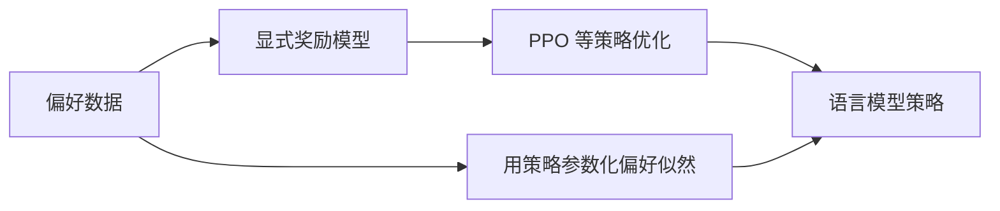

# 01 · DPO：从偏好数据到策略优化

作者：[anka](https://github.com/anka-afk) · 首次发布：2026-11-13 · 状态：手稿初版

《推断智能》系列 · [返回目录](../../README.md) · [录课提纲](../../courses/01-dpo/README.md)

> 既然观测到的是偏好，而最终想学的是策略，能不能直接写出“这个策略预测人会怎么选”的概率？

DPO（Direct Preference Optimization，直接偏好优化）的核心，可以概括为一句话：**用策略概率表示奖励差，再对偏好标签做最大似然估计。**

这篇手稿先解释 DPO 损失在比较什么，再从带 KL 正则的奖励最大化问题出发，推导它为什么成立，最后讨论语言模型中的计算方式、梯度和适用边界。

## 阅读准备

需要了解条件概率、最大似然估计、KL 散度和梯度下降。拉格朗日乘数法的计算会在文中展开。

| 符号 | 含义 |
| --- | --- |
| $x$ | 输入问题或提示词 |
| $y_w, y_l$ | 同一输入下被偏好与不被偏好的回答 |
| $\mathcal D$ | 偏好数据集，包含三元组 $(x,y_w,y_l)$ |
| $\mu(x)$ | 推导中输入的分布，实际可用数据集中的输入分布 |
| $\pi_\theta(y\mid x)$ | 待训练策略生成完整回答的条件概率 |
| $\pi_{\mathrm{ref}}(y\mid x)$ | 冻结的参考策略，通常取偏好训练前的 SFT 模型 |
| $r(x,y)$ | 奖励函数；推导开始时暂时假定已知 |
| $\beta>0$ | KL 正则系数，也出现在 DPO 的偏好 logit 中 |
| $\sigma(z)$ | sigmoid 函数，$1/(1+e^{-z})$ |

这里的“正例”“负例”只表示**一对回答中的相对偏好**，并不意味着正例绝对正确、负例毫无价值。文中对数均为自然对数。

## 1. 要解决什么问题？

我们手里的数据是：“同一个问题下，人更喜欢哪条回答。”希望训练出的，却是能生成回答的语言模型。

在典型的 PPO 式 RLHF 流程中，偏好训练可以分成两步：

1. 用偏好数据训练奖励模型，让奖励差解释人的选择。
2. 固定奖励模型，用 PPO 等强化学习算法优化生成策略，同时约束它不要过度偏离参考策略。

DPO 利用第二步优化问题的解析结构，将策略直接放进偏好模型里，用一个分类损失训练语言模型。它替代的是这两个偏好优化阶段；并不意味着预训练、SFT 或偏好数据收集也消失了。本文讨论原始、基于固定偏好数据的 DPO。[1，§3–4]

两条路线都在利用“人选择哪条回答”的信息。区别在于：DPO 的偏好似然直接由语言模型参数决定，不需要先单独拟合一个奖励网络，再运行 PPO。

## 2. 先看直觉：DPO 比较的是两层相对关系

### 2.1 好回答相对于差回答

当前策略对一对回答的对数概率差是：

$$
m_\theta
=\log\pi_\theta(y_w\mid x)-\log\pi_\theta(y_l\mid x)
=\log\frac{\pi_\theta(y_w\mid x)}{\pi_\theta(y_l\mid x)}.
$$

这个量越大，模型生成正例相对于负例的概率比就越大。这里比较的是完整回答的概率，不是两个独立的二分类分数。

### 2.2 当前策略相对于参考策略

参考策略也有自己的偏好优势：

$$
m_{\mathrm{ref}}
=\log\frac{\pi_{\mathrm{ref}}(y_w\mid x)}{\pi_{\mathrm{ref}}(y_l\mid x)}.
$$

DPO 关心的是两者之差：

$$
\boxed{m_\theta-m_{\mathrm{ref}}}.
$$

它回答的是：**相对于参考模型，当前模型对正例的相对偏好增强了多少？**

定义偏好 logit：

$$
z_\theta=\beta(m_\theta-m_{\mathrm{ref}}).
$$

DPO 损失就是：

$$
\boxed{
\mathcal L_{\mathrm{DPO}}(\theta)
=-\mathbb E_{(x,y_w,y_l)\sim\mathcal D}
\left[\log\sigma(z_\theta)\right].
}
$$

在后文的偏好模型假设下，$\sigma(z_\theta)$ 表示模型预测“人会在这对回答中选择 $y_w$”的概率，**不是语言模型直接生成 $y_w$ 的概率**。

- $z_\theta$ 越大，这个偏好对的损失越小。
- $z_\theta=0$ 时，预测偏好概率为 $0.5$，损失为 $\log 2$。
- $z_\theta<0$ 时，当前策略对正例的相对优势低于参考策略；这不等于断言 $\pi_\theta(y_w\mid x)<\pi_\theta(y_l\mid x)$。

通常在一次 DPO 训练的**初始化时**，令 $\pi_\theta=\pi_{\mathrm{ref}}$，于是所有偏好对都有 $z_\theta=0$。之后训练策略持续更新，参考策略保持冻结；并不是每个 epoch 都重新令两者相等。

参考策略的作用来自后文的 KL 正则推导。它提供比较基准，但不是“绝不会遗忘”或“实际 KL 一定小于某个阈值”的保证。

### 2.3 为什么正例概率不一定上升？

假设参考模型也是初始策略，某个偏好对的序列对数概率如下：

| 状态 | 正例 log probability | 负例 log probability | 对数概率差 |
| --- | ---: | ---: | ---: |
| 初始 / 参考模型 | −2 | −4 | 2 |
| 更新后 | −3 | −6 | 3 |

更新后正例概率从 $e^{-2}$ 降到 $e^{-3}$，但负例概率降得更多，正例相对负例的概率比从 $e^2$ 上升到 $e^3$。因此 $z_\theta$ 从 $0$ 变成 $\beta$，这个偏好对的 DPO 损失下降。

> DPO 直接推动的是相对对数概率差。损失下降不分别保证正例概率一定上升、负例概率一定下降。

这是一个说明损失性质的数值例子，不是对某次真实训练轨迹的描述。

## 3. 推导起点：假如奖励已知，最优策略是什么？

现在暂时假定我们知道奖励函数 $r(x,y)$。最直接的目标是最大化期望奖励：

$$
\max_\pi\;
\mathbb E_{x\sim\mu}
\mathbb E_{y\sim\pi(\cdot\mid x)}[r(x,y)].
$$

如果还希望策略不要过度偏离参考模型，就加入 KL 惩罚：

$$
\boxed{
\max_\pi\;
\mathbb E_{x\sim\mu}
\left[
\mathbb E_{y\sim\pi(\cdot\mid x)}[r(x,y)]
-\beta D_{\mathrm{KL}}
\bigl(\pi(\cdot\mid x)\Vert\pi_{\mathrm{ref}}(\cdot\mid x)\bigr)
\right].
}
$$

注意 KL 的方向与取期望的分布：

$$
D_{\mathrm{KL}}(\pi\Vert\pi_{\mathrm{ref}})
=\sum_y\pi(y\mid x)
\log\frac{\pi(y\mid x)}{\pi_{\mathrm{ref}}(y\mid x)}.
$$

也可以先提出约束形式 $\mathbb E_x[D_{\mathrm{KL}}]\leq\varepsilon$，再在适当条件下通过拉格朗日乘子得到上述正则化目标。这里直接固定 $\beta>0$ 来推导；没有声称任意指定的 $\beta$ 都对应预先给定的同一个 $\varepsilon$。

**推导前提：**在考虑的回答空间上，假定参考策略概率为正、奖励有限，且后文的归一化和有限。我们先在不受神经网络参数限制的概率分布空间求解。对于有限回答空间，下面的求和和求导可直接理解；无限空间需要相应的可积性条件。

### 3.1 用拉格朗日乘数法求解

固定一个输入 $x$，暂时省略条件记号。目标是：

$$
J(\pi)
=\sum_y\pi(y)r(y)
-\beta\sum_y\pi(y)\log\frac{\pi(y)}{\pi_{\mathrm{ref}}(y)},
\qquad \sum_y\pi(y)=1.
$$

归一化约束保证 $\pi$ 是一个概率分布。构造拉格朗日函数：

$$
\mathcal F(\pi,\lambda)
=J(\pi)+\lambda\left(\sum_y\pi(y)-1\right).
$$

对某个 $\pi(y)$ 求导并令导数为零：

$$
\frac{\partial\mathcal F}{\partial\pi(y)}
=r(y)-\beta\left(\log\frac{\pi(y)}{\pi_{\mathrm{ref}}(y)}+1\right)+\lambda=0.
$$

整理得到：

$$
\pi(y)
=\pi_{\mathrm{ref}}(y)
\exp\left(\frac{r(y)}{\beta}\right)
\exp\left(\frac{\lambda}{\beta}-1\right).
$$

再用 $\sum_y\pi(y)=1$ 消去乘子：

$$
\exp\left(\frac{\lambda}{\beta}-1\right)
=\frac{1}{\sum_y\pi_{\mathrm{ref}}(y)\exp(r(y)/\beta)}.
$$

恢复输入 $x$，定义归一化函数，也称配分函数：

$$
Z_r(x)
=\sum_y\pi_{\mathrm{ref}}(y\mid x)
\exp\left(\frac{r(x,y)}{\beta}\right).
$$

于是得到候选最优策略：

$$
\boxed{
\pi_r^*(y\mid x)
=\frac{1}{Z_r(x)}\pi_{\mathrm{ref}}(y\mid x)
\exp\left(\frac{r(x,y)}{\beta}\right).
}
$$

下标 $r$ 强调：这是**给定奖励 $r$ 时**的最优策略。直觉上，它将参考分布按 $\exp(r/\beta)$ 重新加权，再归一化。

### 3.2 为什么它是全局最优解？

只找到驻点还不够。固定 $x$ 后，将目标改写为：

$$
\begin{aligned}
J_x(\pi)
&=\sum_y\pi(y\mid x)
\left[r(x,y)-\beta\log\frac{\pi(y\mid x)}{\pi_{\mathrm{ref}}(y\mid x)}\right]\\
&=\beta\log Z_r(x)
-\beta D_{\mathrm{KL}}\bigl(\pi(\cdot\mid x)\Vert\pi_r^*(\cdot\mid x)\bigr).
\end{aligned}
$$

给定 $r$、$\beta$ 和参考策略后，$Z_r(x)$ 不随待优化策略 $\pi$ 变化。KL 散度非负，在两个分布相同时为零。因此最大值在 $\pi=\pi_r^*$ 时取得。[1，附录 A.1]

但这还不是可直接执行的训练方案：真实奖励未知，$Z_r(x)$ 又需要对所有可能回答求和。对一般语言模型，穷举回答空间通常不可行；仅凭这一点，不能直接把它定性为已经证明的“NP 难问题”。

## 4. 我们真正观测到的是偏好

手里的数据是：

$$
\mathcal D=\{(x_i,y_{w,i},y_{l,i})\}_{i=1}^{N}.
$$

它告诉我们更喜欢哪个回答，没有告诉我们每条回答的绝对分数。

Bradley–Terry（BT）模型为二选一过程引入一个假设：每条回答有一个潜在奖励，选择概率由两条回答的奖励做 softmax 得到。对于同一问题下的回答 $A,B$：

$$
P(A\succ B\mid x)
=\frac{e^{r(x,A)}}{e^{r(x,A)}+e^{r(x,B)}}
=\sigma\bigl(r(x,A)-r(x,B)\bigr).
$$

因此，偏好数据提供的是关于**奖励差**的信息。这是建模假设，不是人类偏好天然满足的定律。

如果训练显式奖励模型 $r_\phi$，对偏好标签做最大似然估计，就得到：

$$
\mathcal L_{\mathrm{RM}}(\phi)
=-\frac1N\sum_{i=1}^N
\log\sigma\left(r_\phi(x_i,y_{w,i})-r_\phi(x_i,y_{l,i})\right).
$$

传统路线可以先最小化这个损失，再用学到的奖励指导 PPO。PPO 使用采样和优化来近似求解策略问题，并不需要显式算出 $Z_r(x)$；配分函数的困难主要阻碍我们直接使用上节的解析表达式。

## 5. 关键一步：让策略直接给出奖励差

回看最优策略的表达式，将它反解为奖励：

$$
r(x,y)
=\beta\log\frac{\pi_r^*(y\mid x)}{\pi_{\mathrm{ref}}(y\mid x)}
+\beta\log Z_r(x).
$$

看起来还是有难算的 $Z_r(x)$，但 BT 只需要同一输入下的奖励差：

$$
\begin{aligned}
r(x,y_w)-r(x,y_l)
&=\left[\beta\log\frac{\pi_r^*(y_w\mid x)}{\pi_{\mathrm{ref}}(y_w\mid x)}+\beta\log Z_r(x)\right]\\
&\quad-\left[\beta\log\frac{\pi_r^*(y_l\mid x)}{\pi_{\mathrm{ref}}(y_l\mid x)}+\beta\log Z_r(x)\right]\\
&=\beta\log\frac{\pi_r^*(y_w\mid x)}{\pi_{\mathrm{ref}}(y_w\mid x)}
-\beta\log\frac{\pi_r^*(y_l\mid x)}{\pi_{\mathrm{ref}}(y_l\mid x)}.
\end{aligned}
$$

**只依赖输入 $x$ 的归一化项，在相减时消掉了。**

对同一输入，将奖励整体加上任意常数 $c(x)$，不会改变 BT 偏好概率，也不会改变对应的 KL 正则最优策略。因此，固定参考策略和 $\beta$ 后，对应到一个策略的是一个奖励等价类，而不是具有唯一绝对零点的奖励函数。

### 5.1 为什么可以把最优策略换成训练中的策略？

这是推导中容易跳过的一步。我们并不是直接宣称训练中的 $\pi_\theta$ 已经对真实奖励最优，而是用它定义一个**隐式奖励**：

$$
\hat r_\theta(x,y)
=\beta\log\frac{\pi_\theta(y\mid x)}{\pi_{\mathrm{ref}}(y\mid x)}.
$$

在前述正概率和归一化条件下，这个奖励对应的配分函数为：

$$
\begin{aligned}
Z_{\hat r_\theta}(x)
&=\sum_y\pi_{\mathrm{ref}}(y\mid x)
\exp\left(\frac{\hat r_\theta(x,y)}{\beta}\right)\\
&=\sum_y\pi_\theta(y\mid x)=1.
\end{aligned}
$$

将其代回最优策略公式，就有：

$$
\boxed{\pi_{\hat r_\theta}^*=\pi_\theta.}
$$

也就是说，每个满足条件的策略都定义了一个隐式奖励，而它本身恰好是**这个隐式奖励**下的 KL 正则最优策略。这里成立的是参数化关系，并不说明隐式奖励已经符合真实偏好。[1，§5.1]

### 5.2 对偏好做最大似然，得到 DPO

将隐式奖励放入 BT 模型：

$$
p_\theta(y_w\succ y_l\mid x)
=\sigma\left(
\beta\log\frac{\pi_\theta(y_w\mid x)}{\pi_{\mathrm{ref}}(y_w\mid x)}
-\beta\log\frac{\pi_\theta(y_l\mid x)}{\pi_{\mathrm{ref}}(y_l\mid x)}
\right).
$$

最大化数据中观测选择的似然，等价于最小化负对数似然：

$$
\boxed{
\begin{aligned}
\mathcal L_{\mathrm{DPO}}(\theta)
=-\mathbb E_{(x,y_w,y_l)\sim\mathcal D}\Biggl[
\log\sigma\Biggl(
&\beta\log\frac{\pi_\theta(y_w\mid x)}{\pi_{\mathrm{ref}}(y_w\mid x)}\\
&-\beta\log\frac{\pi_\theta(y_l\mid x)}{\pi_{\mathrm{ref}}(y_l\mid x)}
\Biggr)\Biggr].
\end{aligned}
}
$$

重新整理括号里的项，就是第 2 节的 $z_\theta=\beta(m_\theta-m_{\mathrm{ref}})$。原来直觉上的“两层相对”，由此获得了完整的推导依据。

这里仍然是在用最大似然拟合**人选择哪条回答的概率**，只是待训练参数已经直接属于语言模型策略。所谓“语言模型本身就是奖励模型”，准确地说，是策略相对于参考策略的对数概率比定义了一个隐式奖励；并不意味着原始生成概率就是通用的质量评分。

## 6. 在语言模型中怎样计算？

对于回答 $y=(t_1,t_2,\ldots,t_T)$，自回归模型给出：

$$
\pi_\theta(y\mid x)
=\prod_{k=1}^{T}\pi_\theta(t_k\mid x,t_{<k}),
$$

因此：

$$
\log\pi_\theta(y\mid x)
=\sum_{k=1}^{T}\log\pi_\theta(t_k\mid x,t_{<k}).
$$

对一个偏好对，训练需要四个序列对数概率：当前策略的正例与负例，以及参考策略的正例与负例。

1. 将同一输入分别与两条回答拼接，在给定真实前缀的条件下计算回答 token 的 log probability。
2. 只对回答部分求和，排除输入 token 与 padding；若完整回答的定义包含结束 token，两套模型应一致处理。
3. 用冻结参考模型计算相同的两个和，也可以在预处理保持一致时预先缓存。
4. 计算 $z_\theta$，对每对样本求 $-\log\sigma(z_\theta)$，再对 batch 取平均。
5. 只对 $\pi_\theta$ 反向传播，参考模型不更新。

这是四个分数，不要求四次独立前向；正负回答可以合批。不同长度的两条回答不需要逐 token 对齐。

**原始 DPO 使用序列对数概率的和。** 若改成长度平均，就改变了目标，不能把它当成完全等价的实现。计算损失时可用稳定的 `logsigmoid` 或 `softplus(-z)` 形式，避免直接对很小的 sigmoid 值取对数。

## 7. 从梯度看它如何更新

固定一个偏好对，令：

$$
\ell_\theta=-\log\sigma(z_\theta).
$$

先对 logit 求导：

$$
\frac{\partial\ell_\theta}{\partial z_\theta}
=-\bigl(1-\sigma(z_\theta)\bigr)
=-\sigma(-z_\theta).
$$

参考策略冻结，所以：

$$
\nabla_\theta z_\theta
=\beta\left[
\nabla_\theta\log\pi_\theta(y_w\mid x)
-\nabla_\theta\log\pi_\theta(y_l\mid x)
\right].
$$

结合链式法则：

$$
\boxed{
\nabla_\theta\ell_\theta
=-\beta\sigma(-z_\theta)
\left[
\nabla_\theta\log\pi_\theta(y_w\mid x)
-\nabla_\theta\log\pi_\theta(y_l\mid x)
\right].
}
$$

若对这个样本做学习率为 $\eta$ 的梯度下降：

$$
\theta\leftarrow\theta
+\eta\beta\sigma(-z_\theta)
\left[
\nabla_\theta\log\pi_\theta(y_w\mid x)
-\nabla_\theta\log\pi_\theta(y_l\mid x)
\right].
$$

这个表达式有两部分：

- 方括号给出提高正例相对对数概率优势的方向。
- $\sigma(-z_\theta)$ 给出随样本变化的权重：当 $z_\theta\ll0$ 时接近 1；当 $z_\theta\gg0$ 时接近 0。

权重较大不等于参数更新幅度一定较大，后者还取决于梯度向量、$\beta$、学习率和优化器。参考模型虽然不参与求导，仍然通过 $z_\theta$ 影响权重。

两项梯度共享模型参数，还会与同一 batch 中其他样本的梯度共同作用。因此，不能把梯度里的两个符号读成“每次更新后，正例概率必升、负例概率必降”。

## 8. 这套推导保证了什么，又没保证什么？

推导建立的是：在给定参考策略、$\beta$ 和相应支持条件下，奖励等价类与 KL 正则最优策略之间存在对应关系；采用 BT 偏好模型后，可以直接用策略参数化偏好似然。

仍需记住几个边界：

1. **解析最优策略是在分布空间中求出的。** 有限参数的神经网络未必能表达或优化到它。
2. **BT 是建模假设。** 偏好噪声、标注分歧和模型失配不会被代数变换自动消除。
3. **有限数据只覆盖部分比较。** 训练损失下降，不保证未见问题上的偏好质量或其他能力同样提升。
4. **$\beta$ 有两个相连的视角。** 在固定奖励的理论目标里，它决定 KL 惩罚强度；在 DPO 损失里，它还缩放偏好 logit 与梯度。不能把“调大 $\beta$”机械等同于任何训练设置下的单调效果。
5. **理论对应不等于实际训练结果一致。** DPO 不保证恢复真实人类奖励对应的最优策略，也不保证与实际 PPO 得到同一个模型。

回到最初的问题：我们观测的是偏好，最终需要的是策略。DPO 的关键，是利用 KL 正则问题的结构，让策略直接给出偏好模型需要的奖励差，再用偏好数据训练它。

## 参考资料

1. Rafael Rafailov, Archit Sharma, Eric Mitchell, Stefano Ermon, Christopher D. Manning, Chelsea Finn. **Direct Preference Optimization: Your Language Model is Secretly a Reward Model.** NeurIPS 2023. [论文](https://arxiv.org/abs/2305.18290) · [全文](https://arxiv.org/html/2305.18290v3)。重点对应 §3–4 的目标与算法、§5.1 的奖励等价类，以及附录 A.1、A.2、A.4 的推导。本文以作者原有笔记为基础重新组织和解释这些内容；数值例子用于说明相对概率性质。

---

© 2026 anka · 《推断智能》 · [CC BY 4.0](https://creativecommons.org/licenses/by/4.0/)

[本文原始地址](https://github.com/anka-afk/Inferring-Intelligence/blob/main/manuscripts/01-dpo/README.md) · 转载须署名、提供原文与许可链接，并说明修改情况，详见 [转载说明](../../ATTRIBUTION.md)。
