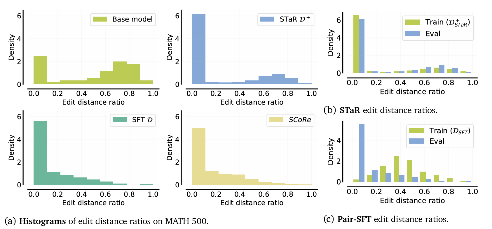
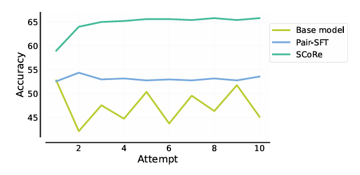

# Training Language Models to Self-Correct via Reinforcement Learning

原文：[[2409.12917] Training Language Models to Self-Correct via Reinforcement Learning](https://arxiv.org/abs/2409.12917)

代码：未提供

> 一句话总结：一种两阶段强化学习方法，让同一个语言模型学会先作答，再回看自己的答案，判断该改哪里、什么时候该保留原答案

## 故事

目的是通过后训练，让模型学会“内在自我纠错“：不靠外部反馈，自己判断对错并更改

指出一个问题：现在的 LLM 基本都没有这个能力

现有路线很多做 Prompt Engineering 或者微调, 微调需要额外监督模型

提出方法 SCoRe: 单模型, 全自生成数据, 多轮在线 RL

### 相关工作

例如说之前的 Reflection 就是 Prompt Engineering 做的

做不出真正的内在纠错

Baseline: **STaR** 与 **Pair-SFT**

其中:

**STaR** 把第二轮"改对了"的轨迹筛出来做 SFT (依旧第一轮作答, 第二轮带着纠错指令重写)

问题: 数据只有要修改的, 容易让模型过度倾向于修改答案, 会导致正确答案也改

**Pair-SFT** 不做多轮轨迹, 用一个正确配一个错误缝合的轨迹对做 SFT, 教给错误解输出正确解

问题: 采集的错误是微调之前的模型生成的, 微调后它自己的分布发生了变化, 根本走不到那个分布(distribution shift), 只会训练数据上的错->对, 模式坍塌到只做很小的更改



## 方法

SCoRe 训练的模型为 $`\pi_\theta`$，固定参考策略为 $`\pi_{\mathrm{ref}}`$

训练集为

```math
\mathcal D=\{(x_i,y_i^\ast)\}_{i=1}^{N},
```

其中 $`x_i`$ 是第 $`i`$ 道题，$`y_i^\ast`$ 是它的标准答案

下文用 $`(x,y^\ast)\sim\mathcal D`$ 表示从训练集中取出一道题及其标准答案

用 $`x_t`$ 表示第 $`t`$ 轮输入给模型的**完整上下文**，$`y_t`$ 表示该轮生成的回答，$`p_t`$ 表示第 $`t`$ 轮结束后加入的复查提示

答案校验器给第 $`t`$ 轮回答的正确性奖励记为

```math
r_t=\hat r(y_t,y^\ast)\in\{0,1\}.
```

数学题按最终答案是否正确判分，代码题按是否通过全部测试判分

判分结果用于训练时更新参数，生成下一轮回答时，模型看不到判分

### 两轮采样

对于一道题，先用原题生成首答，再将原题、首答和复查提示拼接起来，生成第二轮回答：

```math
\begin{aligned} x_1 &= x, & y_1 &\sim \pi_\theta(\cdot\mid x_1),\\ x_2 &= [x_1,y_1,p_1], & y_2 &\sim \pi_\theta(\cdot\mid x_2). \end{aligned}
```

在复查提示词 $`p_1`$ 给定时，两轮回答的联合分布为

```math
P_\theta(y_1,y_2\mid x) = \pi_\theta(y_1\mid x_1)\, \pi_\theta(y_2\mid x_2).
```

推广到 $`T`$ 轮，第 $`t`$ 轮的上下文为

```math
x_t=[x,y_1,p_1,\ldots,y_{t-1},p_{t-1}], \qquad x_1=x.
```

论文用各轮正确性奖励的期望总和描述多轮优化目标：

```math
\max_\theta\ \mathbb E_{\substack{ (x,y^\ast)\sim\mathcal D\\ y_t\sim\pi_\theta(\cdot\mid x_t),\ t=1,\ldots,T }} \left[\sum_{t=1}^{T}r_t\right].
```

论文主要训练 $`T=2`$，即一次首答和一次修订

这个式子描述多轮优化目标, 也就是允许多次修订

## 策略梯度方法 REINFORCE

这里涉及对 REINFORCE 工作的介绍, 熟悉建议跳过

论文使用的是策略估计梯度(用数据来估计梯度更新方向)方法为改进的 REINFORCE

先固定一道题的标准答案 $`y^\ast`$ 和第 $`t`$ 轮上下文 $`x_t`$

这一轮的目标是最大化回答的期望正确性奖励：

```math
\begin{aligned} J_t(\theta;x_t,y^\ast) &=\mathbb E_{y_t\sim\pi_\theta(\cdot\mid x_t)} \left[\hat r(y_t,y^\ast)\right]\\ &=\sum_{y_t}\pi_\theta(y_t\mid x_t)\,\hat r(y_t,y^\ast). \end{aligned}
```

给定 $`y_t`$ 和 $`y^\ast`$，校验器的奖励 $`\hat r(y_t,y^\ast)`$ 是确定的，也没有对 $`\theta`$ 的依赖

用对数导数恒等式 $`\nabla_\theta\pi_\theta=\pi_\theta\nabla_\theta\log\pi_\theta`$，得到

```math
\begin{aligned} \nabla_\theta J_t(\theta;x_t,y^\ast) &=\sum_{y_t}\hat r(y_t,y^\ast)\, \nabla_\theta\pi_\theta(y_t\mid x_t)\\ &=\sum_{y_t}\pi_\theta(y_t\mid x_t)\, \hat r(y_t,y^\ast)\, \nabla_\theta\log\pi_\theta(y_t\mid x_t)\\ &=\mathbb E_{y_t\sim\pi_\theta(\cdot\mid x_t)} \left[r_t\,\nabla_\theta\log\pi_\theta(y_t\mid x_t)\right]. \end{aligned}
```

所以，固定 $`x_t,y^\ast`$ 后，从当前策略采样一条回答 $`y_t`$，用它的实际奖励 $`r_t`$ 乘以其对数概率的梯度，就得到**该轮奖励梯度的一个无偏估计**

对于自回归模型，将第 $`t`$ 轮**整条回答**的对数概率分解为逐 token 的对数概率：

```math
\log\pi_\theta(y_t\mid x_t) = \sum_{j=1}^{|y_t|} \log\pi_\theta(y_{t,j}\mid x_t,y_{t,\lt j}),
```

其中 $`y_{t,j}`$ 是第 $`t`$ 轮回答的第 $`j`$ 个 token，$`y_{t,\lt j}`$ 是该回答中位于它之前的 token

### 加入参考策略的 KL 正则

给定第 $`t`$ 轮上下文 $`x_t`$，用 $`K_t(\theta;x_t)`$ 表示当前策略相对固定参考策略的 KL 散度：

```math
\begin{aligned} K_t(\theta;x_t) &= D_{\mathrm{KL}}\!\left( \pi_\theta(\cdot\mid x_t) \;\middle\|\; \pi_{\mathrm{ref}}(\cdot\mid x_t) \right)\\ &= \mathbb E_{y_t\sim\pi_\theta(\cdot\mid x_t)} \left[ \log\frac{\pi_\theta(y_t\mid x_t)} {\pi_{\mathrm{ref}}(y_t\mid x_t)} \right]. \end{aligned}
```

正则化后, 我们的目标可以写成

```math
\max_\theta\ \mathbb E_{\substack{ (x_t,y^\ast)\sim\mathcal D_t\\ y_t\sim\pi_\theta(\cdot\mid x_t) }} \left[ r_t-\beta_1K_t(\theta;x_t) \right].
```

这样, 我们就得到了两个阶段的通用目标

SCoRe 的设计重点在于**每个阶段给哪一轮什么奖励，以及怎样约束首答分布**

### 行为坍塌

behavior collapse, 这是下面用两阶段训练的动机

这个现象是什么呢? 在只有答案最终正确性奖励下, "把答案改对"这个任务实际上有两个高奖励策略:

1. 真正学会去改正第一轮生成的错误答案
2. 学会第一轮就做对, 第二轮完全不变(行为坍塌)

我们不是单纯要提高答案准确率, 而是**让模型学到有条件的修改行为**

作者通过实验发现: **即使在线训练，只奖励第二次答对，也可能出现行为坍塌**(参数共用)

这就是以下两阶段 RL 的动机

### 阶段一

优化目标:

```math
\max_\theta\;
\mathbb E_{\substack{
(x,y^\ast)\sim\mathcal D\\
y_1\sim\pi_\theta(\cdot\mid x_1)\\
y_2\sim\pi_\theta(\cdot\mid x_2)
}}
\left[
\hat r(y_2,y^\ast)
-
\beta_2 D_{\rm KL}\!\left(
\pi_\theta(\cdot\mid x_1)
\;\middle\|\;
\pi_{\rm ref}(\cdot\mid x_1)
\right)
\right].
```

这里我们看第一项, 是第二轮回答的奖励, **第二轮越正确越好**推动模型学习已经有第一次回答的条件下, 怎么去保持/改正使得第二轮答对

第二项是**生成第一轮回答时**和参考模型分布的 KL 散度, 用来抑制模型通过大幅提升第一轮回答的表现来完成优化, 用输出的 logits 可以计算

这样的设计将两次回答解耦, 让第二次回答有能力超过第一次

这里还保留了一个很小的常规正则项 KL (为了训练稳定, 系数 $`\beta_1 \ll \beta_2`$), 两轮都有:

```math
KL_1=
D_{\mathrm{KL}}
\left(
\pi_\theta(\cdot\mid x)
\;\|\;
\pi_{\mathrm{ref}}(\cdot\mid x)
\right)
```

```math
KL_2=
D_{\mathrm{KL}}
\left(
\pi_\theta(\cdot\mid x,y_1,p)
\;\|\;
\pi_{\mathrm{ref}}(\cdot\mid x,y_1,p)
\right)
```

这里面加入上面的优化目标的话, 其实 $`\beta_1`$ 可以和 $`\beta_2`$ 合并, 不过 $`KL_2`$ 还是有的

到这里我们的记号可能过于复杂了, 简化一下记号, 其中 $`\beta_1`$ 很小, 是常规的 KL 正则:

```math
\mathbb E
\left[
r_2-\beta_2K_1-\beta_1(K_1+K_2)
\right].
```

如果按轮次看的话就是这个样子:

```math
\mathbb E
\left[
r_2-(\beta_2+\beta_1)K_1-\beta_1K_2
\right].
```

### 阶段二

从阶段一得到的 checkpoint 继续训练, 这里模型已经初步学会怎么纠错, 而且第一轮比较偏好接近参考模型，不再需要加强 KL 惩罚

此时目标函数:

```math
\boxed{
\max_\theta
\mathbb E
\left[
r_1+r_2-\beta_1(K_1+K_2)
\right]
}
```

意思就是要同时提高第一轮和第二轮的正确率, 再施加常规的 KL, 这是很自然的目标

但这个目标仍然允许模型回到“保持第一轮回答”的行为, 我们需要对第二轮奖励**塑形**, 需要**鼓励模型去进步, 得到更好的答案**

定义进步奖励:

```math
b_2=\alpha(r_2-r_1),
\qquad \alpha>0.
```

将第二轮奖励强化为:

```math
\boxed{
\tilde r_2
=
r_2+b_2
=
r_2+\alpha(r_2-r_1)
}
```

这个奖励在错->对时是 $`1+\alpha`$, 对->错时是 $`-\alpha`$, 对->对时是 $`1`$, 错->错时是 $`0`$

这个设计有四个效果:

1. **放大成功纠错的奖励信号**
2. **放大错误修改的惩罚信号**
3. **保持正确答案仍然有奖励信号**
4. **保持错误答案不会给奖励信号**

得到最终目标:

```math
\boxed{
\max_\theta
\mathbb E
\left[
r_1+\tilde r_2-\beta_1(K_1+K_2)
\right]
}
```

### 附录: 即时奖励设置: 严格优化的数学推导

此处讲解对于训练目标是最大化两轮平均奖励, 对应梯度是什么, 注意这里是推导理想下我们的做法, 论文实际做法见最后

---

之前的 REINFORCE 推导中, 由于固定了 $`x_t, y^*`$, 所以成立:

```math
\nabla_\theta J_t(\theta;x_t,y^\ast)
=
\mathbb E
\left[
r_t\nabla_\theta\log\pi_\theta(y_t\mid x_t)
\right]
```

但是实际上 $`x_2`$ 包含 $`y_1`$, 它的分布也依赖于参数 $`\theta`$

这说明**固定上下文的单轮梯度，和整个两轮期望总奖励的完整梯度，不是同一个东西**

接下来我们来看这一点, 先忽略一堆 KL 和进步奖励, 定义:

```math
\begin{aligned}
J_{\mathrm{sum}}(\theta)
&=
\mathbb E_{(y_1,y_2)\sim P_\theta}
[r_1+r_2]
\\
&=
\sum_{y_1}\sum_{y_2}
\pi_\theta(y_1\mid x_1)
\pi_\theta(y_2\mid x_2)
(r_1+r_2).
\end{aligned}
```

定义两轮的联合分布:

```math
P_\theta(y_1,y_2\mid x)
=
\pi_\theta(y_1\mid x_1)
\pi_\theta(y_2\mid x_2).
```

对目标求梯度, 使用对数导数恒等式把分布拿出来, 可以得到

```math
\begin{aligned}
\nabla_\theta J_{\mathrm{sum}}
&=
\sum_{y_1,y_2}
(r_1+r_2)
\nabla_\theta P_\theta(y_1,y_2\mid x)
\\
&=
\mathbb E_{P_\theta}
\left[
(r_1+r_2)
\nabla_\theta\log P_\theta(y_1,y_2\mid x)
\right].
\end{aligned}
```

再拆开联合分布的对数:

```math
\log P_\theta(y_1,y_2\mid x)
=
\log\pi_\theta(y_1\mid x_1)
+
\log\pi_\theta(y_2\mid x_2).
```

于是有:

```math
\begin{gathered}
\nabla_\theta J_{\mathrm{sum}} = \\
\mathbb E\Big[(r_1+r_2)\nabla_\theta\log\pi_\theta(y_1\mid x_1)
+(r_1+r_2)\nabla_\theta\log\pi_\theta(y_2\mid x_2)\Big].
\end{gathered}
```

完全展开为四项:

```math
\begin{aligned}
\nabla_\theta J_{\mathrm{sum}}
={}&
\underbrace{
\mathbb E\!\left[
r_1\nabla_\theta\log\pi_\theta(y_1\mid x_1)
\right]}_{\text{第一轮动作与奖励}}
\\
&+
\underbrace{
\mathbb E\!\left[
r_2\nabla_\theta\log\pi_\theta(y_1\mid x_1)
\right]}_{\text{第一轮动作与第二轮奖励}}
\\
&+
\underbrace{
\mathbb E\!\left[
r_1\nabla_\theta\log\pi_\theta(y_2\mid x_2)
\right]}_{\text{这一项为零}}
\\
&+
\underbrace{
\mathbb E\!\left[
r_2\nabla_\theta\log\pi_\theta(y_2\mid x_2)
\right]}_{\text{第二轮动作与第二轮奖励}}.
\end{aligned}
```

下面证明第三项为 $`0`$, 其实直觉强的话可以发现它因果上为 $`0`$

我们记它为 $`C`$:

```math
C=
\mathbb E_{y_1,y_2}
\left[
r_1\nabla_\theta\log\pi_\theta(y_2\mid x_2)
\right].
```

先对 $`y_1`$ 求期望, 再对 $`y_1`$ 下 $`y_2`$ 求期望(蕴含在 $`x_2`$):

```math
C=
\mathbb E_{y_1}
\left[
r_1\,
\mathbb E_{y_2\mid x_2}
\left[
\nabla_\theta\log\pi_\theta(y_2\mid x_2)
\right]
\right].
```

这里把 $`r_1`$ 提出来了是因为确定 $`y_1`$ 之后 $`r_1`$ 的分布已经确定了, 换言之第一轮奖励只和第一轮答案有关

现在计算里面的期望:

```math
\begin{aligned}
&\mathbb E_{y_2\mid x_2}
\left[
\nabla_\theta\log\pi_\theta(y_2\mid x_2)
\right]
\\
&=
\sum_{y_2}
\pi_\theta(y_2\mid x_2)
\nabla_\theta\log\pi_\theta(y_2\mid x_2)
\\
&=
\sum_{y_2}
\nabla_\theta\pi_\theta(y_2\mid x_2)
\\
&=
\nabla_\theta
\sum_{y_2}\pi_\theta(y_2\mid x_2)
\\
&=
\nabla_\theta 1
\\
&=0.
\end{aligned}
```

于是

```math
C=\mathbb E_{y_1}[r_1\cdot 0]=0.
```

这说明它的条件期望为 $`0`$, 但是对于单次采样它可能不为 $`0`$

得到最终梯度公式:

```math
\boxed{
\nabla_\theta J_{\mathrm{sum}}
=
\mathbb E\left[
(r_1+r_2)\nabla_\theta\log\pi_\theta(y_1\mid x_1)
+
r_2\nabla_\theta\log\pi_\theta(y_2\mid x_2)
\right].
}
```

**每一轮动作只需要乘上本轮及之后的奖励，不需要乘上已经发生的奖励**

这就是训练目标:

```math
J_{\mathrm{sum}}(\theta)
=
\mathbb E[r_1+r_2].
```

下的梯度

第一轮看 $`r_2`$ 是因为 $`y_1`$ 会进入第二轮上下文影响第二轮奖励

例如，第一次虽然答错了，但写出了一个很容易检查和修正的解题过程，帮助第二次答对

那么，完整奖励目标会把第二轮成功的一部分功劳也归给第一轮

这里的无偏估计让第一轮考虑未来奖励，并没有在该实验中自动解决行为坍塌, 论文中回避了这种跨轮次信用分配问题, 在有限采样次数下, 不合适的跨轮次信号可能带来巨大噪声

**训练想达到什么效果、把它写成什么数学目标、实际采用什么更新规则，这三者不一定完全一致**

**论文最终没有采用这种更新策略**, 原因除了信用分配复杂, 还有一个是使用了进步奖励:

第二轮奖励为:

```math
\tilde r_2=r_2+\alpha(r_2-r_1).
```

直接和第一轮奖励相加得到完整轨迹目标:

```math
r_1+\tilde r_2
=
(1-\alpha)r_1+(1+\alpha)r_2.
```

在论文中 $`\alpha = 10`$ 下,  这里面对->对仅为 $`2`$, 而错->对则是 $`11`$

**显然会更偏好"先错后对"**, 进步奖励设计实际上不能用这里推导的无偏梯度

---

### 附录: 即时奖励设置: 论文实际更新方式

**先让同一个模型连续回答两次，再分别给这两次回答分配训练信号，最后一起更新这个模型**

如果严格优化两轮总奖励 $`\mathbb E[r_1+r_2]`$, 第一轮的策略梯度需要同时考虑 $`r_1`$ 和 $`r_2`$

论文实际采用按轮即时奖励更新, 第一轮只使用 $`r_1`$, 第二轮使用塑形奖励 $`\tilde r_2`$, 这是一种不同的信用分配选择

对于 RL 中信用分配常用的折扣因子, 论文中取 $`0`$, 不把第二轮奖励作为未来期望给第一轮, 加入奖励塑形后:

```math
\boxed{
g_{\mathrm{II}}
=
\mathbb E
\left[
r_1
\nabla_\theta\log\pi_\theta(y_1\mid x_1)
+
\tilde r_2
\nabla_\theta\log\pi_\theta(y_2\mid x_2)
\right]
}
```

和完整的目标梯度相差一项:

```math
\boxed{
\mathbb E\left[
\tilde r_2\nabla_\theta\log\pi_\theta(y_1\mid x_1)
\right].
}
```

## 实验

实验主要是要验证三个点:

1. SCoRe 有没有让模型学会自我纠错(还是陷入其他局部解)
2. 两阶段训练是否必要? 进步奖励设计是否必要?
3. 看看能不能省推理预算

### 主要实验

实验设计主要是分两个维度: 数学和代码

| 任务     | 基础模型             | 训练数据                    | 评估数据               | 正确性奖励      |
| ------ | ---------------- | ----------------------- | ------------------ | ---------- |
| 数学推理   | Gemini 1.5 Flash | MATH 训练集，加原测试集中的 4500 题 | 剩余 500 题，即 MATH500 | 最终答案正确为 1  |
| 代码生成   | Gemini 1.0 Pro   | MBPP                    | HumanEval          | 通过全部测试为 1  |
| 离线代码修复 | 使用代码任务训练后的模型     | 同上                      | MBPP-R             | 修复后的程序是否正确 |

使用贪心解码，即温度为 0；后面的推理预算扩展实验使用温度 0.7

评价指标:

| 指标                         | 含义              |
| -------------------------- | --------------- |
| $`\mathrm{Acc}@t_1`$         | 首答准确率           |
| $`\mathrm{Acc}@t_2`$         | 第二轮准确率          |
| $`\Delta(t_1,t_2)`$          | 第二轮相对首答的净提升     |
| $`\Delta^{i\to c}(t_1,t_2)`$ | 首答错误、第二轮正确的题目比例 |
| $`\Delta^{c\to i}(t_1,t_2)`$ | 首答正确、第二轮错误的题目比例 |

下面是在 MATH500 上的结果(实验设计第一行):

| 方法             |     首答准确率 |    第二轮准确率 | 纠错净收益 $`\Delta`$ |
| -------------- | --------: | --------: | -------------: |
| 基础模型           |     52.6% |     41.4% |          −11.2 |
| Self-Refine    |     52.8% |     51.8% |           −1.0 |
| STaR，包含“对→对”数据 |     53.6% |     54.0% |           +0.4 |
| Pair-SFT       |     52.4% |     54.2% |           +1.8 |
| **SCoRe**      | **60.0%** | **64.4%** |       **+4.4** |

其中基础模型比较糖, 给完提示词然后改错的比较多, Self-Refine是提示词工程的 baseline, 缓解了改错的情况但还是效果不行, 下面俩提升很小

而 SCoRe 不仅让模型第一轮更会做题, 还让它在第二轮改善结果

下面看在 HumanEval 上的成绩:

| 方法          |     首答准确率 |    第二轮准确率 | 纠错净收益 $`\Delta`$ |
| ----------- | --------: | --------: | -------------: |
| 基础模型        |     53.7% |     56.7% |           +3.0 |
| Self-Refine |     53.7% |     52.5% |           −1.2 |
| Pair-SFT    |     56.1% |     54.3% |           −1.8 |
| **SCoRe**   | **52.4%** | **64.6%** |      **+12.2** |

这里俩对比都有点路边, 基础模型反而比较强

SCoRe 第一次回答成绩降低了, 但是第二轮有巨大提升, 这说明确实是学会了怎么纠错, 而不是靠增强第一轮成绩第二轮不变的方式刷分

豪德接下来我们来看屎山代码修复成绩(MBPP-R):

| 方法 | MBPP-R 修复准确率 |
|---|---:|
| 基础模型 | 47.3% |
| Self-Refine | 30.7% |
| Pair-SFT | 59.8% |
| SCoRe | 60.6% |

可以看到修屎山上 Pair-SFT 其实夯爆了, 但是它在修自己生成的代码(HumanEval)时拉完了

这里其实还支持了论文的一个动机: 会修屎山 $`\ne`$ 会修自己拉的屎山(所谓的 distribution-shift)

### 消融实验

接下来看看消融吧, 这是在 MATH 上的成绩:

| 方法                     | 首答准确率 | 第二轮准确率 | 纠错净收益 |
| ---------------------- | ----: | -----: | ----: |
| 完整 SCoRe               | 60.0% |  64.4% |  +4.4 |
| 去掉多轮训练，改为单轮训练          | 61.8% |  59.4% |  −2.4 |
| 去掉阶段一                  | 59.2% |  61.4% |  +2.2 |
| 去掉奖励塑形                 | 60.0% |  62.6% |  +2.6 |
| 阶段二用 STaR 替代 REINFORCE | 56.2% |  58.4% |  +2.2 |

单轮的首答准确率提升了但是第二轮却下降了, 说明这种训练方式不能训练出纠错能力

奖励塑形(进步奖励)的设计明显可以提升纠错能力

可以看到每个组件都非常夯啊(不过我其实觉得一两个点差的不是很多, 可能这个模型能力就这样了吧)

### 推理预算实验

这个实验检验: 在有很多推理预算的时候应该全部重新做好, 还是用来检查原来答案好?

这里比较两个方法, 假设能生成 $`2K`$ 次回答:

1. 生成 $`2K`$ 次回答然后投票
2. 生成 $`K`$ 次回答, 然后对这 $`K`$ 次回答修正一次再投票

总调用次数一样

在 MATH500 上的成绩:

| 每题生成预算 | 全部用于并行采样 | 并行首答＋一次自我纠错 |
|---:|---:|---:|
| 2 | 约 60.0% | 约 60.0% |
| 4 | 约 63.8% | 约 64.2% |
| 8 | 约 65.2% | 约 68.0% |
| 16 | 约 66.6% | 约 69.6% |
| 32 | 约 67.4% | 约 70.5% |

模型使用 Gemini 1.5 Flash，采样温度为 0.7

说明有之前生成的经验的先验, 还是好过盲抽的

### 更多轮次的纠错实验

我们模型依旧只对两轮训练, 来看看让它连续修 $`10`$ 次的成绩怎么样(看看能不能迁移到更多轮)



看看结果图, Pair-SFT 和 SCoRe 都在第二轮之后达到了边际, 没有更多提升了, 基础模型则是震荡

这里的训练只训练两轮, 如果是更多轮要考虑多轮的 distribution-shift 和信用分配问题了

> 图源：Aviral Kumar 等，[Training Language Models to Self-Correct via Reinforcement Learning](https://arxiv.org/abs/2409.12917)，图 4、图 8（[CC BY 4.0](https://creativecommons.org/licenses/by/4.0/)）。
