# Mamba: Linear-Time Sequence Modeling with Selective State Spaces

原文：[[2312.00752] Mamba: Linear-Time Sequence Modeling with Selective State Spaces](https://arxiv.org/abs/2312.00752)

代码：https://github.com/state-spaces/mamba

发表：**COLM 2024 + Main + Oral（Outstanding Paper Award）**

> 一句话总结： **Transformer 保留了全部历史，所以善于按内容检索，但计算和缓存昂贵；传统 SSM 把历史压成固定大小的状态，所以高效，却不能根据内容决定记什么、忘什么。Mamba 想让这个“压缩过程”由输入动态控制，同时保持线性复杂度。**

## 故事

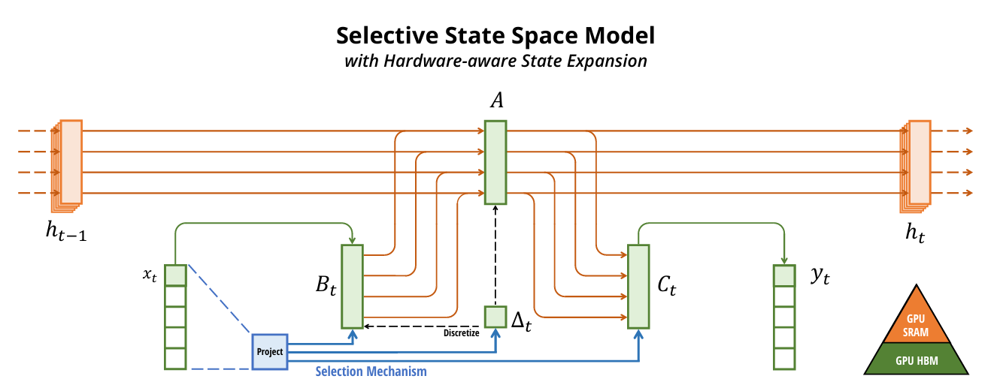

传统自注意力在序列长度 $`L`$ 的时候训练计算量为 $`O(L^2)`$, 自回归生成还要保存 KV cache

目前的线性注意力、长卷积、S4 虽然快但是在语言上表现不好, 作者认为原因不只是模型容量和训练方式, 还有这些模型缺少“根据当前内容，选择记住或忽略信息”的能力

是一种"既要又要"的想法, 既要像注意力一样进行内容相关的信息选择, 又要像 RNN 那样维护固定大小的状态

序列建模的核心是"如何压缩上下文"

- **注意力**：保留每个历史位置的 KV，相当于不压缩历史长度，因此检索灵活(能够在上下文窗口的任意两点之间连线)，但成本高(平方)
- **RNN/SSM**：把全部历史压进固定大小状态，因此便宜(线性甚至常数)(在连续信号上表现好但是在文本这种离散数据上不行)，但压缩损失可能很大
- 那么，高效模型的关键就不再是“要不要压缩”，而是：**能否根据内容，聪明地压缩**

### 提出问题

**LTI**: 线性时不变

意思就是: (Δ, A, B, C) 在所有时间步固定

此前所有结构化 SSM 都是 LTI, 这是计算效率的考虑, 为了把递归展开成全局卷积

这个文章说: **让旧 SSM 快的东西（LTI→卷积），正是让它笨的东西**

核心想法: 去掉 LTI 约束，让 Δ、B、C 成为输入的函数, 虽然只能走递归, 但是要想办法优化它

定位问题到"内容无关的压缩":

### 任务一

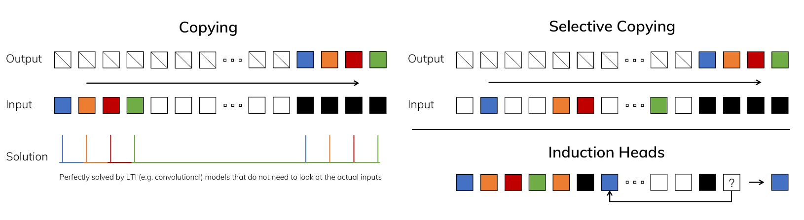

这个任务是输入一串 token, 输出一段 token, 有两个任务:

左边的是第一个任务, 要记的 token 在固定位置, 隔一段空白延迟, 然后在固定位置复述

输入:  红 蓝 绿 黄 _ _ _ _ _ _

输出:  _ _ _ _ _ _ 红 蓝 绿 黄

固定时移, 一个读"t-6 位置"的卷积核就能解决了, 不用看内容

右边的是第二个任务, 选择性记忆, 把要记的彩色 token 随机混入白色噪声, 输出按顺序排好(去掉白色噪声), 每一个 token 的延迟都不太一样, 所以说一个固定的卷积核应该做不好这个任务

输入:  _ 红 _ _ 蓝 _ 绿 _ _ _

输出:  _ _ _ _ _ _ _ 红 蓝 绿

想要的行为是：**白色 → g=0（状态原样不动）；彩色 → g=1（写入）**

g 必须**读一眼 x_t 再决定**——这就叫 selection

如果是老方法, 那就是: g 固定为 0.1 时，白色噪声每步都以 10% 混进状态，彩色也只以 10% 写入——状态被噪声污染，且写入强度与内容无关, 例如 $`h_t = (1−g)·h_{t−1} + g·x_t`$

### 任务二

Induction Heads: 按内容的回查

LLM 有一种叫**上下文学习**的现象——不改权重，仅凭 prompt 里给的例子就能照做(one-shot)

Anthropic 的机制可解释性工作（Olsson et al. 2022）发现 attention 里有一种头在做一件具体的事：**回查"这个 token 上次出现时后面跟的是什么"，然后抄过来**

比如说: 序列里出现过 "Harry Potter"，后面再出现 "Harry"，模型应预测 "Potter"

实验设置: 2 层小模型、词表 16、训练长度 256 的随机序列中植入重复 bigram；测试时把长度拉到 2^6…2^20 看外推

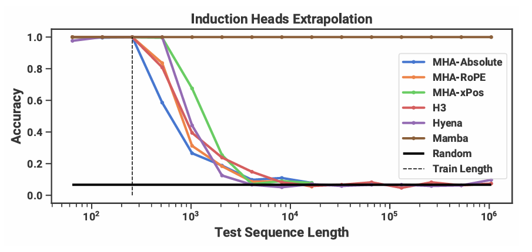

这里的 "Harry" 是 key, 肯定是要做键值查找的, 所以 LTI 必然失败

Attention 天然会：query-key 匹配就是显式查找

Mamba 的做法：bigram 出现时**选择性记住相关 token、忽略中间一切**，把关联写进状态保留到查询时刻

实验结果: Mamba 训练 256、**完美外推到 1M（4000×）**；各 attention 变体（absolute/RoPE/xPos/NoPE 位置编码）超过训练长度约 2× 就崩

很可能是由于位置编码在训练长度外失配, Mamba 根本没有位置编码, 机制上已经赢了

测试内容是能力有无, Transformer 能力都是有的但是外推能力不行

### 门控 $`\ne`$ 选择

H3、Hyena 声称他们加了门控, 模型就有数据依赖性了, Mamba 反驳说这种门作用在**每个位置内部的特征之间**，而**沿时间轴搬运信息的递归/卷积仍是 LTI**

门改变不了 token 间的间隔调度, 这个 token 记多少加个门控没啥用

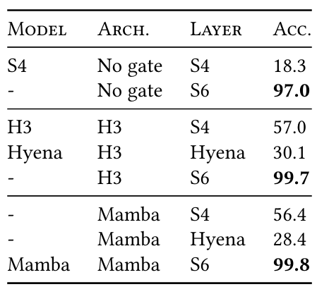

只加门控，18.3→57.0，**部分**改善

只换内层为 S6、完全不要门控，97.0: **内层的选择性就能提供很大提升，不需要外层门控**

另两行（H3+Hyena 30.1、Mamba+Hyena 28.4）：把内层换成另一种 LTI 变体，无论外层加什么门控都没用

### 把效率找回来

既然改掉了 LTI 结构不能用卷积把递归展开了, 作者指出递归 FLOPs 是 $`O(BLDN)`$、常数比卷积 $`O(BLD log L)`$ 小, 对于长序列有优势

真正重要的事情是**顺序性**和**内存**:

parallel scan 让递归可并行

kernel fusion 把大状态关在 SRAM 里、只把 (B,L,D) 输出写回 HBM；

反向重算不存中间量

### 架构

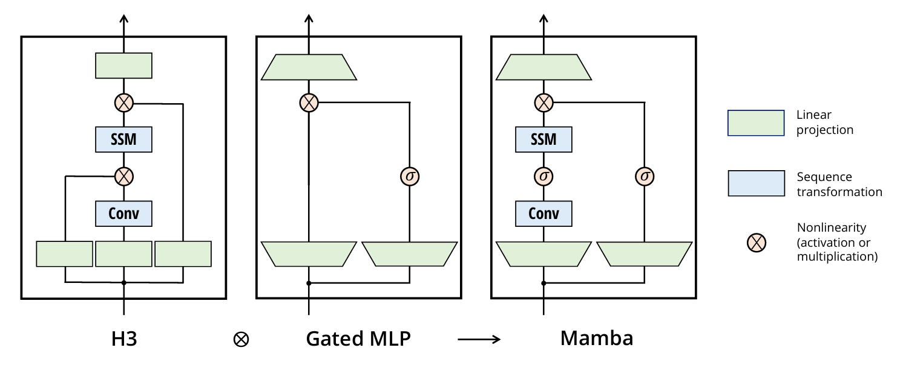

## 方法

这里先介绍它的前身: **结构化状态空间模型(S4)**

在现代控制理论中，任何一个连续时间线性时不变（LTI）系统，都可以用一组一阶常微分方程（ODE）来描述

SSM 使用了控制论里面的微分方程, 将输入信号通过一个隐变量 $`h(t)`$ 映射到输出信号 $`y(t)`$

首先我们有一个连续的变化系统:

```math
h'(t) = A h(t) + B x(t)
```

```math
y(t) = C h(t)
```

其中:

- $`h(t)`$ 是一个隐变量, 同 RNN 的隐藏层, 用来压缩存储历史信息
- $`A`$ 是状态转移矩阵, 决定过去记忆怎么衰减/保留
- $`B`$ 是输入矩阵, 决定当前输入 $`x(t)`$ 有多少保存到 $`h(t)`$
- $`C`$ 是输出矩阵, 决定如何从 $`h(t)`$ 提取信息并生成当前输出 $`y(t)`$

$`h'(t) = \frac{dh(t)}{dt}`$  表示记忆状态随时间的变化率

这个变化率由 $`A h(t)`$ 系统自身的演化（衰减或振荡）与 输入 $`x(t)`$ (外部新刺激对记忆状态的瞬时注入) 影响

S4 中矩阵 $`A`$ 不是随机初始化的, 基于高阶多项式投影算子(**HiPPO 理论**)构造, 用正交多项式去最优逼近历史信号曲线

这是对于连续系统而言的, 由于 NLP 处理的是离散的 token ($`x_0, x_1, x_2, \dots`$), 需要引入一个步长参数 $`\Delta`$, 通过零阶保持(ZOH)规则把连续参数 $`(\Delta, A, B)`$ 转换为离散参数 $`(\overline{A}, \overline{B})`$, 推导如下:

### 零阶保持 ZOH

这是一个假设, "零阶"是用零阶多项式插值像阶梯一样

假设在时间 $`[t_{k}, t_{k+1}]`$ (区间长度 $`\Delta = t_{k+1} - t_k`$)内, 输入信号 $`x(\tau)`$ 会一直保持为一个常数 $`x_k`$ 不变

在这个时间段 $`[t_{k}, t_{k+1}]`$ 内, 我们想解这个微分方程, 微分方程为:

```math
h'(\tau) - A h(\tau) = B x_k
```

注意左侧可以凑微分, 左乘一个 $`e^{-A\tau}`$ (注意有矩阵指数, 那就要关注可逆的问题了):

```math
e^{-A\tau} h'(\tau) - e^{-A\tau} A h(\tau) = e^{-A\tau} B x_k
```

```math
\frac{d}{d\tau} \left( e^{-A\tau} h(\tau) \right) = e^{-A\tau} B x_k
```

对 $`\tau`$ 在这个时间段做积分:

```math
\int_{t_k}^{t_{k+1}} \frac{d}{d\tau} \left( e^{-A\tau} h(\tau) \right) d\tau = \int_{t_k}^{t_{k+1}} e^{-A\tau} B x_k \, d\tau
```

直接得到:

```math
e^{-A t_{k+1}} h(t_{k+1}) - e^{-A t_k} h(t_k) = \left( \int_{t_k}^{t_{k+1}} e^{-A\tau} d\tau \right) B x_k
```

化简一下, 左乘 $`e^{A t_{k+1}}`$, 记 $`h_{k+1} = h(t_{k+1})`$, $`h_k = h(t_k)`$, 注意 $`\Delta = t_{k+1} - t_k`$:

```math
h_{k+1} = e^{A(t_{k+1} - t_k)} h_k + \left( \int_{t_k}^{t_{k+1}} e^{A(t_{k+1} - \tau)} d\tau \right) B x_k
```

```math
h_{k+1} = e^{\Delta A} h_k + \left( \int_{0}^{\Delta} e^{As} ds \right) B x_k \quad \text{(令 } s = t_{k+1} - \tau \text{)}
```

可以, 我们要的解已经出来了, 接下来就是变成好看的形式, $`x_k`$ 前面的系数算一下:

这里要保证 $`A`$ 可逆才能解, 如果不是矩阵这个真的随便积, 于是要求 $`A`$ 是对角阵并且对角线元素为负数:

```math
\int_0^\Delta e^{As} ds = A^{-1} (e^{\Delta A} - I)
```

看原始方程: $`h'(t) = A h(t) + B x(t)`$, 左边 $`h'(t) = \frac{dh}{dt}`$ 是状态对时间的导数, 单位 $`[\text{状态}] / [\text{秒}]`$

那右边矩阵 $`A, B`$ 的单位只能是 $`[\text{秒}]^{-1}`$(频率赫兹), 而步长 $`\Delta`$ 的单位是 $`[\text{秒}]`$

为了统一尺度, 凑出无量纲的 $`\Delta A`$, 分子分母同乘 $`\Delta`$

```math
\int_0^\Delta e^{As} ds \cdot B = (\Delta A)^{-1} (e^{\Delta A} - I) \cdot \Delta B
```

于是我们得到最终公式:

```math
\overline{A} = \exp(\Delta A), \quad \overline{B} = (\Delta A)^{-1}(\exp(\Delta A) - I) \cdot \Delta B
```

于是模型就变成了类似于 RNN 的递推公式:

```math
h_t = \overline{A} h_{t-1} + \overline{B} x_t, \quad y_t = C h_t
```

(

注意, 实际上矩阵求逆很浪费时间, Mamba 用一阶泰勒展开近似:

```math
(\Delta A)^{-1}(e^{\Delta A} - I) = I + \frac{\Delta A}{2!} + \frac{(\Delta A)^2}{3!} + \cdots
```

(这里也说明了乘一个 $`\Delta`$ 的好处)

$`\Delta`$ 很小的时候还能做欧拉离散化近似:

```math
\overline{B} \approx I \cdot \Delta B = \Delta B
```

)

这就是 S4, 它的特点如下:

1. 线性时不变(LTI), $`(\Delta, A, B, C)`$ 是固定不变的参数, 不随时间 $`t`$ 和输入 $`x(t)`$ 改变
2. 非常快, 由于参数固定, 递推公式可以展开成全局卷积, 用快速傅里叶变换(FFT)可以并行算完一整个序列, 推理的时候用 RNN 模式, 每个 token $`O(1)`$ 时间
3. 笨蛋, 由于参数固定, 模型对所有输入都一样处理, 不管输入啥都用同样的权重去记忆/遗忘

### LTI 模式有多快: 卷积展开

这里 $`(\Delta, A, B, C)`$ 全部固定不变, $`h_t = \overline{A} h_{t-1} + \overline{B} x_t`$ 从 $`t=0`$ 开始($`h_{-1} = 0`$)展开:

$`t=0`$: $`h_0 = \overline{B} x_0 \implies y_0 = C\overline{B} x_0`$

$`t=1`$: $`h_1 = \overline{A}\overline{B} x_0 + \overline{B} x_1 \implies y_1 = C\overline{A}\overline{B} x_0 + C\overline{B} x_1`$

$`t=2`$: $`h_2 = \overline{A}^2\overline{B} x_0 + \overline{A}\overline{B} x_1 + \overline{B} x_2 \implies y_2 = C\overline{A}^2\overline{B} x_0 + C\overline{A}\overline{B} x_1 + C\overline{B} x_2`$

推广一下:

```math
y_t = \sum_{k=0}^{t} \left( C \overline{A}^{t-k} \overline{B} \right) x_k
```

定义卷积核:

```math
\overline{K} = (C\overline{B}, C\overline{A}\overline{B}, C\overline{A}^2\overline{B}, \dots, C\overline{A}^{L-1}\overline{B})
```

于是输出序列变成输入 $`x`$ 和 $`\overline{K}`$ 的一维离散卷积:

```math
y = x * \overline{K}
```

### 选择性机制 S6

作者通过两个实验(复制和归纳头)说明内容感知的重要性, 那我们怎么为 S4 加入内容感知呢?

解法很简单, 打破时不变性! 让参数随着输入 $`x(t)`$ 动态变化即可

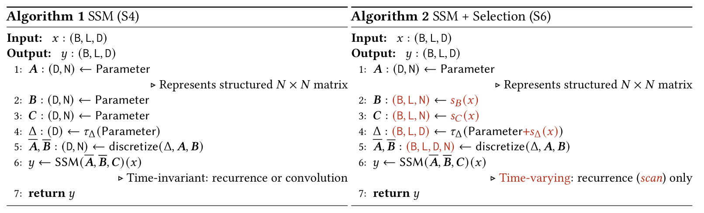

矩阵 $`A`$ 保持为固定, 方便计算稳定, 把 $`B, C, \Delta`$ 变成输入 $`x_t`$ 的函数

```math
B = s_B(x) = \text{Linear}_N(x)
```

```math
C = s_C(x) = \text{Linear}_N(x)
```

这俩没啥好看的, 就是一个全连接层把形状映射到和隐藏状态一样大($`N`$)来当权重

张量形状对齐:

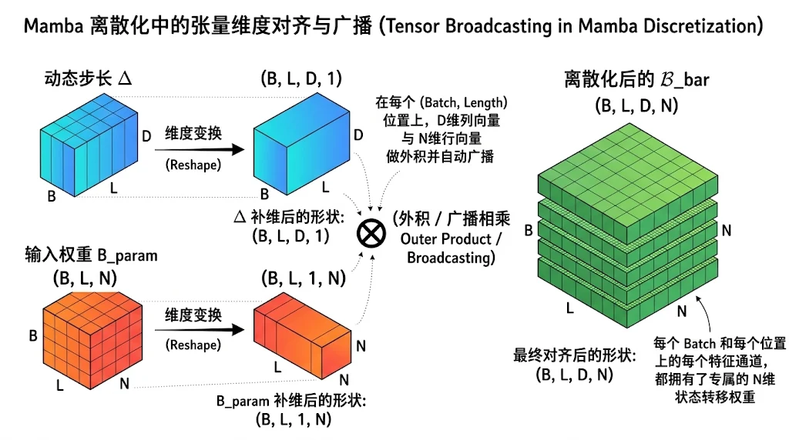

为了省参数，动态算出来的 $`B_t`$ 和 $`C_t`$ 并没有给每个特征通道 $`D`$ 单独算一份，而是让同一时刻的所有 $`D`$ 个通道**共享**同一组 $`N`$ 维向量（所以形状是$`(B, L, N)`$)

第 5 步做离散化的时候，通过张量广播（在对应位置补 1 维做外积），把 $`(B, L, D)`$ 的 $`\Delta`$ 和$`(B, L, N)`$ 的 $`B`$ 乘在一起，就自然展开成了 $`(B, L, D, N)`$ 的完整状态转移矩阵

我们来看点有意思的:

```math
\Delta = \tau_\Delta(\text{Parameter} + s_\Delta(x)) = \text{softplus}(\text{Parameter} + \text{Broadcast}(\text{Linear}_1(x)))
```

我们从两个角度看这个设计:

形式上, $`\text{Linear}_1(x)`$ 把 $`x_t \in \mathbb{R}^D`$ 投影到一个标量, 再广播到 $`D`$ 维(也可以做低秩投影, 降到一个小秩再升到 $`D`$), 这里的设计是为了: 对于一些纯废话, 应该让所有 $`D`$ 个通道同时忽略它, 最合理最省参数

$`+ \text{Parameter}`$ 是一个可学习的偏置, 形状为 $`(D,)`$, 用于初始化步长的基础尺度(也可以整合到线性层)(论文初始化到 $`[0.001, 0.1]`$)

$`\tau_\Delta = \text{softplus}(\cdot) = \ln(1 + e^{(\cdot)})`$ 是为了控制 $`\Delta`$ 严格大于 $`0`$(去符合模型里面这个东西是采样步长的定义, $`softplus`$ 平滑楚楚可导大于 $`0`$)

从 RNN 传承的角度:

**这里是全文最牛逼最精彩的部分**

我们令 $`N=1, A=-1, B=1`$, 见证 ZOH 的奇迹

此时连续系统退化为标量微分方程(漏积分器):

```math
h'(t) = -h(t) + x(t)
```

我们把 $`+Parameter`$ 吸收进 $`Linear`$ 层的偏置项中, 则有步长 $`\Delta_t`$ :

```math
\Delta_t = \text{softplus}(\text{Linear}(x_t)) = \ln\left(1 + e^{\text{Linear}(x_t)}\right)
```

紧接着我们把 $`A = -1`$ 和 $`\Delta_t`$ 代入 ZOH 公式 $`\overline{A}_t = \exp(\Delta_t A)`$ :

```math
\overline{A}_t = \exp\left( -\ln\left(1 + e^{\text{Linear}(x_t)}\right) \right) = \frac{1}{1 + e^{\text{Linear}(x_t)}}
```

这让我们想到了 $`\sigma(z) = \frac{1}{1 + e^{-z}}`$, 这是 Sigmoid 函数, 它有 $`\frac{1}{1 + e^z} = \sigma(-z) = 1 - \sigma(z)`$, 于是:

```math
\overline{A}_t = 1 - \sigma(\text{Linear}(x_t))
```

还剩一个 ZOH 公式, 将 $`A = -1, B = 1`$ 代入 $`\overline{B}_t = (\Delta_t A)^{-1}(\exp(\Delta_t A) - I)\Delta_t B`$ :

```math
\overline{B}_t  = \sigma(\text{Linear}(x_t))
```

我们令一个门控变量 $`g_t = \sigma(\text{Linear}(x_t))`$ , 代回状态方程 $`h_t = \overline{A}_t h_{t-1} + \overline{B}_t x_t`$ :

```math
h_t = (1 - g_t) h_{t-1} + g_t x_t
```

这就是经典门控循环单元（GRU / LSTM）的核心更新方程!!

当 $`\text{Linear}(x_t) \to +\infty`$ 时 $`\Delta_t \to +\infty \implies g_t \to 1 \implies h_t = 0 \cdot h_{t-1} + 1 \cdot x_t = x_t`$ 是重置

当 $`\text{Linear}(x_t) \to -\infty`$ 时 $`\Delta_t \to 0 \implies g_t \to 0 \implies h_t = 1 \cdot h_{t-1} + 0 \cdot x_t = h_{t-1}`$ 保留记忆

$`\Delta`$ 就等价于 RNN 的门控! RNN 你究竟看到了多远

SSM 的离散化步长 $`\Delta`$ 不是一个随意的超参数, 而是传统 RNN 启发式门控机制在连续时间系统下的严格数学推广!

### 硬件感知算法

引入选择性机制后，出现了一个巨大的工程灾难：

因为 $`\overline{A}_t`$ 和 $`\overline{B}_t`$ 每个时间步都在变, 不再满足 LTI, 失去了转换为全局卷积的能力, 但是也不可能递归一步一步算

我们的前向计算是一种 RNN 模式:

```math
h_t = \overline{A}_t h_{t-1} + \overline{B}_t x_t
```

这里指出两个问题, 我们稍后解决:

1. 串行依赖导致的时间过慢:
   $`h_{100}`$ 必须等待 $`h_{99}`$, 而 $`h_{99}`$ 必须等待 $`h_{98}`$, 如果句子很长 $`L = 100,000`$, GPU 只能排队等一个核心循环十万次
2. 显存爆炸:
   假设 BatchSize $`B=1`$, 序列长度 $`L=100,000`$, 特征维度 $`D=1024`$, 隐状态维度 $`N=16`$
   输入 $`x`$ 的大小为 $`L \times D`$(200MB左右), 但中间隐状态的总大小为 $`L \times D \times N`$, 膨胀了 $`N=16`$ 倍(3.2GB左右), 如果层数堆起来, Batch 多起来, 直接爆炸

作为 FlashAttention 的作者，Tri Dao 在这里用了三招:

1. 并行扫描 **Parallel Associative Scan**

   我们先来看前缀和问题, 做个铺垫, 对数组 $`[3, 1, 4, 2]`$, 求前缀和 $`[3, 4, 8, 10]`$, 我们有两个办法:

   串行算法: 3 -> 3+1=4 -> 4+4=8 -> 8+2=10(计算 3 步)

   并行算法, 树状两两合并

   首先左边算 3+1=4, 右边同时算 4+2=6

   把左边的总和 4 直接加到右边的 4 和 6 上, 直接得到最终答案(只用了两步, 准确来说是 $`Log_2(L)`$)

   这就是并行前缀和（Blelloch Scan 算法）, 它的时间复杂度为 $`O(\log L)`$

   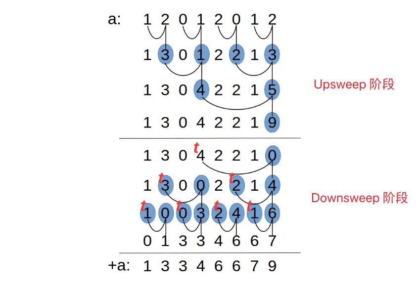

   另一个例子:

   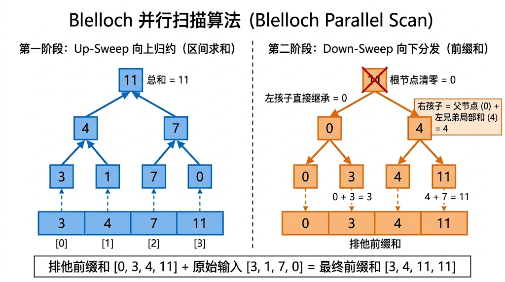

   其中 DownSweep 过程是从根节点开始把每个节点视为前缀和, 根节点是把整个数组视为一个数, 前面没有数是 $`0`$

   我们的公式 $`h_t = \overline{A}_t h_{t-1} + \overline{B}_t x_t`$ 虽然多了个乘法 $`\overline{A}_t`$, 但是它和加法是一样的满足**结合律**

   我们考虑一个仿射变换算子 $`e_t = (a_t, b_t)`$, 令 $`a_t = \overline{A}_t`$, $`b_t = \overline{B}_t x_t`$

   我们推两步:

   ```math
   h_1 = a_1 h_0 + b_1
   ```

   ```math
   h_2 = a_2 h_1 + b_2 = a_2(a_1 h_0 + b_1) + b_2 = \underbrace{(a_2 a_1)}_{\text{新 } a} h_0 + \underbrace{(a_2 b_1 + b_2)}_{\text{新 } b}
   ```

   我们直觉发现 $`e_{1\to 2} = (a_2 a_1, \; a_2 b_1 + b_2)`$, 外推一下到任意步:

   ```math
   (a_2, b_2) \bullet (a_1, b_1) = (a_2 \odot a_1, \; a_2 \odot b_1 + b_2)
   ```

   (这里是因为矩阵 $`A`$ 被设计成了对角阵所以矩阵乘法可以用 $`\odot`$ 表示)

   对应到 $`e_2 \bullet e_1`$:

   ```math
   h_2 = \overline{A}_2 (\overline{A}_1 h_0 + \overline{B}_1 x_1) + \overline{B}_2 x_2 = (\overline{A}_2 \odot \overline{A}_1) h_0 + (\overline{A}_2 \odot \overline{B}_1 x_1 + \overline{B}_2 x_2)
   ```

   并且容易看出 $`(e_3 \bullet e_2) \bullet e_1 = e_3 \bullet (e_2 \bullet e_1)`$ 满足结合律

   GPU 可以开启成千上万个线程，分两个阶段（Up-Sweep 归约 + Down-Sweep 分发）并行合并相邻二元组, 以 $`L=8`$ 为例:

   1. 同时计算 $`(e_1 \bullet e_0), (e_3 \bullet e_2), (e_5 \bullet e_4), (e_7 \bullet e_6)`$
   2. 两两计算 $`e_{3:0}, e_{7:4}`$
   3. 再跨步合并, 直接一次算出 $`h_0, h_1, \dots, h_7`$

   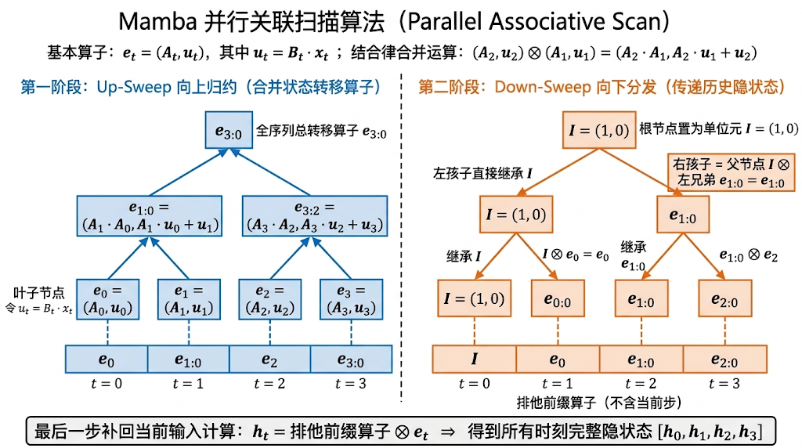

   以上就是并行扫描算法

2. 算子融合 **Kernel Fusion**

   目的是减少显存读写, 目前计算瓶颈来自于 HBM 和 SRAM 的 rollin rollout

   如果不优化的话, 需要先从 HBM 搬出 $`\Delta, A, B`$ ($`L \times D`$)在 SRAM 算出 $`\overline{A}, \overline{B}`$ ($`L \times D \times 16`$, 假设隐状态 $`N=16`$), 再搬回 HBM 存起来, 第二趟再把 $`\overline{A}, \overline{B}`$ 搬入 SRAM, 做完并行扫描算出隐状态 $`h`$ ($`L \times D \times 16`$), 再保存到 HBM, 第三趟再把 $`h`$ 和 $`C`$ 搬入 SRAM 相乘得到 $`y`$($`L \times D`$), 最后存回 HBM, 主要时间都浪费在搬运乘上隐状态大小的参数块上了, 那我们进行算子融合, 让放大后的参数不进进出出

   Tri Dao 用底层 CUDA C++ 写了一个**融合算子**

   只把 $`(\Delta, A, B, C, x)`$ 一次读入 SRAM ($`O(BLD + DN)`$), 在 SRAM 算出 $`\overline{A}, \overline{B}`$, 紧接着直接做并行扫描算出 $`h`$, 再直接 $`h`$ 和 $`C`$ 相乘得到 $`y`$, 膨胀了 $`16`$ 倍的 $`h`$ 全程不出 SRAM, 最后把 $`y`$ 成品写回 HBM

   如果序列 $`L`$ 很长, SRAM 一次放不完就分块

3. 重计算 **Recomputation**

   反向传播需要用到前向传播的中间状态 $`h`$ ($`\overline{A}_t h_{t-1}`$ 求梯度有个 $`h`$), 为了省显存, 前向传播的时候不保持这些, 在反向传播的时候重新算一遍, 省了很多显存(以算代存, 因为计算过剩)

最后在 GPU 上比 FlashAttention-2 还快

### Mamba 架构

S6 只是一个序列变换层（类似于 Transformer 里的 Attention 层）, 怎么搭建完整的神经网络?

Transformer 是 Attention 层 + MLP（前馈网络）层交替堆叠

之前的 SSM 模型也是模仿这种做法，把 SSM 块 和 MLP 块 交替堆叠

受门控注意力单元（GAU）启发，作者**直接把 H3 块和现代大模型常用的门控 MLP（SwiGLU）合二为一**，形成了一个单一、同构的 **Mamba Block**，然后像搭积木一样不断重复堆叠即可


输入 $`x`$ 进来后, 先通过线性投影把特征维度扩大 $`E`$ 倍（通常 $`E=2`$ ), 分成左右两条分支

左边是主分支, 先经过一个一维短因果卷积（1D Conv，提取局部相邻词的特征）$`\to`$ 经过 SiLU 激活函数 $`\to`$ 送入核心的 **Selective SSM（S6）** 进行长距离序列建模

右边是门控分支, 直接经过一个 SiLU 激活函数，作为门控信号

最后进行**融合输出**：左右两条分支的输出做**逐元素相乘（门控交互）**，最后通过一个输出线性投影层把维度降回原来的 $`D`$

(为了对齐参数量，2 个堆叠的 Mamba Block 的参数量大约等于 1 个 Transformer 层（包含 1 个 MHA + 1 个 MLP）的参数量)

## 实验

### 主要实验

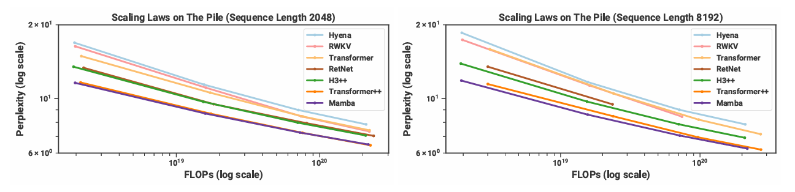

在 The Pile 数据集（125M ~ 1.3B 参数）上，Mamba 是**第一个在困惑度上真正追平并超越强力基线 Transformer++（LLaMA 配方：RoPE + SwiGLU + RMSNorm）的纯线性复杂度模型**，且上下文越长（2k → 8k），优势越明显

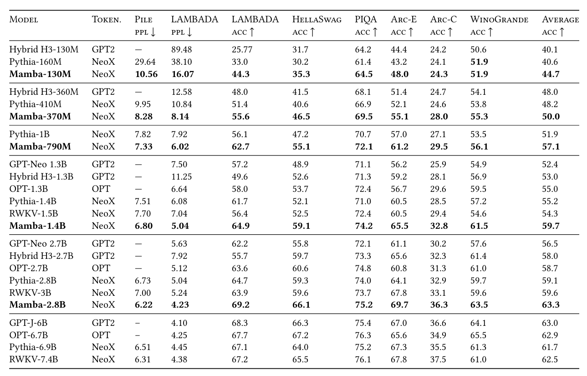

Mamba-2.8B 在常识推理任务（LAMBADA, HellaSwag, PIQA, ARC 等）上的平均准确率（63.3%）不仅全面碾压同尺寸的 Pythia-2.8B（59.1%）和 RWKV-3B（59.6%），甚至**打平了参数量翻倍的 Pythia-6.9B（61.7%）和 GPT-J-6B（63.0%）**

#### 跨模态百万级长序列验证（DNA & 音频）

- **基因（HG38）**：大猩猩五物种分类任务（基因相似度高达 99%），随着序列长度从 $`10^3`$ 拉长到 $`10^6`$（1M），Mamba 准确率一路飙升至 **81.31%**，远超 HyenaDNA（54.87%）
- **语音生成（SC09）**：24.3M 参数的 Mamba-UNet 将生成指标 FID 降到了 **0.67**，远超同规模扩散模型 DiffWave（1.92）和 SaShiMi（1.42）

#### 速度

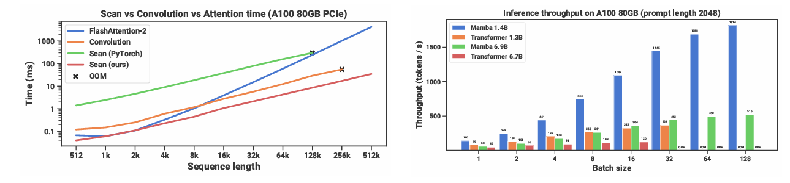

- **训练速度**：序列长度超过 2K 后，Mamba 的融合扫描算子速度超过 **FlashAttention-2**，比原生 PyTorch 扫描快 **20~40 倍**
- **推理吞吐量**：因为不需要保存随长度膨胀的 KV Cache，推理时可以开超大 Batch Size，A100 上生成吞吐量达到同尺寸 Transformer 的 **4~5 倍**（Mamba-6.9B 的推理速度甚至快于比它小 5 倍的 Transformer-1.3B）

### 消融实验

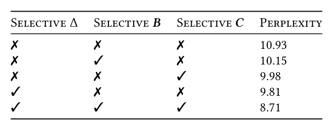

$`\Delta`$ 变成依赖输入的参数提升最大(RNN 那个定理), 三者同时选择性有协同效益

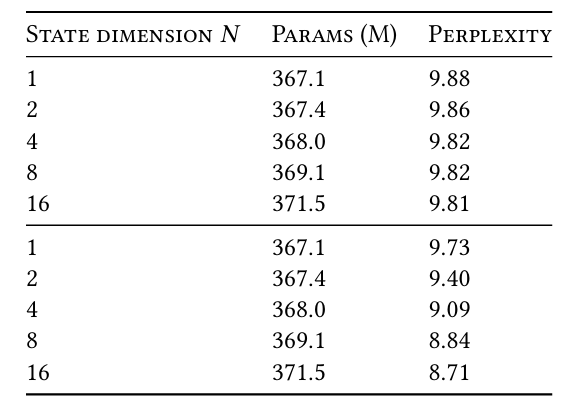

隐状态维度 $`N`$ 越大越好吗?

$`B, C`$ 固定时几乎没提升 （9.88 → 9.81）

开启选择性后提升巨大（9.73 → 8.71）

## 问题与思考

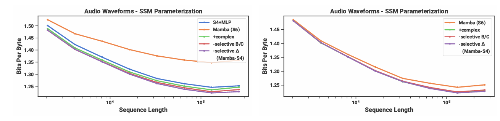

在均匀采样的连续平滑音频波形（YouTubeMix）上，加了选择性机制的 S6 反而比固定参数的 S4 表现差（在 U-Net 外层保留 LTI 的 S4 效果最好）

说明**离散高信息密度数据需要“选择性过滤”，而连续平滑物理信号更适合“全局时不变滤波”**

虽然 Mamba 能处理 1M 长度，但所有历史最终都要压缩进固定大小的隐状态 $`h_t \in \mathbb{R}^{D \times N}`$ 里。在需要**极高精度逐字检索**（如多针大海捞针、超长文档精确引用）的任务上，有损压缩的隐状态在理论上限上仍弱于无损保留全量历史词向量的 Attention

这也直接催生了后来的 **Mamba-2（结构化状态空间对偶 SSD）** 以及 **Jamba / Zamba（Mamba + 少量 Attention 混合架构）**

> 图源：Albert Gu、Tri Dao，[Mamba: Linear-Time Sequence Modeling with Selective State Spaces](https://arxiv.org/abs/2312.00752)（[CC BY 4.0](https://creativecommons.org/licenses/by/4.0/)）；并行扫描与张量广播示意图为作者自制。