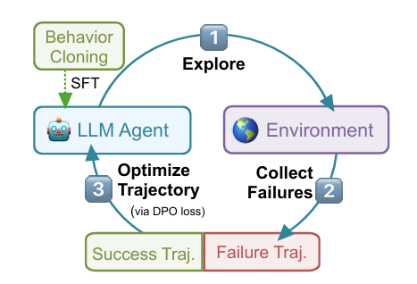
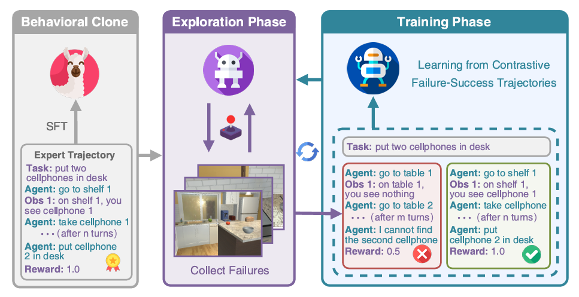
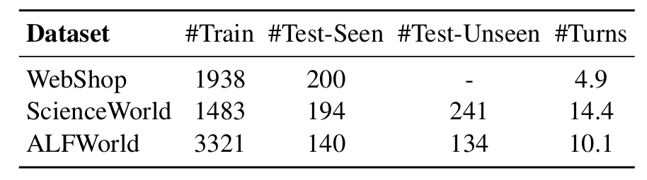
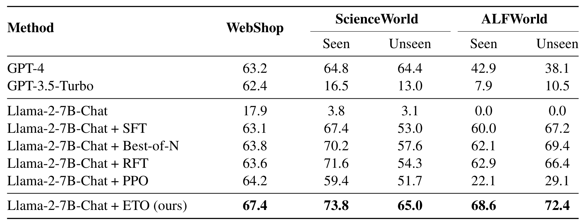
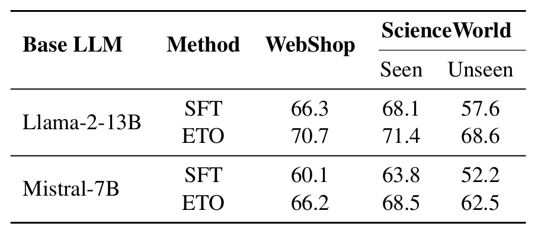
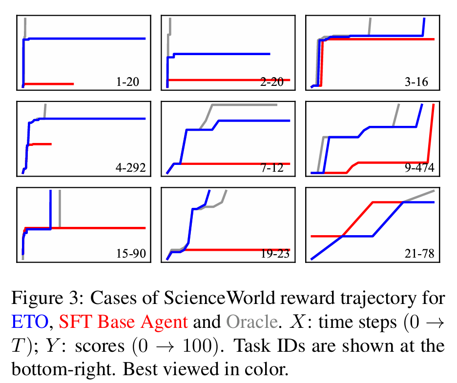
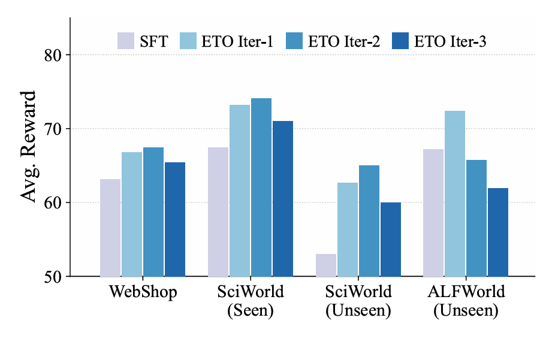
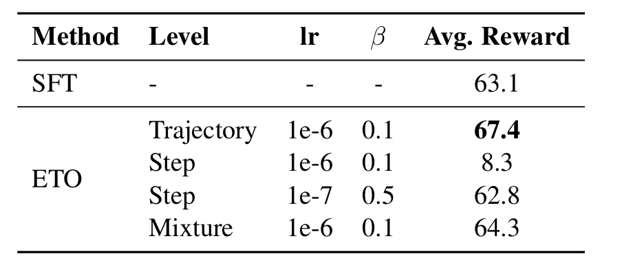
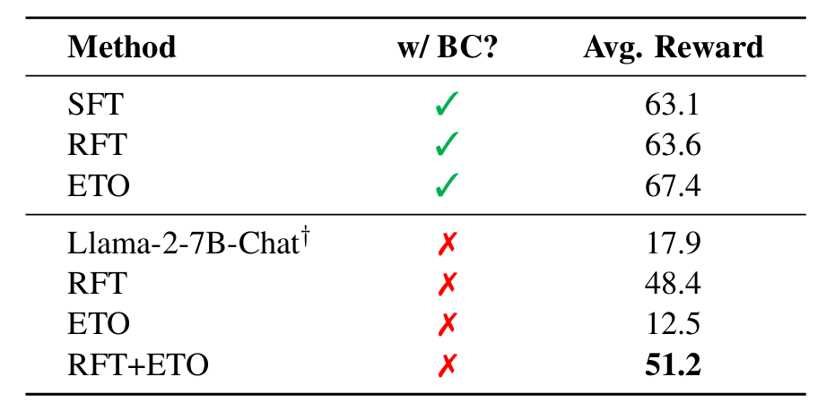

# Trial and Error: Exploration-Based Trajectory Optimization for LLM Agents

原文：[[2403.02502] Trial and Error: Exploration-Based Trajectory Optimization for LLM Agents](https://arxiv.org/abs/2403.02502)

代码：[Yifan-Song793/ETO: Trial and Error: Exploration-Based Trajectory Optimization of LLM Agents (ACL 2024 Main Conference)](https://github.com/Yifan-Song793/ETO)

> 一句话总结：提出了名叫**ETO**的方法, 让 LLM 通过不断探索产生的失败轨迹与专家提供的成功轨迹配对(数据生成方法), 通过 DPO 迭代训练, 进行探索->训练->探索循环, 提升任务表现与泛化性能

## 故事

- 研究问题：LLM 怎么在长程任务(Trajectory)中通过 RL 提升完成任务的能力
- 现有工作的不足：当前 Agentic RL 通常只是 LLM 模仿专家成功的过程, 但是没有从自己犯的错误中学习, 能否利用自身错误经验(在自己的分布中调整)
  常见做法: 行为克隆(BC)->SFT
- 核心想法与贡献：把自己的失败与同一任务的成功轨迹配对学习

## 方法



**先与环境交互，收集轨迹并确定偏好；再在固定的偏好数据上进行 DPO 训练**

训练对象:

用任务指令 $`u`$、行动 $`a_t`$ 和观察 $`o_t`$ 表示，可以写成：

```math
e=(u,a_1,o_1,\ldots,a_n).
```

策略 $`\pi_\theta`$ 决定在当前交互历史下生成什么行动

论文采用 ReAct 格式，在行动前生成推理文本，并把这部分文本也计入模型生成的行动内容

1\. BC: 首先用专家成功的轨迹做 SFT, 只对 LLM 生成的内容做 Loss, 得到$`\pi_{base}`$

2\. 让$`\pi_{base}`$在训练集上与真实环境交互, 生成自己的轨迹

```math
\hat e\sim\pi_{\mathrm{base}}(\cdot\mid u).
```

这里收集的是**模型自己行动造成的失败**

3\. 构造同一个任务的**成功-失败对**

对于同一个任务比较已有的专家成功轨迹与刚刚生成的探索轨迹, 根据环境给的最终奖励, 把奖励更高的轨迹记为$`e_w`$，奖励更低的记为 $`e_l`$, 形成偏好数据:

```math
(u,e_w,e_l),\qquad e_w\succ e_l.
```

只保留奖励不同的轨迹对(因为要 DPO 有学习信号), 偏好来自于环境奖励

**粒度来自于整个轨迹, 没有具体信用分配到某一步**

4\. 用 **DPO** 学习这些偏好

SFT 只告诉模型“这个专家动作应该生成”；ETO 进一步告诉模型：

对于这个任务，相比你走过的这条失败路径，应该更偏向这条成功路径

DPO 不是只比较当前模型对两条轨迹的概率

它还引入一个冻结的**参考策略** $`\pi_{\mathrm{ref}}`$，比较当前策略相对参考策略的偏好变化

**这个方法是为了训练稳定**

把 DPO 目标中的偏好强度记为 $`z`$:

```math
z=
\beta\left[
\log\frac{\pi_\theta(e_w\mid u)}{\pi_\theta(e_l\mid u)}
-
\log\frac{\pi_{\mathrm{ref}}(e_w\mid u)}
{\pi_{\mathrm{ref}}(e_l\mid u)}
\right].
```

训练损失:

```math
\mathcal L_{\mathrm{DPO}}
=
-\mathbb E_{(u,e_w,e_l)\sim D_p}
\left[\log\sigma(z)\right].
```

其中 $`D_p`$ 是偏好数据集，$`\sigma`$ 是 sigmoid 函数，$`\beta`$ 是与参考策略约束有关的系数

- **当前策略的概率比**：模型有多偏向成功轨迹？
- **减去参考策略的概率比**：相比训练开始前，这种偏好改变了多少？
- **最小化损失**：推动模型进一步偏向被标记为更好的轨迹

**优化推动的是成功相对于失败的概率优势；不能保证每次更新都让成功轨迹的绝对概率上升、失败轨迹的绝对概率下降**

5\. 虽然优化对象是一条长轨迹，实现时仍然使用语言模型的 token 概率

在每个行动位置，模型根据任务、先前行动和环境观察，计算实际行动文本的概率；再把这些生成 token 的对数概率相加，得到轨迹的对数概率

即使成功和失败轨迹长度不同、行动不同、产生的观察也不同，仍然可以分别计算它们的轨迹概率，再放入 DPO 目标。它并不要求两条轨迹逐步对齐

6\. 完成一轮 DPO 训练后，再让更新后的智能体执行训练任务，收集它现在仍然会犯的错误，与已有专家轨迹重新配对，进行下一轮训练

**每轮开始时，都用当前策略更新基础策略和参考策略；参考策略在这一轮训练期间保持冻结**

这样，训练数据就会跟随智能体能力变化：上一轮解决了一部分问题，下一轮探索再暴露剩余问题

但专家轨迹和训练任务仍然是固定的，论文也发现，多轮迭代可能因数据多样性不足而**过拟合**



### ETO 算法

**输入**：专家轨迹数据集 $`D=\{(u,e)\}`$，初始策略 $`\pi_\theta`$，迭代轮数 $`I`$。

1\. **行为克隆**：在专家轨迹上进行 SFT，只计算模型生成的推理与行动 token 的损失，得到基础策略 $`\pi_\theta`$

2\. **迭代探索与训练**，重复 $`I`$ 轮：

- 令 $`\pi_{\mathrm{base}}=\pi_{\mathrm{ref}}=\pi_\theta`$。
- 对每个训练任务 $`u`$，用 $`\pi_{\mathrm{base}}`$ 与环境交互，采集轨迹及奖励：

```math
\hat e\sim\pi_{\mathrm{base}}(\cdot\mid u).
```

- 比较 $`\hat e`$ 与专家轨迹 $`e`$ 的环境奖励，保留有效偏好差异的样本，构造：

```math
D_p=\{(u,e_w,e_l)\},\qquad e_w\succ e_l.
```

- 在固定数据集 $`D_p`$ 上进行标准 DPO 训练，更新 $`\pi_\theta`$；本轮 $`\pi_{\mathrm{ref}}`$ 保持冻结。

3\. **输出**：最终策略 $`\pi_\theta`$。

> 每轮重新采集当前策略的失败轨迹，使偏好数据随智能体能力变化；ETO 不改 DPO 目标，核心是利用失败探索构造轨迹级偏好数据并迭代训练。

## 实验

实验设置:



主要在三个交互环境上做实验:

1. WebShop: 网络购物, 01 稠密奖励
2. ScienceWorld: 科学实验, 01 稠密奖励, 有子目标
3. ALFWorld: 家务, 只有 01 二值奖励

其中后面两个拆分了留出集来测试

模型基座使用 Llama-2-7B-Chat, 使用平均奖励指标

BaseLine 选择纯 SFT, Best-of-N, RFT, PPO

### 主要实验

从失败轨迹中做 ETO，全面优于纯模仿学习和其他后训练方法，且在分布外场景优势更明显:



---

ETO 迁移到不同基座模型的效果，收益幅度与基座有关



1. 作者推测 ETO 对较弱的基座 Agent 增益更大
2. Mistral-7B 通用能力强于 Llama-2-13B，但无论 SFT 还是 ETO 后的 Agent 表现都不如 Llama-2-7B，作者认为这说明**基础 LLM 能力与 Agent 交互能力之间没有强正相关**

---

ETO 不仅最终得分更高，任务执行效率也更高(步数)



纵轴是累积子目标得分, 线条越早往上冲说明进度越快, 可以看到 ETO 进度基本都是很快的, 不过展示的案例很少, 有 CherryPick 的可能

### 消融实验

对探索-训练迭代轮数的消融:



显然不是 ETO 训练越多轮越好的, 有明显拐点(1-2 轮), 作者推测这是因为训练集很小容易过拟合

---

对比粒度消融:

ETO 是对整条轨迹做对比学习, 这里改成按步骤, 前 $`t`$ 步按专家轨迹, 然后让模型自己预测并跑完剩下的步骤, 用最终奖励的高低来判断第 $`t`$ 步动作的好坏做单步 DPO(这样奖励分配是不是不合适)



在相同超参下会崩溃, 加大 KL 约束仍然会不如 SFT

1. **在缺乏真实步骤级奖励时，直接用最终结果奖励去给单步动作贴标签会引入噪声、导致训练不稳定，不如整条轨迹对比**
2. 但是不足以否定所有步骤级的对比方法, 这是信用分配太粗糙导致的

---

无专家轨迹的 Self-Play 实验:

去掉前期的专家轨迹 BC（SFT）阶段，直接拿未微调的 Llama-2-7B-Chat（温度设 1.0）在 WebShop 里自己采样多条轨迹，按最终奖励两两配对做对比训练



1. 在没有专家轨迹的时候, ETO **无法冷启动**, 会退化
2. 用 RFT 提升基础能力后, 用 ETO 还是有收益
3. 说明 **ETO 可能依赖模型自身能力**

## 问题与思考

- 如果自身失败轨迹和成功轨迹差异很大, 学习信号会不会很稀疏?
- 多轮迭代退化问题很明显, 信用分配也比较粗糙
- 没有跨任务迁移实验
- 很一般, 鉴定为人上人

> 图源：Yifan Song 等，[Trial and Error: Exploration-Based Trajectory Optimization for LLM Agents](https://arxiv.org/abs/2403.02502)（[CC BY 4.0](https://creativecommons.org/licenses/by/4.0/)）。