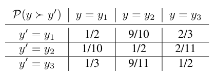
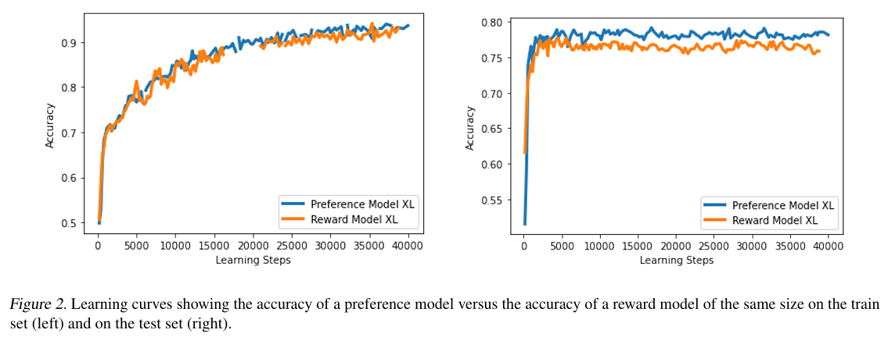
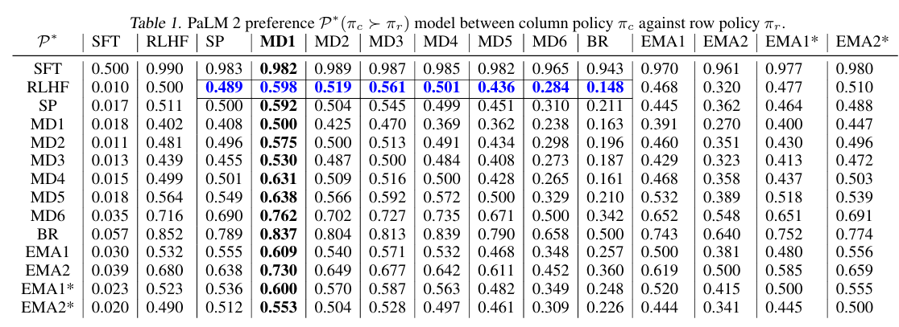
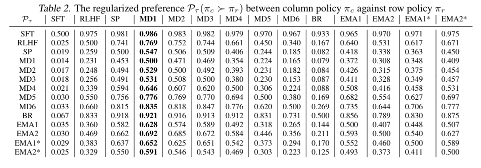
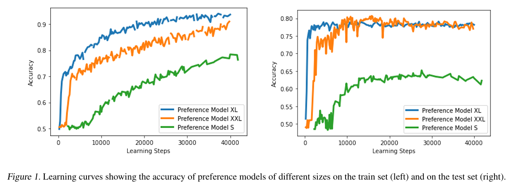

# Nash Learning from Human Feedback

原文：[[2312.00886] Nash Learning from Human Feedback](https://arxiv.org/abs/2312.00886)

代码：无

发表：ICML 2024 Main **Spotlight**

> 一句话总结：摒弃了传统 RLHF 将成对人类偏好强行压缩为标量奖励（BT 模型）并最大化期望分数的范式，转而直接学习双输入偏好模型、把大模型对齐重构为求解 KL 正则化双人常和博弈的唯一纳什均衡，并提出让当前策略与“自身和参考策略的几何混合”对打的镜像下降算法（Nash-MD / Nash-MD-PG），在不存储历史策略的前提下实现了最后一步收敛

**也许, SFT 是错的**

## 故事

源自于对 RLHF 底层假设的一种反思, 就是人类给的标签本身就是两个数据里面哪个更好, 传统做法一定要先压缩成一个标量绝对分数, 这丢掉了什么?

- 其实之前笔者也想到, B-T 模型中的标量分数信息量可能不够, 也许需要向量+MLP? 这是另一个方向

前情提要, 在这种**双人, 对称, 常和博弈**中我们可以把纳什均衡理解为: **没有任何一个对手能对你拿到超过 50% 的胜率（没有任何对手对你占优势）**，你立于不败之地( 尽管纳什均衡的本质是“僵持/稳定状态”, **在对手策略不变的前提下，没有任何一方能通过单方面改变自己的策略来获得更高收益** )

作者给出了这样的例子:

我们有 $`3`$ 种不同偏好的回答 $`y_1, y_2, y_3`$, 针对 $`3`$ 种有不同偏好的人群, 形成了一个"石头剪刀布"的循环偏好:

- 第一类人极度偏爱 $`y_2`$ 胜过 $`y_1`$
- 第二类人极度偏爱 $`y_1`$ 胜过 $`y_3`$
- 第三类人极度偏爱 $`y_3`$ 胜过 $`y_2`$

假设三种人几乎一样多, 只有第一种人稍微少一点, 记为 $`1/3 - \epsilon`$, 其他两种人占比都是 $`1/3 + \epsilon/2`$

基于 B-T 模型就一定要给每个回答打一个绝对分数, 算出来 $`y_1`$ 的期望得分会稍微多一点(更喜欢 $`y_2`$ 而不是 $`y_1`$ 的会少一点), 那我们目标是最大化奖励的期望, 会学到一个确定的最优策略: $`100\%`$ 只输出 $`y_1`$, 无视其他两种人的偏好

同时, 如果再加一点点扰动, 例如第一种人多一些, 那么 RLHF 的最优解就会变成 $`y_2`$, 最后优化到 $`100\%`$ 只输出 $`y_2`$

现在我们来看纳什均衡的结果:

根据题目有: $`\mathbb{P}(\text{Type 1}) = \frac{1}{3}-\epsilon`$;  $`\mathbb{P}(\text{Type 2}) = \mathbb{P}(\text{Type 3}) = \frac{1}{3}+\frac{\epsilon}{2}`$

对于第一种人群: $`\mathcal{P}_1(y_2 > y_1) = 1`$,

对于第二种人群: $`\mathcal{P}_2(y_1 > y_3) = 1`$,

对于第三种人群: $`\mathcal{P}_3(y_3 > y_2) = 1`$

我们按人群比例加权平均得到随机抽一个人打分的胜率 $`\mathcal{P}_\epsilon = (\frac{1}{3}-\epsilon)\mathcal{P}_1 + (\frac{1}{3}+\frac{\epsilon}{2})(\mathcal{P}_2 + \mathcal{P}_3)`$:

$`\mathcal{P}_\epsilon(y_2 > y_1) = (\frac{1}{3}-\epsilon)\cdot 1 + (\frac{2}{3}+\epsilon)\cdot \frac{1}{2} = \frac{2}{3} - \frac{\epsilon}{2}`$

$`\mathcal{P}_\epsilon(y_3 > y_1) = (\frac{1}{3}+\frac{\epsilon}{2})\cdot 0 + (\frac{2}{3}-\frac{\epsilon}{2})\cdot \frac{1}{2} = \frac{1}{3} - \frac{\epsilon}{4}`$

$`\mathcal{P}_\epsilon(y_3 > y_2) = (\frac{1}{3}+\frac{\epsilon}{2})\cdot 1 + (\frac{2}{3}-\frac{\epsilon}{2})\cdot \frac{1}{2} = \frac{2}{3} + \frac{\epsilon}{4}`$

算一下所有的:

| $`\mathcal{P}_\epsilon(\text{行} > \text{列})`$ | $`y_1`$ | $`y_2`$ | $`y_3`$ |
| --- | --- | --- | --- |
| **$`y_1`$** | $`\frac{1}{2}`$ | $`\frac{1}{3}+\frac{\epsilon}{2}`$ | $`\frac{2}{3}+\frac{\epsilon}{4}`$ |
| **$`y_2`$** | $`\frac{2}{3}-\frac{\epsilon}{2}`$ | $`\frac{1}{2}`$ | $`\frac{1}{3}-\frac{\epsilon}{4}`$ |
| **$`y_3`$** | $`\frac{1}{3}-\frac{\epsilon}{4}`$ | $`\frac{2}{3}+\frac{\epsilon}{4}`$ | $`\frac{1}{2}`$ |

我们要找的纳什均衡策略为 $`\pi^* = (p_1, p_2, p_3)`$, 其中 $`p_1 + p_2 + p_3 = 1`$, 假设它不是一个纯策略, 是一个混合策略: $`p_1, p_2, p_3 > 0`$

由于纳什均衡的定义, 对任何一个纯策略 $`y_1, y_2, y_3`$, 打赢 $`\pi^*`$ 的概率都不能超过 $`\frac{1}{2}`$ (否则我只要一直出胜率 $`> \frac{1}{2}`$ 的动作就能稳赢 $`\pi^*`$), 必须满足:

```math
\mathcal{P}_\epsilon(y_1 > \pi^*) \le \frac{1}{2}, \quad \mathcal{P}_\epsilon(y_2 > \pi^*) \le \frac{1}{2}, \quad \mathcal{P}_\epsilon(y_3 > \pi^*) \le \frac{1}{2}
```

又由于自己打自己恒等于 $`\frac{1}{2}`$, 把自己打自己的胜率按照一次出招展开:

```math
p_1 \mathcal{P}_\epsilon(y_1 > \pi^*) + p_2 \mathcal{P}_\epsilon(y_2 > \pi^*) + p_3 \mathcal{P}_\epsilon(y_3 > \pi^*) = \mathcal{P}_\epsilon(\pi^* > \pi^*) = \frac{1}{2}
```

对于三个 $`\le \frac{1}{2}`$ 的数, 加权平均恰好等于 $`\frac{1}{2}`$, 那么唯一的解就是三个数都等于 $`\frac{1}{2}`$(只要有一个严格小于 $`\frac{1}{2}`$, 加权平均就会小于 $`\frac{1}{2}`$, 等式不成立)

于是我们得到一个方程组来求解 $`(p_1, p_2, p_3)`$:

```math
\mathcal{P}_\epsilon(y_i > \pi^*) = \frac{1}{2}, \quad i \in \{1, 2, 3\}
```

对于任意的一个 $`i`$, 我们展开这个方程组, 把右边的 $`\frac{1}{2}`$ 挪过来凑一个 $`p_1 + p_2 + p_3 = 1`$ 乘上去:

```math
\sum_{j=1}^3 p_j \mathcal{P}_\epsilon(y_i > y_j) - \frac{1}{2}\sum_{j=1}^3 p_j = 0 \iff \sum_{j=1}^3 p_j \underbrace{\left(\mathcal{P}_\epsilon(y_i > y_j) - \frac{1}{2}\right)}_{\text{记为净胜率 } A_{ij}} = 0
```

也就是把之前的矩阵每一个格子减去 $`\frac{1}{2}`$, 我们得到净胜率矩阵:

| $`A_{ij} = \mathcal{P}_\epsilon(y_i > y_j) - \frac{1}{2}`$ | $`y_1`$                             | $`y_2`$                             | $`y_3`$                             |
| -------------------------------------------------------- | --------------------------------- | --------------------------------- | --------------------------------- |
| **$`y_1`$**                                                | $`0`$                               | $`-\frac{1}{6}+\frac{\epsilon}{2}`$ | $`\frac{1}{6}+\frac{\epsilon}{4}`$  |
| **$`y_2`$**                                                | $`\frac{1}{6}-\frac{\epsilon}{2}`$  | $`0`$                               | $`-\frac{1}{6}-\frac{\epsilon}{4}`$ |
| **$`y_3`$**                                                | $`-\frac{1}{6}-\frac{\epsilon}{4}`$ | $`\frac{1}{6}+\frac{\epsilon}{4}`$  | $`0`$                               |

根据上面推出来的纳什均衡方程, 每一行都要等于 0:

```math
p_1\left(-\frac{1}{6}-\frac{\epsilon}{4}\right) + p_2\left(\frac{1}{6}+\frac{\epsilon}{4}\right) + p_3 \cdot 0 = 0
```

```math
\left(\frac{1}{6}+\frac{\epsilon}{4}\right)(p_2 - p_1) = 0
```

由于人群占比要大于 $`0`$, $`\vert{}\epsilon\vert{} \le \frac{1}{3}`$, 所以这个系数不可能为 $`0`$, 必有:

```math
p_1 = p_2
```

根据归一化条件, 直接得到:

```math
p_3 = 1 - 2p_1
```

再代入第二行计算:

```math
p_1\left(\frac{1}{6}-\frac{\epsilon}{2}\right) + p_2 \cdot 0 + p_3\left(-\frac{1}{6}-\frac{\epsilon}{4}\right) = 0
```

```math
p_1\left(\frac{1}{6}-\frac{\epsilon}{2}\right) = (1 - 2p_1)\left(\frac{1}{6}+\frac{\epsilon}{4}\right)
```

```math
p_1\left[\left(\frac{1}{6}-\frac{\epsilon}{2}\right) + \left(\frac{1}{3}+\frac{\epsilon}{2}\right)\right] = \frac{1}{6}+\frac{\epsilon}{4}
```

```math
\frac{1}{2} p_1 = \frac{1}{6}+\frac{\epsilon}{4} \implies \mathbf{p_1 = \frac{1}{3}+\frac{\epsilon}{2}}
```

得到: $`p_2 = p_1 = \mathbf{\frac{1}{3}+\frac{\epsilon}{2}}`$;   $`p_3 = 1 - 2p_1 = 1 - 2\left(\frac{1}{3}+\frac{\epsilon}{2}\right) = \mathbf{\frac{1}{3}-\epsilon}`$

于是得到纳什均衡:

```math
\pi^* = \left(\frac{1}{3}+\frac{\epsilon}{2},\ \frac{1}{3}+\frac{\epsilon}{2},\ \frac{1}{3}-\epsilon\right)
```

这里其实有点反直觉, 少 $`\epsilon`$ 的是 Type 1（偏爱 $`y_2 > y_1`$），但概率变成 $`1/3-\epsilon`$ 的反而是 **$`y_3`$**（而不是 $`y_2`$）！原因是博弈的**制衡效应**：Type 1 变少后，$`y_2`$ 压制 $`y_1`$ 的优势变弱了；为了让对手选 $`y_2`$ 时不吃亏，均衡策略反而需要降低克制 $`y_2`$ 的 $`y_3`$ 的出场概率

简单说就是石头剪刀布里面布变弱了, 不是一定赢石头了, 直觉上我们应该少出布

但是在博弈里, 我们的对手也不傻, 真正该少出的是剪刀($`y_3`$), 因为对手也会少出布, 那剪刀抓到布的概率就变小了! (对手出布的收益变小了, 你要康他也要少出)

以上是对纳什均衡的简单推导与体验, 这种策略更好兼顾了多种偏好, 并且对扰动变化平滑

### B-T 模型的三个缺陷

B-T 模型除了会丢失多样性, 不稳定容易被扰动外还有三个问题:

#### 缺陷一：无法表达非传递性

无法表达非传递性, 例如石头剪刀布, 没有说绝对较好的偏好, 例如 $`y_1 > y_2 > y_3 > y_1`$ 循环

有这么一种观点 "人类只要理性，偏好就一定有传递性，就能用单一分数表示", 我们可以推翻它

假设有三种回答 $`y_1, y_2, y_3`$ 以及三个人 $`z_1, z_2, z_3`$ (被抽到的概率都是 $`1/3`$), 每个人都有一套理性的打分标准:

| 人类 | 给 $`y_1`$ 打分 | 给 $`y_2`$ 打分 | 给 $`y_3`$ 打分 | 个人严格排序 |
| --- | --- | --- | --- | --- |
| **$`z_1`$** | 2 | 1 | 3 | $`y_3 > y_1 > y_2`$ |
| **$`z_2`$** | 4 | 6 | 5 | $`y_2 > y_3 > y_1`$ |
| **$`z_3`$** | 9 | 8 | 7 | $`y_1 > y_2 > y_3`$ |

对所有答案做两两比较得到:

 $`\mathcal{P}(y_1 > y_2) = \mathbf{2/3}`$ ;  $`\mathcal{P}(y_2 > y_3) = \mathbf{2/3}`$;  $`\mathcal{P}(y_3 > y_1) = \mathbf{2/3}`$

可以发现一定存在 $`y_1 > y_2 > y_3 > y_1`$ 这样的偏好循环, 任何一个标量奖励模型 $`r(y)`$ 都没办法建模 $`r(y_1) > r(y_2) > r(y_3) > r(y_1)`$

**只要数据来自多元化的人群，标量奖励模型在数学上就注定装不下真实的群体偏好**

#### 缺陷二：有约束下最大化 Elo 分数与最大化胜率不一致

即使 B-T 模型完全准确, 加上策略约束(例如 KL 正则化), "最大化 Elo 分" 的最优策略也会输给"最大化胜率"的策略

假设有三个回答 $`y_1, y_2, y_3`$, 它完全满足 B-T 模型, 于是存在一个真实 Elo 分数:

$`R(y_1) = 0`$; $`R(y_2) = \log 9 \approx 2.20`$ (断档领先); $`R(y_3) = \log 2 \approx 0.69`$ (中等)

由于完全满足 B-T 模型, 于是有胜率 $`\mathcal{P}(y > y') = \sigma(R(y) - R(y'))`$, 偏好表如下:



如果要最大化奖励, 那肯定是 $`100\%`$ 选 $`y_2`$, 但是真实微调中, 策略是有约束的(例如 KL 正则化), 作者施加了一个约束: 选择 $`y_1`$ 的概率必须是选 $`y_2`$ 的两倍(作者说这种约束也可以通过 KL 惩罚软性实现)

由于策略要求 $`\pi(y_1) = 2\pi(y_2)`$, 设选择 $`y_3`$ 的概率为 $`p \in [0, 1]`$, 那剩下的 $`1-p`$ 必须按 $`2:1`$ 比例分给 $`y_1`$ 和 $`y_2`$, 也就是说所有策略都是以下两个策略的混合:

- $`\pi_A = (\frac{2}{3}, \frac{1}{3}, 0)`$
- $`\pi_B = (0, 0, 1)`$

任一策略写成 $`\pi = (1-p)\pi_A + p\pi_B`$

两种目标对应策略:

- **RLHF(最大化策略奖励)**: 为了尽可能蹭到 $`y_2`$ 的高分, 宁可带上两倍的 $`0`$ 分回答 $`y_1`$,
  选出的最优策略为 $`\pi_R^* = (\frac{2}{3}, \frac{1}{3}, 0)`$, 它的期望奖励为:

```math
\frac{2}{3}\times 0 + \frac{1}{3}\log 9 = \log 3 \approx 1.10
```

- **NLHF(最大化策略胜率)**

我们的目标是我们的策略比任何其他策略都要强, 我们先单独算策略 $`\pi_B`$ 打赢策略 $`\pi_A`$ 的概率

```math
\mathcal{P}(\pi_B > \pi_A) = \frac{2}{3}\mathcal{P}(y_3 > y_1) + \frac{1}{3}\mathcal{P}(y_3 > y_2) = \frac{2}{3}\times\frac{2}{3} + \frac{1}{3}\times\frac{2}{11} = \frac{50}{99} > \frac{1}{2}
```

假设我们的策略 $`\pi`$ 给 $`y_3`$ 分配概率 $`p`$, 我们的任意一个对手 $`\pi'`$ 给 $`y_3`$ 分配概率 $`q`$, 有两个策略:

- $`\pi = (1-p)\pi_A + p\pi_B`$
- $`\pi' = (1-q)\pi_A + q\pi_B`$

由于 $`\mathcal{P}(A>B) = 1 - \mathcal{P}(B>A)`$, 我们有四种基础胜率:

- 自己对自己: $`\mathcal{P}(\pi_A > \pi_A) = \frac{1}{2}`$, $`\mathcal{P}(\pi_B > \pi_B) = \frac{1}{2}`$
- B 对 A: $`\mathcal{P}(\pi_B > \pi_A) = \frac{50}{99}`$
- A 对 B: $`\mathcal{P}(\pi_A > \pi_B) = 1 - \frac{50}{99} = \frac{49}{99}`$

我们把和对手 $`\pi'`$ 的全部出招组合拆开:

```math
\begin{aligned} \mathcal{P}(\pi > \pi') &= (1-p)(1-q)\cdot \mathcal{P}(\pi_A > \pi_A) && \text{（双方都出 A）} \\ &\quad + (1-p)q \cdot \mathcal{P}(\pi_A > \pi_B) && \text{（你出 A，对手出 B）} \\ &\quad + p(1-q) \cdot \mathcal{P}(\pi_B > \pi_A) && \text{（你出 B，对手出 A）} \\ &\quad + pq \cdot \mathcal{P}(\pi_B > \pi_B) && \text{（双方都出 B）} \end{aligned}
```

代入基础胜率:

```math
\mathcal{P}(\pi > \pi') = (1-p)(1-q)\cdot\frac{1}{2} + (1-p)q\cdot\frac{49}{99} + p(1-q)\cdot\frac{50}{99} + pq\cdot\frac{1}{2}
```

整理一下:

```math
\begin{aligned} \mathcal{P}(\pi > \pi') &= \frac{1}{2}\Big[\underbrace{(1-p)(1-q) + (1-p)q + p(1-q) + pq}_{\text{4 种情况的概率之和，恒等于 } 1}\Big] \\ &\quad + \frac{1}{198}\Big[p(1-q) - (1-p)q\Big] \end{aligned}
```

最后化简为:

```math
\mathcal{P}(\pi > \pi') = \frac{1}{2} + \frac{p - q}{198}
```

可以看出, 只要 $`p > q`$, 你的胜率就严格大于 $`50\%`$, 如果你选任意 $`p \lt  1`$ 的策略, 对上 $`q = 1`$ 的策略, 你的胜率都会掉到 $`50\%`$ 以下, 只要你选 $`p=1`$, 你的胜率就会 $`\ge \frac{1}{2}`$

**这就是约束集合 $`\mathcal{S}`$ 中唯一能够最大化最坏情况胜率的策略, 也就是纳什均衡**

于是我们得到最优策略是 $`100\%`$ 选择 $`y_3`$, 即 $`\pi_{\mathcal{P}}^* = (0, 0, 1)`$, 它的期望奖励只有 $`\log 2 \approx 0.69`$, 比 RLHF 低

现在, 对两种策略做一次比较:

我们算一下 $`\pi_{\mathcal{P}}^*`$ 对 $`\pi_R^*`$ 的胜率:

```math
\mathcal{P}(\pi_{\mathcal{P}}^* > \pi_R^*) = \frac{2}{3}\mathcal{P}(y_3 > y_1) + \frac{1}{3}\mathcal{P}(y_3 > y_2) = \frac{2}{3}\times\frac{2}{3} + \frac{1}{3}\times\frac{2}{11} = \frac{50}{99} > \frac{1}{2}
```

可以看出 NLHF 竟然赢了, 这是因为 $`\pi_R^*`$ 为了那 $`1/3`$ 的概率出 $`y_2`$, 不得不承受 $`2/3`$ 概率抽出极差的 $`y_1`$, 虽然平均分拉高了, 但是在实战种, 稳健的 $`y_3`$ 靠着稳定地战胜那 $`2/3`$ 的 $`y_1`$ 还是赢了

**在有约束或正则化的优化下，最大化 Elo 期望奖励和最大化胜率根本不是一回事**，哪怕偏好本身 100% 符合 BT 模型

#### 缺陷三：奖励模型显式依赖采样分布

奖励模型只看单个回答 $`(x, y)`$，但它的打分本质上是和训练集里的其他回答暗中对比出来的。一旦策略模型更新、生成回答的分布变了，原来的最优奖励模型 $`r^\pi`$ 就会失准

**接下来我将向你证明这一点**.

##### 最优 B-T 模型的平均胜率匹配性质

给定真实偏好 $`\mathcal{P}(y > y')`$ 和采样分布 $`\pi`$, 定义该分布下的最大似然估计(最小化交叉熵)学到的最优 B-T 奖励为:

```math
r^\pi \triangleq \arg\max_r \mathbb{E}_{y, y' \sim \pi,\; Z \sim \nu}\big[\log \sigma(r(y_w^Z) - r(y_l^Z))\big]
```

其中 $`y, y'`$ 是从 $`\pi`$ 中独立同分布采样的两个回答, $`y_w^Z, y_l^Z`$ 是随机人类 $`Z \sim \nu`$ 选出的胜者和败者. 诱导出的对应 B-T 模型记为 $`\mathcal{P}_{BT}^\pi(y > y') \triangleq \sigma(r^\pi(y) - r^\pi(y'))`$, 对 $`\pi`$ 的支撑集上的任意回答 $`z`$ 有:

```math
\mathcal{P}(z > \pi) = \mathcal{P}_{BT}^\pi(z > \pi)
```

这个可能不太好看出什么, 我们固定回答 $`z`$, 从采样分布 $`\pi`$ 中随机抽一个对手 $`y`$, 则人类更喜欢 $`z`$ 的期望概率为:

```math
\sum_{y} \pi(y)\,\mathcal{P}(z > y) \;=\; \sum_{y} \pi(y)\,\mathcal{P}_{BT}^\pi(z > y)
```

右边移动到左边:

```math
\sum_{y} \pi(y)\,\Big[\underbrace{\mathcal{P}_{BT}^\pi(z > y) - \mathcal{P}(z > y)}_{\text{BT 模型在单对 }(z,y)\text{ 上的预测误差}}\Big] \;=\; 0
```

我们这样就能看穿 B-T 偏好模型的底裤了

从数理统计来说, 这个模型信息量就是不足的, 假设一共有 $`N`$ 个回答, 那两两偏好矩阵 $`\mathcal{P}(z > y)`$ 就有 $`\frac{N(N-1)}{2}`$ 个独立的胜率

但是奖励模型 $`r(\cdot)`$ 只给每个回答分配 $`1`$ 个标量分数, 一共只有 $`N`$ 个自由度

只要真实偏好不是天生符合 B-T 模型, 我们的自由度不够, 就不可能把 $`\frac{N(N-1)}{2}`$ 个胜率全部拟合准, 一定会高估一些低估一些, 去最优化平均误差

此外最大化似然函数 $`\mathcal{L}(r)`$ 时, 只能对 $`N`$ 个参数分别求导令其为 $`0`$, 只有 $`N`$ 个方程, 也就是对每个 $`z`$, 强迫它对所有的对手 $`y`$ 的预测误差按照 $`\pi(y)`$ 加权求和之后为 $`0`$, 实际上我们没有对单独的两两误差做任何约束

也就是说 B-T 模型并不保证**每一对**回答的胜率都拟合准，它只保证每个回答 $`z`$ 对抗**当前采样分布 $`\pi`$ 整体**的平均胜率是准的(在当前采样分布的预测误差的期望为 $`0`$)

---

**开始证明:**

首先我们要消去随机人类 $`Z`$, 固定一对采样的 $`(y, y')`$, 对随机人类 $`Z`$ 求期望:

我们知道 $`y`$ 赢的概率为 $`\mathcal{P}(y > y')`$, $`y'`$ 赢的概率为 $`\mathcal{P}(y' > y)`$, 对目标函数展开(消去 $`Z \sim \nu`$):

```math
\mathbb{E}_{y, y' \sim \pi}\Big[\mathcal{P}(y > y')\log\sigma\big(r(y) - r(y')\big) + \mathcal{P}(y' > y)\log\sigma\big(r(y') - r(y)\big)\Big]
```

由于 $`y, y'`$ 独立同分布, 根据他们在期望中的对称性, 把第二项的哑变量 $`y, y'`$ 对换期望不变, 原函数严格等于 $`2 \cdot \mathbb{E}_{y, y' \sim \pi}[\mathcal{P}(y > y')\log\sigma(r(y) - r(y'))]`$, 去掉常数因子, 得到目标函数:

```math
\mathcal{L}(r) \triangleq \mathbb{E}_{y, y' \sim \pi}\big[\mathcal{P}(y > y')\log\sigma\big(r(y) - r(y')\big)\big]
```

也就是说, 右边这个 B-T 给出的概率越接近真实人类偏好越好

我们把目标函数的期望展开为双重求和:

```math
\mathcal{L}(r) = \sum_{y}\sum_{y'} \pi(y)\pi(y')\,\mathcal{P}(y > y')\log\sigma\big(r(y) - r(y')\big)
```

对某一个特定回答 $`z`$ 的分数 $`r(z)`$ 求偏导, 求和与 $`r(z)`$ 无关, 不含 $`r`$ 的系数直接提出来, 得到:

```math
\partial_{r(z)}\mathcal{L}(r) = \sum_{y}\sum_{y'} \pi(y)\pi(y')\,\mathcal{P}(y > y') \cdot \frac{\partial}{\partial r(z)}\log\sigma\big(r(y) - r(y')\big)
```

由链式法则: $`\sigma'(u) = \sigma(u)(1-\sigma(u))`$, $`1-\sigma(u)=\sigma(-u)`$, 于是:

```math
\frac{d}{du}\log\sigma(u) = \frac{\sigma'(u)}{\sigma(u)} = 1 - \sigma(u) = \sigma(-u)
```

令 $`u = r(y) - r(y')`$, 代入得到:

```math
\frac{\partial}{\partial r(z)}\log\sigma\big(r(y) - r(y')\big) = \sigma\big(r(y') - r(y)\big) \cdot \frac{\partial}{\partial r(z)}\big(r(y) - r(y')\big)
```

先处理 $`\frac{\partial}{\partial r(z)}\big(r(y) - r(y')\big)`$, 把奖励模型 $`r`$ 看成一个向量, 每个回答对应一个独立的分量, 只有变量刚好为 $`z`$ 的时候偏导才为 $`1`$, 否则为 $`0`$, 即 $`\frac{\partial r(y)}{\partial r(z)} = \mathbb{I}\{y=z\}`$, $`\frac{\partial r(y')}{\partial r(z)} = \mathbb{I}\{y'=z\}`$

代入刚刚的偏导, 顺手代入最优奖励 $`r^\pi`$ (这个时候偏导应该为 $`0`$, 因为达到最大值):

```math
\partial_{r(z)}\mathcal{L}(r^\pi) = \sum_{y}\sum_{y'} \pi(y)\pi(y')\,\mathcal{P}(y > y')\,\sigma\big(r^\pi(y') - r^\pi(y)\big)\Big(\mathbb{I}\{y=z\} - \mathbb{I}\{y'=z\}\Big)
```

我们下面来消去求和号, 看最右边括号, 对于第一项 $`\mathbb{I}\{y=z\}`$, 只有 $`y=z`$ 存活, 这里 $`y'`$ 是一个哑变量, 顺手把它换成 $`y`$ 方便之后合并:

```math
\sum_{y'} \pi(z)\pi(y')\,\mathcal{P}(z > y')\,\sigma\big(r^\pi(y') - r^\pi(z)\big) = \pi(z)\,\mathbb{E}_{y \sim \pi}\big[\mathcal{P}(z > y)\,\sigma\big(r^\pi(y) - r^\pi(z)\big)\big]
```

看第二项 $`-\mathbb{I}\{y'=z\}`$, 只有 $`y'=z`$ 这一项存活:

```math
-\sum_{y} \pi(y)\pi(z)\,\mathcal{P}(y > z)\,\sigma\big(r^\pi(z) - r^\pi(y)\big) = -\pi(z)\,\mathbb{E}_{y \sim \pi}\big[\mathcal{P}(y > z)\,\sigma\big(r^\pi(z) - r^\pi(y)\big)\big]
```

合并两项:

```math
\partial_{r(z)}\mathcal{L}(r^\pi) = \pi(z)\,\mathbb{E}_{y \sim \pi}\Big[\mathcal{P}(z > y)\,\sigma\big(r^\pi(y) - r^\pi(z)\big) - \mathcal{P}(y > z)\,\sigma\big(r^\pi(z) - r^\pi(y)\big)\Big]
```

坚持住我们离胜利很接近了, 大家可能已经眼花缭乱了吧, 我们记:

$`a = \mathcal{P}(z > y)`$, $`b = \sigma\big(r^\pi(y) - r^\pi(z)\big) = \mathcal{P}_{BT}^\pi(y > z)`$

由于 $`\mathcal{P}(y > z) = 1 - \mathcal{P}(z > y) = 1 - a`$ 并且 $`\sigma\big(r^\pi(z) - r^\pi(y)\big) = 1 - \sigma\big(r^\pi(y) - r^\pi(z)\big) = 1 - b`$

中括号里面的内容可以变为:

```math
\begin{aligned} a b - (1 - a)(1 - b) &= ab - (1 - a - b + ab) \\ &= a + b - 1 \\ &= a - (1 - b) \end{aligned}
```

把 $`a`$ 和 $`1 - b = 1 - \mathcal{P}_{BT}^\pi(y > z) = \mathcal{P}_{BT}^\pi(z > y)`$ 代回去, 得到:

```math
\text{中括号的一坨} = \mathcal{P}(z > y) - \mathcal{P}_{BT}^\pi(z > y)
```

我们再把期望 $`\mathbb{E}_{y \sim \pi}`$ 放进去, 根据 $`\mathcal{P}(z > \pi) = \mathbb{E}_{y \sim \pi}[\mathcal{P}(z > y)]`$:

```math
\partial_{r(z)}\mathcal{L}(r^\pi) = \pi(z)\Big[\mathcal{P}(z > \pi) - \mathcal{P}_{BT}^\pi(z > \pi)\Big]
```

大家记得之前我们代入了一个 $`r^\pi`$ 吗, 它是这个无约束优化的最优解, 这个时候偏导应该为 $`0`$:

```math
\pi(z)\Big[\mathcal{P}(z > \pi) - \mathcal{P}_{BT}^\pi(z > \pi)\Big] = 0
```

由于 $`z`$ 在 $`\pi`$ 的支撑集里面, $`\pi(z) > 0`$, 得到:

```math
\mathcal{P}(z > \pi) = \mathcal{P}_{BT}^\pi(z > \pi)
```

**证毕**

##### 存在新采样分布使最优奖励模型必然改变

我们有一个前提假设: 真实偏好 $`\mathcal{P}`$ 不能被 B-T 奖励模型完美拟合(前面的多元偏好例子)

等价于在某个采样分布 $`\pi`$ 下, 存在一对回答 $`(y, y')`$（其中 $`y, y' \in \text{supp}(\pi)`$）使得旧模型预测有误差:

```math
\mathcal{P}_{BT}^\pi(y > y') \neq \mathcal{P}(y > y')
```

我们要证明:

存在一个采样分布 $`\pi' \neq \pi`$ (他们的支撑集相同), 使得两个分布训练出来的最优 B-T 奖励模型 $`r^\pi`$ 和 $`r^{\pi'}`$ 本质不同(不止相差一个常数, 而是 $`\mathcal{P}_{BT}^\pi \neq \mathcal{P}_{BT}^{\pi'}`$)

---

**开始证明:**

思路是在旧分布下, 根据上面的最优 B-T 模型的平均胜率匹配性质, B-T 模型的误差是靠加权平均刚好抵消为 $`0`$ 的, 我们可以构造一个新分布 $`\pi'`$, 专门把有误差的那个对手的 $`y'`$ 的权重调大, 打破原来的误差抵消, 使得新分布下的最优模型 $`r^{\pi'}`$ 不得不改变分数

新分布的构造如下:

把除了 $`y'`$ 之外的所有回答的概率砍半然后加到 $`y'`$ 上

对任意的 $`z \neq y'`$, 令 $`\pi'(z) = \frac{1}{2}\pi(z)`$

对 $`\pi'(y') = c\,\pi(y')`$, 其中 $`c > 1`$ 并且是保证 $`\pi'`$ 合法的常数(其实 $`c = \frac{1}{2} + \frac{1}{2\pi(y')}`$, 因此 $`(c - \frac{1}{2})\pi(y') = \frac{1}{2} > 0`$)

对任意一个偏好模型 $`\mathcal{Q}`$, 计算回答 $`y`$ 对新分布 $`\pi'`$ 的平均胜率 $`\mathcal{Q}(y > \pi')`$, 定义展开求和:

```math
\mathcal{Q}(y > \pi') = \sum_{z \neq y'} \pi'(z)\,\mathcal{Q}(y > z) + \pi'(y')\,\mathcal{Q}(y > y')
```

代入我们的 $`\pi'(z)`$ 和 $`\pi'(y')`$:

```math
\mathcal{Q}(y > \pi') = \frac{1}{2}\sum_{z \neq y'} \pi(z)\,\mathcal{Q}(y > z) + c\,\pi(y')\,\mathcal{Q}(y > y')
```

这里可以从第二项拆一个 $`\frac{1}{2}\pi(y')\mathcal{Q}(y > y')`$ 出来补给第一项:

```math
\begin{aligned}  \mathcal{Q}(y > \pi') &= \frac{1}{2}\underbrace{\left[\sum_{z \neq y'} \pi(z)\,\mathcal{Q}(y > z) + \pi(y')\,\mathcal{Q}(y > y')\right]}_{\text{这正是 } \mathcal{Q}(y > \pi)} + \left(c - \frac{1}{2}\right)\pi(y')\,\mathcal{Q}(y > y') \\  &= \frac{1}{2}\mathcal{Q}(y > \pi) + \left(c - \frac{1}{2}\right)\pi(y')\,\mathcal{Q}(y > y')  \end{aligned}
```

我们把这个式子的任意偏好模型 $`\mathcal{Q}`$ 分别代入真实偏好 $`\mathcal{Q} = \mathcal{P}`$ 和旧分布训练出来的 B-T 模型 $`\mathcal{Q} = \mathcal{P}_{BT}^\pi`$, 然后两式相减:

```math
\begin{aligned} \mathcal{P}_{BT}^\pi(y > \pi') - \mathcal{P}(y > \pi') &= \frac{1}{2}\underbrace{\Big[\mathcal{P}_{BT}^\pi(y > \pi) - \mathcal{P}(y > \pi)\Big]}_{=\,0 \text{（由上面引理）}} \\ &\quad + \underbrace{\left(c - \frac{1}{2}\right)\pi(y')}_{=\,\frac{1}{2}\,>\,0} \cdot \underbrace{\Big[\mathcal{P}_{BT}^\pi(y > y') - \mathcal{P}(y > y')\Big]}_{\neq\,0 \text{（由前提假设）}} \\ &\neq 0 \end{aligned}
```

立即有:

```math
\mathcal{P}_{BT}^\pi(y > \pi') \neq \mathcal{P}(y > \pi')
```

也就是说, 旧分布 $`\mathcal{P}_{BT}^\pi`$ 在新分布 $`\pi'`$ 下, 平均胜率已经对不上了

对于新分布 $`\pi'`$, 再次根据上面的最优 B-T 模型的平均胜率匹配性质, 新分布训练出来的最优奖励模型必然有:

```math
\mathcal{P}(y > \pi') = \mathcal{P}_{BT}^{\pi'}(y > \pi')
```

既然 $`\mathcal{P}_{BT}^\pi(y > \pi') \neq \mathcal{P}(y > \pi')`$ 并且 $`\mathcal{P}_{BT}^{\pi'}(y > \pi') = \mathcal{P}(y > \pi')`$, 那必然有:

```math
\mathcal{P}_{BT}^\pi(y > \pi') \neq \mathcal{P}_{BT}^{\pi'}(y > \pi')
```

按 $`\pi'`$ 的期望展开:

```math
\sum_{z} \pi'(z)\Big[\sigma\big(r^\pi(y) - r^\pi(z)\big) - \sigma\big(r^{\pi'}(y) - r^{\pi'}(z)\big)\Big] \neq 0
```

说明至少存在一个 $`z`$, 使得(由于 $`\sigma(\cdot)`$ 单调, 直接拿掉):

```math
r^\pi(y) - r^\pi(z) \neq r^{\pi'}(y) - r^{\pi'}(z)
```

说明两个采样分布训练出来的最优奖励模型 $`r^\pi`$ 和 $`r^{\pi'}`$ 确实本质上改变了, 并不是相差一个常数

**证毕**

因此在多轮迭代（收集数据 $`\to`$ 训裁判模型 $`\to`$ 优化策略 $`\to`$ 用新策略收集新数据）的闭环里，**传统 RLHF 的奖励模型会因为分布漂移而“过期”，必须推倒重训；而 NLHF 的双输入偏好模型在理想情况下不依赖采样分布，可以直接保留并不断喂新数据增量更新**

（注：现实中由于数据有限和模型近似误差，偏好模型仍会受局部数据量影响，只是依赖度远低于 RM；本文实验未做多轮迭代验证，属于理论分析结论）

### NLHF 的核心思路

知道上面的缺陷后, 我们的思路就很清晰了:

**既然问题全都出在 B-T 模型把偏好压缩成了一个标量, 那干脆就不压缩好了**

文章提出两个点:

1. **把"单输入打分器"替换为"双输入比较器"**
   直接用监督学习一个偏好模型 $`\mathcal{P}(y > y' \mid x)`$, 把两个回答放进去比
   它不假设偏好必须严格有序, 可以容纳**循环偏好**
   不依赖数据是怎么采样出来的, "人类更喜欢哪个"的概率只取决于 $`y`$ 和 $`y'`$, 多轮迭代可以直接服用这个模型继续训练
2. **没有分数, 优化目标变成纳什均衡**
   没有分数了就没办法用分数作为奖励信号优化, 但是我们可以转而追求纳什均衡
   自然地**保留了多元偏好** (可能这就是哈基米说人话的原因)

## 方法

哼哼, 我们的方法分为三个部分:

1. 定义一个很好的正则化博弈目标
2. 定义一个表格型算法 Nash-MD 并推导
3. 实现具体的大模型策略梯度算法 Nash-MD-PG

### KL 正则化的偏好博弈

首先我们先不加正则化, 我们的目标是求原始偏好 $`\mathcal{P}(\pi > \pi')`$ 的纳什均衡(这个时候不唯一):

```math
\pi^* = \arg\max_\pi \min_{\pi'} \mathcal{P}(\pi > \pi')
```

这个很好理解, 先看里面的 $`\min_{\pi'} \mathcal{P}(\pi > \pi')`$, 意思是先固定你的策略 $`\pi`$, 然后选一个让你的胜率最低的对手 $`\pi'`$(它专门挑最克制你的策略), 意思是最坏情况的**保底胜率**, 然后最外层 $`\arg\max_{\pi}`$ 意思为在所有可选的策略 $`\pi`$ 中, 选择一个保底胜率最高的 $`\pi^*`$ (之前证明过冯诺依曼极小极大定理, 这个最高的保底胜率为 $`50\%`$, 这种情况下的策略就是纳什均衡)

好机会, 我们来严格推一把, 推导:

#### 冯诺依曼极小极大定理

这是我们博弈论的基石, 说白了就是只要允许双方使用**混合策略（随机出招）**，先手和后手的差距就会**彻底消失**

定理陈述如下:

考虑一个有限双人零和博弈，收益矩阵为 $`A \in \mathbb{R}^{m \times n}`$

玩家 1（最大化者）选混合策略 $`x \in \Delta_m = \{x \in \mathbb{R}^m \mid \mathbf{1}_m^T x = 1,\; x \ge 0\}`$

玩家 2（最小化者）选混合策略 $`y \in \Delta_n = \{y \in \mathbb{R}^n \mid \mathbf{1}_n^T y = 1,\; y \ge 0\}`$

玩家 1 的期望收益为 $`x^T A y`$

结论是: 我们先选 $`x`$ 再让对手针对, 和对手先选 $`y`$ 我们再针对, 两者的最优值完全相等:

```math
\max_{x \in \Delta_m} \min_{y \in \Delta_n} x^T A y \;=\; \min_{y \in \Delta_n} \max_{x \in \Delta_m} x^T A y
```

**证明**:

首先看弱对偶方向, 对于任意固定的 $`x \in \Delta_m`$ 和 $`y \in \Delta_n`$, 显然:

```math
\min_{y' \in \Delta_n} x^T A y' \;\le\; x^T A y \;\le\; \max_{x' \in \Delta_m} (x')^T A y
```

意思是, 随机出招你得到的分数加载对手出最克制你的招和你出最克制对手的招的分数之间

对左边取 $`max`$, 对右边取 $`min`$, 仍然成立:

```math
\max_{x \in \Delta_m} \min_{y \in \Delta_n} x^T A y \;\le\; \min_{y \in \Delta_n} \max_{x \in \Delta_m} x^T A y
```

初见端倪了, 难点在证这个等号成立

接下来固定玩家 $`1`$ 的策略 $`x`$, 看里面的 $`\min_{y \in \Delta_n} x^T A y`$

$`x^T A`$ 是一个固定的 $`n`$ 维向量, $`y`$ 是一个概率分布, 现在要求这玩意的 $`min`$, 那我们只要找到 $`x^T A`$ 最小的那一个分量, 我们的 $`y`$ 把这个分量的概率堆到 $`1`$:

```math
\min_{y \in \Delta_n} (x^T A) y = \min_{j \in \{1,\dots,n\}} (x^T A)_j
```

这个就是玩家 $`1`$ 最小的保底收益, 引入一个辅助记号 $`v \in \mathbb{R}`$ 表示, 要最大化这个保底收益 $`v`$, 等价于让 $`x^T A`$ 每一个分量都 $`\ge v`$(写成向量形式为 $`A^T x \ge v\mathbf{1}_n`$):

```math
\begin{aligned} \text{(Primal LP)} \quad \max_{x \in \mathbb{R}^m,\; v \in \mathbb{R}} \quad & v \\ \text{s.t.} \quad & A^T x - v\mathbf{1}_n \ge 0 \\ & \mathbf{1}_m^T x = 1 \\ & x \ge 0 \end{aligned}
```

下面把它的对偶问题用拉格朗日乘数法搞出来, 引入拉格朗日乘子:

不等式约束 $`A^T x - v\mathbf{1}_n \ge 0`$ 引入乘子 $`y \in \mathbb{R}^n`$ 且 $`y \ge 0`$

等式约束 $`1 - \mathbf{1}_m^T x = 0`$ 引入乘子 $`\lambda \in \mathbb{R}`$

保留约束 $`x \ge 0`$ 和 $`v \in \mathbb{R}`$

我们不去直接求 $`v`$ 的最大值, 而是找一个保证 $`\ge v`$ 的上界

拉格朗日函数(原问题为 $`max`$, 松弛项为加正项 $`\ge`$):

```math
L(x, v, y, \lambda) = v + y^T(A^T x - v\mathbf{1}_n) + \lambda(1 - \mathbf{1}_m^T x)
```

合并同类项:

```math
L(x, v, y, \lambda) = \lambda + v(1 - \mathbf{1}_n^T y) + x^T(A y - \lambda \mathbf{1}_m)
```

上面的不等式带着原变量 $`(x,v)`$, 我们要找一个绝对的最大值, 可以先找到所有的上界, 然后求上界的最小值, 甩掉 $`(x,v)`$, 不管那些复杂的约束, 直接在 $`x\ge 0, v \in \mathbb{R}`$ 上求 $`L`$ 的上确界

构造对偶函数:  $`g(y, \lambda) = \sup_{v \in \mathbb{R},\; x \ge 0} L(x, v, y, \lambda) \ge max_{x,v} v`$, 下面我们要让这个上界变成上确界(不会无界)

由于这个 $`v`$ 是无界量, 要让上确界存在, 系数必须为 $`0`$:

```math
1 - \mathbf{1}_n^T y = 0 \iff \mathbf{1}_n^T y = 1
```

由于前面说了 $`y \ge 0`$ 现在它的和又为 $`1`$, 于是 $`y`$ 变成一个概率分布 $`y \in \Delta_n`$

下面对 $`x \ge 0`$ 取上确界, 要让 $`x^T(Ay - \lambda\mathbf{1}_m)`$ 不会到 $`+ \infty`$, 括号的每一个分量必须都 $`\le 0`$:

```math
A y - \lambda \mathbf{1}_m \le 0 \iff A y \le \lambda \mathbf{1}_m
```

 此时上确界在 $`x = 0`$ 处取到, 此时 $`g(y, \lambda) = \lambda`$, 只要满足两个条件, $`\lambda`$ 就是原问题最优值 $`v^*`$ 的一个上界, 为了压缩这个上界到上确界, 我们最小化它, 因此对偶问题就是:

```math
\begin{aligned} \text{(Dual LP)} \quad \min_{y \in \mathbb{R}^n,\; \lambda \in \mathbb{R}} \quad & \lambda \\ \text{s.t.} \quad & A y \le \lambda \mathbf{1}_m \\ & \mathbf{1}_n^T y = 1 \\ & y \ge 0 \end{aligned}
```

 对于这个对偶问题, 看他的约束 $`\mathbf{1}_n^T y = 1, y \ge 0`$ 显然是 $`y \in \Delta_n`$, 另一个约束 $`Ay \le \lambda \mathbf{1}_m`$ 说明 $`\lambda`$ 要比 $`Ay`$ 的每一个分量都大, 而对偶问题的目标是最小化 $`\lambda`$, 所以最优的 $`\lambda`$ 就是 $`\max_i (Ay)_i = \max_{x \in \Delta_m} x^T A y`$

 也就是说对偶问题恰好就是玩家 $`2`$ 的 Minimax 问题 $`\min_{y \in \Delta_n} \max_{x \in \Delta_m} x^T A y`$

由于概率单纯形 $`\Delta_m, \Delta_n`$ 都是非空紧集, 原问题与对偶问题都可行且有界, 总之这是一个线性规划问题是凸问题, 根据**强对偶定理**, 原问题最优解等于对偶问题最优解:

```math
\max_{x \in \Delta_m} \min_{y \in \Delta_n} x^T A y \;=\; \text{Primal}^* \;=\; \text{Dual}^* \;=\; \min_{y \in \Delta_n} \max_{x \in \Delta_m} x^T A y
```

**证毕**

这个定理保证了在大模型输出(这个混合策略)下, $`\max\min = \min\max`$ 严格成立, 并且保证**纳什均衡**一定存在, 并且求解 $`\max_\pi \min_{\pi'}`$ 优化问题就等价于求解纳什均衡

由于允许 $`\max_\pi \min_{\pi'}`$ 交换为 $`\min_{\pi'} \max_\pi`$, 根据偏好博弈的对称常和性质 $`\mathcal{P}(\pi > \pi') = 1 - \mathcal{P}(\pi' > \pi)`$, 我们推出 $`v^* = 1 - v^* \implies v^* = \frac{1}{2}`$, 也就是这个纳什均衡的保底胜率有一个严格下界 $`50\%`$, 只要找到最优策略 $`\pi^*`$, 对任何对手你的胜率都至少这么多

加上正则化之后, 我们的博弈目标不再双线性, 而是关于 $`\pi`$ 凹, 关于 $`\pi'`$ 凸, 直接一把梭 Sion 极小极大定理, 保证正则化纳什均衡的存在性(后面讲)

但是直接求原始偏好博弈的纳什均衡, 模型可能为了胜利不择手段, 偏离 SFT 模型太远, 必须要加一个 KL 散度正则化约束策略在参考策略 $`\mu`$ 附近, 改良得到正则化博弈目标:

```math
\mathcal{P}_\tau(\pi > \pi') \triangleq \mathcal{P}(\pi > \pi') - \tau KL_\rho(\pi, \mu) + \tau KL_\rho(\pi', \mu)
```

我们先仔细端详这个优化目标, $`\rho`$ 是 prompt $`x`$ 的分布

$`KL_\rho(\pi, \mu) \triangleq \mathbb{E}_{x\sim\rho}[KL(\pi(\cdot\mid x), \mu(\cdot\mid x))]`$  意思是对所有 prompt 的 KL 散度求均值, 衡量策略 $`\pi`$ 整体偏离参考策略多远

下面我们来看每一项是什么个事:

由于这个是一个双人常和博弈, 双方选手是 $`\pi`$ 和 $`\pi'`$, 第一项是你比对手牛逼多少, 比赛规则是谁离参考策略 $`\mu`$ 远谁扣分, 这个是第二项我们的扣分, 为了公平, 对手 $`\pi'`$ 违反规则了也要扣分, 在这种常和博弈中就等价于给你加分, 这个是第三项对手的扣分

不止如此, 这样定义博弈目标还有两个香香软软绝绝子的性质:

1. 是一个反对称常和博弈
   互换 $`\pi`$ 和 $`\pi'`$, 得到对手得分:

```math
\mathcal{P}_\tau(\pi' > \pi) = \mathcal{P}(\pi' > \pi) - \tau KL_\rho(\pi', \mu) + \tau KL_\rho(\pi, \mu)
```

   对手的得分和我们的加起来:

```math
\mathcal{P}_\tau(\pi > \pi') + \mathcal{P}_\tau(\pi' > \pi) = \mathcal{P}(\pi > \pi') + \mathcal{P}(\pi' > \pi) = 1
```

   还保证自己打自己时 $`\mathcal{P}_\tau(\pi > \pi) = \frac{1}{2}`$, **依旧是一个公平的、总分恒为 1 的双人博弈**
2. 这个博弈目标的**纳什均衡存在且唯一**

#### 正则化偏好模型的纳什均衡存在且唯一

对于正则化的偏好模型:

```math
\mathcal{P}_\tau(\pi > \pi') = \mathcal{P}(\pi > \pi') - \tau KL_\rho(\pi, \mu) + \tau KL_\rho(\pi', \mu)
```

纳什均衡存在且唯一

**证明:**

先证**存在性**:

由于原始偏好 $`\mathcal{P}(\pi > \pi')`$ 双线性(对于 $`\pi`$ 和 $`\pi'`$ 均为线性), KL 散度 $`KL_\rho(\pi, \mu)`$ 对 $`\pi`$ 为严格凸函数, $`-\tau KL_\rho(\pi, \mu)`$ 对 $`\pi`$ 为严格凹函数, 同时 $`+\tau KL_\rho(\pi', \mu)`$ 对 $`\pi'`$ 为严格凸函数

因此 $`\mathcal{P}_\tau(\pi > \pi')`$ 关于 $`\pi`$ 是凹的, 关于 $`\pi'`$ 是凸的, 由 **Sion 极小极大定理**, 纳什均衡必然存在

别急我们来证明这个 Sion 极小极大定理:

##### Sion 极小极大定理

冯诺依曼极小极大定理只适用于双线性函数(马鞍面), 博弈目标加上 KL 正则化后变成了弯曲的一个马鞍面

设 $`X \subset \mathbb{R}^m`$ 和 $`Y \subset \mathbb{R}^n`$ 是两个非空的**紧致凸集**(概率分布就是一种), $`f(x, y)`$ 连续, 满足:

固定对手 $`y`$ 时, $`f(\cdot, y)`$ 是关于 $`x`$ 的**凹函数**（你越混合策略，保底收益不会变差）

固定自己 $`x`$ 时, $`f(x, \cdot)`$ 是关于 $`y`$ 的**凸函数**（对手越混合策略，你的收益可能被压得更低）

这种情况下我们有结论: 先后手依旧无差别，博弈存在唯一的值 $`v^*`$:

```math
\max_{x \in X} \min_{y \in Y} f(x, y) \;=\; \min_{y \in Y} \max_{x \in X} f(x, y) \;\triangleq\; v^*
```

显然依旧弱对偶 $`\max_x \min_y f(x,y) \le v^*`$ 成立, 只需要证明反方向的不等式:

一定能找到某个高手策略 $`x^* \in X`$, 对所有对手 $`y \in Y`$ 都至少有 $`v^*`$ 分

来用**反证法**, 假设不存在这样的高手策略 $`x^*`$, 于是找有限个对手 $`y_1, \dots, y_k`$, 不存在 $`x \in X`$ 能同时对战这 $`k`$ 个对手及格

每个 $`x`$ 对战这 $`k`$ 个对手的超额得分(比对手多的分)可以画成 $`k`$ 维空间的一个点, 因为 $`f`$ 对 $`x`$ 是凹函数, 这些点往下延伸的是一个凸集, 并且完全避开了全正象限(总有打不过的)

既然两个凸集不相交，根据超平面分离定理(想要这个的证明吗), 我们就能在它们中间**插一块超平面隔板**

这个超平面的法向量 $`\lambda`$ 是一个**混合策略权重**, 利用 $`f`$ 对 $`y`$ 是凸的, 我们可以把 $`y_1, \dots, y_k`$ 按 $`\lambda`$ 混合成一个超级对手策略 $`\bar{y}`$, 就能直接把你的最高分压到 $`v^*`$ 以下, 与你的 $`v^*`$ 是最高分矛盾

**证明:**

记 $`v^* \triangleq \min_{y \in Y} \max_{x \in X} f(x, y)`$, 取一个松弛量 $`\epsilon > 0`$, 对每一个对手 $`y \in Y`$, 定义能打赢 $`y`$ 的及格策略集合:

```math
K_y^\epsilon \triangleq \{x \in X \mid f(x, y) \ge v^* - \epsilon\}
```

由于 $`f`$ 连续并且 $`X`$ 是紧集, 每个 $`K_y^\epsilon`$ 都是紧集, 根据紧集的有限交性质, 我们挑 $`k`$ 个对手 $`y_1, \dots, y_k \in Y`$, 他们的及格集合有交集 $`\bigcap_{i=1}^k K_{y_i}^\epsilon \neq \emptyset`$, 对于无穷多个集合的交集 $`\bigcap_{y \in Y} K_y^\epsilon`$ 非空

(我们最后要让 $`\epsilon = 1/n \to 0`$ 取嵌套交集, 找到满足 $`f(x^*, y) \ge v^*`$ 的 $`x^*`$, 可以说早有预谋)

这里我们就把和无穷多个对手战斗转化为了和有限 $`k`$ 个对手战斗

**进行反证假设:** 存在 $`k`$ 个对手 $`y_1, \dots, y_k \in Y`$, 使得 $`\bigcap_{i=1}^k K_{y_i}^\epsilon = \emptyset`$

也就是说无论选择哪个 $`x \in X`$, 在这 $`k`$ 个对手里总存在一个把你的得分压到 $`v^* - \epsilon`$ 以下

对每个 $`x`$ 我们定义它的超额得分(比对手高出的分数):

```math
F(x) \triangleq \Big(f(x, y_1) - (v^* - \epsilon),\; \dots,\; f(x, y_k) - (v^* - \epsilon)\Big) \in \mathbb{R}^k
```

根据假设, 总存在至少一个对手使得 $`F(x)`$ 的某个分量为严格负数

在 $`\mathbb{R}^k`$ 中构造两个集合:

**及格区**: $`\mathbb{R}_+^k \triangleq \{w \in \mathbb{R}^k \mid w_1 \ge 0, \dots, w_k \ge 0\}`$, 它是个凸集

**可达得分下面的区域:**

```math
C \triangleq \{z \in \mathbb{R}^k \mid \exists x \in X \text{ 使得 } z \le F(x)\}
```

它是个凸集, 任取 $`z_1 \le F(x_1)`$ 和 $`z_2 \le F(x_2)`$, 权重 $`\theta \in [0, 1]`$, 由于 $`f(\cdot, y_i)`$ 为凸函数, 有:

```math
F\big(\theta x_1 + (1-\theta)x_2\big) \;\ge\; \theta F(x_1) + (1-\theta)F(x_2) \;\ge\; \theta z_1 + (1-\theta)z_2
```

$`X`$ 也是个凸集, $`\theta x_1 + (1-\theta)x_2 \in X`$, 所以 $`\theta z_1 + (1-\theta)z_2 \in C`$

它与 $`\mathbb{R}_+^k`$ 不相交, 因为它至少有一个打不赢的分量为负, 不可能全正

根据**超平面分离定理**: 在 $`\mathbb{R}^k`$ 中, 两个不相交的非空凸集 $`C`$ 和 $`\mathbb{R}_+^k`$ 之间一定存在一个超平面(法向量 $`\lambda \in \mathbb{R}^k`$ 和阈值 $`\alpha \in \mathbb{R}`$)将两个集合分离在两边

```math
\sup_{z \in C} \lambda^T z \;\le\; \alpha \;\le\; \inf_{w \in \mathbb{R}_+^k} \lambda^T w
```

看右边: $`\alpha \le \inf_{w \in \mathbb{R}_+^k} \lambda^T w`$, 因为 $`w \in \mathbb{R}_+^k`$ 每个分量可以无穷大, 所以如果存在 $`\lambda_i \lt  0`$, 只要把对应的分量 $`w_i`$ 推到 $`w_i`$, 右边就会变成 $`-\infty`$, 不等式不可能成立, 必有任意 $`\lambda_i \ge 0`$, 于是 $`\lambda \ge 0`$, 于是 $`w \in \mathbb{R}_+^k`$ 取 $`w = 0`$ 时右边达到最小值 $`0`$, 因此 $`\alpha \le 0`$, 又由于 $`\lambda \neq 0`$, 可以把 $`\lambda`$ 归一化使得 $`\sum_{i=1}^k \lambda_i = 1`$(这里是为了让它变成一个概率分布)

看左边: $`\sup_{z \in C} \lambda^T z \le \alpha \le 0`$, 因为 $`F(x)`$ 本来就在 $`C`$ 离, 所以 $`\lambda^T F(x) \le 0`$, 展开:

```math
\sum_{i=1}^k \lambda_i \Big(f(x, y_i) - (v^* - \epsilon)\Big) \le 0 \implies \sum_{i=1}^k \lambda_i f(x, y_i) \le v^* - \epsilon
```

因为 $`Y`$ 是凸集, $`\bar{y} \triangleq \sum_{i=1}^k \lambda_i y_i`$ 依旧在 $`Y`$ 里面, $`f(x, \cdot)`$ 关于 $`y`$ 又是凸的, 我们可以用 Jensen 不等式, 对任意的 $`x`$:

```math
f(x, \bar{y}) = f\left(x, \sum_{i=1}^k \lambda_i y_i\right) \;\le\; \sum_{i=1}^k \lambda_i f(x, y_i) \;\le\; v^* - \epsilon
```

对两边的 $`x`$ 取最大值 $`\max_{x \in X}`$:

```math
\max_{x \in X} f(x, \bar{y}) \;\le\; v^* - \epsilon \;\lt \; v^* \;=\; \min_{y \in Y} \max_{x \in X} f(x, y)
```

于是我们找到了一个 $`\bar{y} \in Y`$, 它允许你拿到的最高分居然比所有对手里最狠的那个 $`v^*`$ 还要低 $`\epsilon`$

因此反证假设不成立，有限交必不为空，进而存在高手策略 $`x^*`$ 使得 $`\max_x \min_y f(x,y) \ge v^*`$

**证毕**

接下来我们证**唯一性**:

因为 $`\mathcal{P}_\tau`$ 是反对称常和博弈，两个玩家各自的收益函数可以写成：

```math
R(\pi; \pi') = \mathcal{P}(\pi > \pi') - \tau KL_\rho(\pi, \mu), \qquad R(\pi'; \pi) = \mathcal{P}(\pi' > \pi) - \tau KL_\rho(\pi', \mu)
```

把策略拼成策略向量 $`\bar{\pi} = [\pi, \pi']`$, 梯度拼成向量场 $`v(\bar{\pi}) = [\nabla_\pi R(\pi; \pi'),\; \nabla_{\pi'} R(\pi'; \pi)]`$, 接下来我们有个引理 **Rosen**:

##### Rosen 严格单调性引理

对任意两组联合策略 $`\bar{\pi}_1 = [\pi_1, \pi'_1]`$ 和 $`\bar{\pi}_2 = [\pi_2, \pi'_2]`$, 只要满足严格单调条件:

```math
\big(v(\bar{\pi}_1) - v(\bar{\pi}_2)\big)^T (\bar{\pi}_1 - \bar{\pi}_2) \le 0 \quad (\text{当且仅当 } \bar{\pi}_1 = \bar{\pi}_2 \text{ 时取等号})
```

那么纳什均衡就唯一

来简单证一下这个, 反证法:

**假设**这个博弈有**两个不相同的纳什均衡**: $`\bar{\pi}_1 = [\pi_1, \pi'_1]`$ 和 $`\bar{\pi}_2 = [\pi_2, \pi'_2]`$

由于 $`\bar{\pi}_1`$ 是纳什均衡, 任何一方向 $`\bar{\pi}_2`$ 移动收益都不增加(一阶最优性条件):

```math
v(\bar{\pi}_1)^T (\bar{\pi}_2 - \bar{\pi}_1) \le 0 \quad \Longleftrightarrow \quad v(\bar{\pi}_1)^T (\bar{\pi}_1 - \bar{\pi}_2) \ge 0
```

同理:

```math
v(\bar{\pi}_2)^T (\bar{\pi}_1 - \bar{\pi}_2) \le 0
```

用他们相减:

```math
\big(v(\bar{\pi}_1) - v(\bar{\pi}_2)\big)^T (\bar{\pi}_1 - \bar{\pi}_2) \;=\; \underbrace{v(\bar{\pi}_1)^T (\bar{\pi}_1 - \bar{\pi}_2)}_{\ge\, 0} - \underbrace{v(\bar{\pi}_2)^T (\bar{\pi}_1 - \bar{\pi}_2)}_{\le\, 0} \;\ge\; 0
```

我们发现这俩纳什均衡内积 $`\ge 0`$, 但是我们的前提条件是 $`\bar{\pi}_1 \neq \bar{\pi}_2`$ 下这个内积 $`\lt  0`$, 矛盾, 因此纳什均衡唯一

**证毕**

我们下面把梯度场 $`v(\bar{\pi})`$ 算出来验证一下, 对每个 prompt $`x`$ 的分量求导($`\frac{\partial}{\partial \pi(y)}[\pi(y)\log\frac{\pi(y)}{\mu(y)}] = \log\frac{\pi(y)}{\mu(y)} + 1`$):

```math
v(\bar{\pi})(x) = \rho(x)\Big[\mathcal{P}(y > \pi'\mid x) - \tau\log\frac{\pi(y\mid x)}{\mu(y\mid x)} - \tau,\;\; \mathcal{P}(y > \pi\mid x) - \tau\log\frac{\pi'(y\mid x)}{\mu(y\mid x)} - \tau\Big]
```

我们代入 Rosen 的不等式, 拆成两块化简, 分别是偏好和 KL 正则:

对偏好部分:

```math
\underbrace{\mathcal{P}(\pi_1 > \pi'_1) + \mathcal{P}(\pi'_1 > \pi_1)}_{=\,1} + \underbrace{\mathcal{P}(\pi_2 > \pi'_2) + \mathcal{P}(\pi'_2 > \pi_2)}_{=\,1} - \Big(\underbrace{\mathcal{P}(\pi_2 > \pi'_1) + \mathcal{P}(\pi'_1 > \pi_2)}_{=\,1} + \underbrace{\mathcal{P}(\pi_1 > \pi'_2) + \mathcal{P}(\pi'_2 > \pi_1)}_{=\,1}\Big) = 2 - 2 = 0
```

因为偏好有反对称性, $`\mathcal{P}(A>B) + \mathcal{P}(B>A) = 1`$, 这部分刚好为 $`0`$ (也就是说, 如果不加 KL 正则化, 原始博弈目标代入 Rosen 中严格等于 $`0`$, 不满足在策略不同时 $`\lt  0`$, 原始博弈目标的纳什均衡不唯一)

对 KL 正则项部分:

只看第一个玩家 $`\pi_1, \pi_2`$ 的部分(对 $`x \sim \rho`$ 取期望, 常数 $`-\tau`$ 消掉):

```math
-\tau \sum_y \left(\log\frac{\pi_1(y)}{\mu(y)} - \log\frac{\pi_2(y)}{\mu(y)}\right)\big(\pi_1(y) - \pi_2(y)\big) = -\tau \sum_y \big(\pi_1(y) - \pi_2(y)\big)\log\frac{\pi_1(y)}{\pi_2(y)}
```

拆开括号变成对称 KL 散度之和:

```math
-\tau\Big(\sum_y \pi_1(y)\log\frac{\pi_1(y)}{\pi_2(y)} + \sum_y \pi_2(y)\log\frac{\pi_2(y)}{\pi_1(y)}\Big) = -\tau\big(KL(\pi_1 \Vert{} \pi_2) + KL(\pi_2 \Vert{} \pi_1)\big)
```

第二个玩家的项完全一致, 于是合并得到:

```math
\big(v(\bar{\pi}_1) - v(\bar{\pi}_2)\big)^T (\bar{\pi}_1 - \bar{\pi}_2) = -\tau\Big(KL_\rho(\pi_1 \Vert{} \pi_2) + KL_\rho(\pi_2 \Vert{} \pi_1) + KL_\rho(\pi'_1 \Vert{} \pi'_2) + KL_\rho(\pi'_2 \Vert{} \pi'_1)\Big) \le 0
```

由于 KL 散度非负, 只有两个分布严格相等时为 $`0`$, 于是满足 Rosen 的严格单调性, 纳什均衡唯一

**证毕**

到此为止, 我们已经证明了我的 KL 正则化博弈目标是一个很好的博弈目标, 它不仅保持了博弈的性质, 还保证这种前提下纳什均衡存在且唯一

### 表格型算法 Nash-MD

在 Tabular(就是那个表格型) 设定下，我们暂时把 prompt $`x`$ 忽略，把大模型的策略看成一个离散概率分布 $`\pi \in \Delta(\mathcal{Y})`$（比如一共只有 $`N`$ 个候选回答，策略就是这 $`N`$ 个回答的采样概率向量）

既然我们已经知道正则化纳什均衡 $`\pi_\tau^*`$ 存在且唯一，接下来我们设计一个迭代算法，一步步把策略 $`\pi_t`$ 训到 $`\pi_\tau^*`$

我们最直接的想法是自博弈, 自己打自己, 谁赢了增加谁的概率, 但这个方法不好, 在博弈论里有一种转圈震荡的情况, 比如说石头剪刀布, 石头出的多就该多出布, 布出的多就该多出剪刀, 这样永远停不下来, 传统解决方案是对所有历史策略取平均, 不过我们这里是 LLM, 你不可能把训练过程中保存的 10,000 个大模型权重全部平均起来推理

我们需要最后一步收敛, 而不是平均收敛, 于是 Nash-MD 震撼登场

#### Nash Mirror Descent（纳什镜像下降）

每一轮迭代分为两步:

第一步: 制造一个混合对手 $`\pi_t^\mu`$:

把当前策略 $`\pi_t`$ 和参考策略 $`\mu`$ 按几何平均混合:

```math
\pi_t^\mu(y) \triangleq \frac{\pi_t(y)^{1-\eta_t\tau}\,\mu(y)^{\eta_t\tau}}{\sum_{y'} \pi_t(y')^{1-\eta_t\tau}\,\mu(y')^{\eta_t\tau}}
```

(其实就是**在 logits 空间做线性加权平均**)

```math
\log \pi_t^\mu(y) = (1-\eta_t\tau)\log \pi_t(y) + \eta_t\tau\log \mu(y) - \log Z
```

其中 $`\eta_t`$ 是学习率, $`\tau`$ 是 KL 正则化强度

第二步: 通过解优化问题得到新策略 $`\pi_{t+1}`$:

```math
\pi_{t+1} \triangleq \arg\max_{\pi} \Big[\eta_t \mathcal{P}(\pi > \pi_t^\mu) - KL(\pi, \pi_t^\mu)\Big]
```

#### 与 KL 正则化博弈目标的等价变形

这个优化问题其实等价于我们上面提出的 KL 正则化博弈目标, 只是做了一下变形, 我们来推导一下:

这个优化问题等价于:

```math
\pi_{t+1} = \arg\max_{\pi} \Big[\eta_t \mathcal{P}_\tau(\pi > \pi_t^\mu) - (1-\eta_t\tau)KL(\pi, \pi_t)\Big]
```

以混合对手 $`\pi_t^\mu`$ 为对手, 最大化 KL 正则化博弈目标, 同时限制新策略 $`\pi`$ 不要偏离旧策略 $`\pi_t`$ 太多

我们把 KL 正则化博弈目标代入:

```math
\begin{aligned} &\arg\max_{\pi} \Big[\eta_t \Big(\mathcal{P}(\pi > \pi_t^\mu) - \tau KL(\pi, \mu) + \tau KL(\pi_t^\mu, \mu)\Big) - (1-\eta_t\tau)KL(\pi, \pi_t)\Big] \end{aligned}
```

其中 $`+\eta_t\tau KL(\pi_t^\mu, \mu)`$ 是个常数和 $`\pi`$ 无关直接丢掉:

```math
\arg\max_{\pi} \Big[\eta_t \mathcal{P}(\pi > \pi_t^\mu) \underbrace{- \eta_t\tau KL(\pi, \mu) - (1-\eta_t\tau)KL(\pi, \pi_t)}_{\text{这两个 KL 散度可以合并}}\Big]
```

把后面的俩展开:

```math
\begin{aligned} &-\eta_t\tau \sum_y \pi(y)\log\frac{\pi(y)}{\mu(y)} - (1-\eta_t\tau)\sum_y \pi(y)\log\frac{\pi(y)}{\pi_t(y)} \\ =& -\sum_y \pi(y)\Big[\underbrace{\big(\eta_t\tau + 1 - \eta_t\tau\big)}_{=\,1}\log\pi(y) - (1-\eta_t\tau)\log\pi_t(y) - \eta_t\tau\log\mu(y)\Big] \\ =& -\sum_y \pi(y)\log\frac{\pi(y)}{\pi_t(y)^{1-\eta_t\tau}\mu(y)^{\eta_t\tau}} \end{aligned}
```

我们之前的混合策略定义为 $`\pi_t^\mu(y) = \frac{\pi_t(y)^{1-\eta_t\tau}\mu(y)^{\eta_t\tau}}{Z}`$, 分母为 $`\pi_t^\mu(y) \cdot Z`$, 代进去:

```math
\begin{aligned} =& -\sum_y \pi(y)\log\frac{\pi(y)}{\pi_t^\mu(y) \cdot Z} \\ =& -\sum_y \pi(y)\log\frac{\pi(y)}{\pi_t^\mu(y)} + \underbrace{\sum_y \pi(y)\log Z}_{=\,\log Z\text{（与 }\pi\text{ 无关）}} \\ =& -KL(\pi, \pi_t^\mu) + \log Z \end{aligned}
```

把无关的扔掉, 代回去得到优化目标:

```math
\pi_{t+1} = \arg\max_{\pi} \Big[\eta_t \mathcal{P}(\pi > \pi_t^\mu) - KL(\pi, \pi_t^\mu)\Big]
```

#### Nash-MD 的显式更新公式

要求解那个优化问题太麻烦了, 我们直接用拉乘求解析解:

把期望胜率 $`\mathcal{P}(\pi > \pi_t^\mu) = \sum_y \pi(y)\mathcal{P}(y > \pi_t^\mu)`$ 和 KL 散度 $`KL(\pi, \pi_t^\mu) = \sum_y \pi(y)\log\frac{\pi(y)}{\pi_t^\mu(y)}`$ 代入 Nash-MD 第二步的优化问题, 引入拉格朗日乘子 $`\lambda`$ 保证 $`\sum_y \pi(y) = 1`$:

```math
\mathcal{J}(\pi, \lambda) = \sum_y \pi(y)\Big[\eta_t \mathcal{P}(y > \pi_t^\mu) - \log \pi(y) + \log \pi_t^\mu(y)\Big] + \lambda\left(\sum_y \pi(y) - 1\right)
```

对某个 $`\pi(y)`$ 求导并令其为 $`0`$:

```math
\frac{\partial \mathcal{J}}{\partial \pi(y)} = \eta_t \mathcal{P}(y > \pi_t^\mu) - \log \pi(y) - 1 + \log \pi_t^\mu(y) + \lambda = 0
```

解一下:

```math
\log \pi_{t+1}(y) = \log \pi_t^\mu(y) + \eta_t \mathcal{P}(y > \pi_t^\mu) + (\lambda - 1)
```

由于上面我们的 logits 推导 $`\log \pi_t^\mu(y) = (1-\eta_t\tau)\log\pi_t(y) + \eta_t\tau\log\mu(y) - \log Z`$, 代入:

```math
\log \pi_{t+1}(y) = (1-\eta_t\tau)\log\pi_t(y) + \eta_t\tau\log\mu(y) + \eta_t \mathcal{P}(y > \pi_t^\mu) + c
```

这里把和 $`y`$ 无关的东西全部打包成常数 $`c`$ 不管

新策略的对数概率，就是老策略 $`\pi_t`$ 和初始策略 $`\mu`$ 按比例混合后，再加上每个回答对抗混合对手的胜率 $`\eta_t \mathcal{P}(y > \pi_t^\mu)`$ ，最后做一次 Softmax 归一化, 非常简洁优美

#### Nash-MD 的收敛速度

先说结论:

设 $`\pi_\tau^*`$ 是正则化偏好模型 $`\mathcal{P}_\tau`$ 的唯一纳什均衡

Nash-MD 在每一步 $`t`$（满足 $`0 \le \eta_t\tau \le 1`$）都满足这样的**单步收缩不等式**：

```math
\mathrm{KL}(\pi_\tau^*, \pi_{t+1}) \le (1 - \eta_t\tau)\,\mathrm{KL}(\pi_\tau^*, \pi_t) + 2\eta_t^2
```

进一步，如果选取递减的学习率 $`\eta_t = \frac{2}{\tau(t+2)}`$（$`t=0,1,\dots`$），则有：

```math
\mathrm{KL}(\pi_\tau^*, \pi_T) \le \frac{8}{\tau^2(T+1)} = O(1/T)
```

每走一步，当前策略 $`\pi_t`$ 到真实纳什均衡 $`\pi_\tau^*`$ 的 KL 距离都会先乘上一个小于 $`1`$ 的压缩系数 $`(1-\eta_t\tau)`$（往目标拉近），再付出一个二阶步长误差 $`+2\eta_t^2`$

只要学习率按 $`1/t`$ 衰减，压缩项就能压过二阶误差项，把**最后一步** $`\pi_T`$ 压向 $`\pi_\tau^*`$，不需要存任何历史策略平均

---

**证明**:

要证明这个 $`O(\frac{1}{T})`$ 的收敛速度, 我们需要两个引理:

##### 引理 1

对任意策略 $`\pi`$，当 $`0 \le \eta_t\tau \le 1`$ 时：

```math
\mathrm{KL}(\pi, \pi_t^\mu) \le \eta_t\tau\,\mathrm{KL}(\pi, \mu) + (1-\eta_t\tau)\,\mathrm{KL}(\pi, \pi_t) - \eta_t\tau\,\mathrm{KL}(\pi_t^\mu, \mu)
```

**引理 1 的证明：**

首先我们计算等式, 根据混合策略的定义($`\pi_t^\mu(y) = \frac{\pi_t(y)^{1-\eta_t\tau}\mu(y)^{\eta_t\tau}}{Z}`$),

其中 $`Z = \sum_{y'} \pi_t(y')^{1-\eta_t\tau}\mu(y')^{\eta_t\tau}`$, 两边取对数:

```math
\log \pi_t^\mu(y) = (1-\eta_t\tau)\log\pi_t(y) + \eta_t\tau\log\mu(y) - \log Z
```

把这个公式代入 $`\mathrm{KL}(\pi, \pi_t^\mu)`$ 的定义:

```math
\begin{aligned}
\mathrm{KL}(\pi, \pi_t^\mu) &= \sum_y \pi(y)\big[\log\pi(y) - \log\pi_t^\mu(y)\big] \\
&= \sum_y \pi(y)\Big[(1-\eta_t\tau)\log\frac{\pi(y)}{\pi_t(y)} + \eta_t\tau\log\frac{\pi(y)}{\mu(y)} + \log Z\Big] \\
&= (1-\eta_t\tau)\,\mathrm{KL}(\pi, \pi_t) + \eta_t\tau\,\mathrm{KL}(\pi, \mu) + \log Z
\end{aligned}
```

(注意代入时我们把 $`\log\pi(y)`$ 拆成 $`(1-\eta_t\tau)\log\pi(y) + \eta_t\tau\log\pi(y)`$ 构造对数概率差并两两配对, 并且最后一步有 $`\sum_y \pi(y)\log Z = \log Z`$)

可以发现现在的等式前两项和我们要证明的目标已经一样了, 只需要对最后面的 $`\log Z`$ 做一个放缩, 去证明 $`\log Z \le -\eta_t\tau\,\mathrm{KL}(\pi_t^\mu, \mu)`$

我们把 $`\eta_t\tau\,\mathrm{KL}(\pi_t^\mu, \mu)`$ 展开, 代入 $`\pi_t^\mu(y)`$:

```math
\begin{aligned}
\eta_t\tau\,\mathrm{KL}(\pi_t^\mu, \mu)
&= \eta_t\tau \sum_y \pi_t^\mu(y)\log\frac{\pi_t(y)^{1-\eta_t\tau}\mu(y)^{\eta_t\tau}}{Z\,\mu(y)} \\
&= \eta_t\tau \sum_y \pi_t^\mu(y)\log\left(\frac{\pi_t(y)}{\mu(y)}\right)^{1-\eta_t\tau} - \eta_t\tau\sum_y \pi_t^\mu(y)\log Z \\
&= (1-\eta_t\tau)\sum_y \pi_t^\mu(y)\log\left(\frac{\pi_t(y)^{\eta_t\tau}}{\mu(y)^{\eta_t\tau}}\right) - \eta_t\tau\log Z
\end{aligned}
```

其中第三步我们把外面的乘数和里面的指数做了交换, 这里是故意的, 为了下一步代入 $`\pi_t^\mu(y)`$ 把里面的 $`\mu(y)^{\eta_t\tau}`$ 约掉:

由于 $`0 \le \eta_t\tau \le 1`$, 并且 $`\log`$ 是个凹函数, 对分布 $`\pi_t^\mu`$ 的期望用 Jensen 不等式 $`\mathbb{E}[\log X] \le \log\mathbb{E}[X]`$:

```math
\begin{aligned}
\eta_t\tau\,\mathrm{KL}(\pi_t^\mu, \mu)
&\le (1-\eta_t\tau)\log\left[\sum_y \pi_t^\mu(y)\frac{\pi_t(y)^{\eta_t\tau}}{\mu(y)^{\eta_t\tau}}\right] - \eta_t\tau\log Z \\
&= (1-\eta_t\tau)\log\left[\sum_y \frac{\pi_t(y)^{1-\eta_t\tau}\mu(y)^{\eta_t\tau}}{Z}\cdot\frac{\pi_t(y)^{\eta_t\tau}}{\mu(y)^{\eta_t\tau}}\right] - \eta_t\tau\log Z \\
&= (1-\eta_t\tau)\log\left[\frac{1}{Z}\underbrace{\sum_y \pi_t(y)}_{=\,1}\right] - \eta_t\tau\log Z \\
&= -(1-\eta_t\tau)\log Z - \eta_t\tau\log Z = -\log Z
\end{aligned}
```

即得:

```math
\log Z \le -\eta_t\tau\,\mathrm{KL}(\pi_t^\mu, \mu)
```

代回上面的式子即:

```math
\mathrm{KL}(\pi, \pi_t^\mu) \le \eta_t\tau\,\mathrm{KL}(\pi, \mu) + (1-\eta_t\tau)\,\mathrm{KL}(\pi, \pi_t) - \eta_t\tau\,\mathrm{KL}(\pi_t^\mu, \mu)
```

**证毕**

（其实把 $`\pi = \pi_t^\mu`$ 代入 $`\mathrm{KL}(\pi, \pi_t^\mu)`$ 展开的等式, 就有 $`\mathrm{KL}(\pi_t^\mu, \pi_t^\mu) = 0`$, 直接得到

```math
\log Z = -(1-\eta_t\tau)\mathrm{KL}(\pi_t^\mu, \pi_t) - \eta_t\tau\mathrm{KL}(\pi_t^\mu, \mu)
```

Jensen 不等式扔掉的就是这个 $`(1-\eta_t\tau)\mathrm{KL}(\pi_t^\mu, \pi_t) \ge 0`$）

##### 引理 2

这里非常复杂, 是 Munos et al. (2020) 的 Lemma 7, 推导要花很长的篇幅, 暂时只讲结论:

设 $`p, q \ge 1`$ 满足 $`\frac{1}{p}+\frac{1}{q}=1`$，$`\varphi`$ 是关于 $`\ell_p`$ 范数的 $`\sigma`$-强凸函数，对应的 Bregman 散度为 $`D_\varphi(\pi, \pi') = \varphi(\pi) - \varphi(\pi') - \nabla\varphi(\pi')\cdot(\pi - \pi')`$

对任意向量 $`\delta \in \mathbb{R}^{|\mathcal{Y}|}`$ 和起点 $`\pi^- \in \Delta(\mathcal{Y})`$，定义一步镜像上升：

```math
\pi^+ = \arg\max_{\pi \in \Delta(\mathcal{Y})}\left[\sum_y \pi(y)\delta(y) - D_\varphi(\pi, \pi^-)\right]
```

则对任意参考策略 $`\pi \in \Delta(\mathcal{Y})`$，都有：

```math
D_\varphi(\pi, \pi^+) \le D_\varphi(\pi, \pi^-) + \sum_y \big(\pi^-(y) - \pi(y)\big)\delta(y) + \frac{2}{\sigma}\|\delta\|_q^2
```

---

把 Nash-MD 的更新公式代入：

起点 $`\pi^- = \pi_t^\mu`$，终点 $`\pi^+ = \pi_{t+1}`$，收益向量 $`\delta(y) = \eta_t \mathcal{P}(y \succ \pi_t^\mu)`$，

选负熵 $`\varphi(\pi) = \sum_y \pi(y)\log\pi(y)`$，它的 Bregman 散度恰好就是 $`D_\varphi(\pi, \pi') = \mathrm{KL}(\pi, \pi')`$，

取对偶范数 $`p=1, q=\infty`$：由 Pinsker 不等式 $`\mathrm{KL}(\pi, \pi') \ge \frac{1}{2}\|\pi - \pi'\|_1^2`$，可知 $`\varphi`$ 关于 $`\ell_1`$ 范数的强凸系数为 $`\sigma = 1`$

简单算一下 $`\|\delta\|_\infty`$：由于偏好概率 $`\mathcal{P}(y \succ \pi_t^\mu) \in [0, 1]`$，每个分量的绝对值都不超过 $`\eta_t`$，所以 $`\|\delta\|_\infty = \max_y |\eta_t \mathcal{P}(y \succ \pi_t^\mu)| \le \eta_t`$，于是 $`\frac{2}{\sigma}\|\delta\|_\infty^2 \le 2\eta_t^2`$

得到对任意策略 $`\pi`$ 都成立：

```math
\mathrm{KL}(\pi, \pi_{t+1}) \le \mathrm{KL}(\pi, \pi_t^\mu) + \eta_t \sum_y \big(\pi_t^\mu(y) - \pi(y)\big)\mathcal{P}(y \succ \pi_t^\mu) + 2\eta_t^2
```

##### 主定理证明

可以，万事俱备，我们来凑这个收敛速度不等式：

我们把 $`\pi = \pi_\tau^*`$ 代入 $`\mathrm{KL}(\pi, \pi_{t+1}) \le \mathrm{KL}(\pi, \pi_t^\mu) + \eta_t \sum_y \big(\pi_t^\mu(y) - \pi(y)\big)\mathcal{P}(y \succ \pi_t^\mu) + 2\eta_t^2`$，

紧接着， 对 $`\mathrm{KL}(\pi_\tau^*, \pi_t^\mu)`$ 应用 $`\mathrm{KL}(\pi, \pi_t^\mu) \le \eta_t\tau\,\mathrm{KL}(\pi, \mu) + (1-\eta_t\tau)\,\mathrm{KL}(\pi, \pi_t) - \eta_t\tau\,\mathrm{KL}(\pi_t^\mu, \mu)`$:

```math
\begin{aligned}
\mathrm{KL}(\pi_\tau^*, \pi_{t+1})
&\le \underbrace{\mathrm{KL}(\pi_\tau^*, \pi_t^\mu)}_{\text{用引理 1 放大}} + \eta_t \underbrace{\sum_y \big(\pi_t^\mu(y) - \pi_\tau^*(y)\big)\mathcal{P}(y \succ \pi_t^\mu)}_{=\,\mathcal{P}(\pi_t^\mu \succ \pi_t^\mu) - \mathcal{P}(\pi_\tau^* \succ \pi_t^\mu)} + 2\eta_t^2 \\
&\le (1-\eta_t\tau)\,\mathrm{KL}(\pi_\tau^*, \pi_t) + \eta_t\tau\Big(\mathrm{KL}(\pi_\tau^*, \mu) - \mathrm{KL}(\pi_t^\mu, \mu)\Big) \\
&\quad + \eta_t\Big(\mathcal{P}(\pi_t^\mu \succ \pi_t^\mu) - \mathcal{P}(\pi_\tau^* \succ \pi_t^\mu)\Big) + 2\eta_t^2
\end{aligned}
```

根据自己打自己的胜率 $`\mathcal{P}(\pi_t^\mu \succ \pi_t^\mu) = 1/2`$, 我们把所有带 $`\eta_t`$ 的项合并起来打包成正则化偏好 $`\mathcal{P}_\tau`$:

```math
\begin{aligned}
\mathrm{KL}(\pi_\tau^*, \pi_{t+1})
&\le (1-\eta_t\tau)\,\mathrm{KL}(\pi_\tau^*, \pi_t) + \eta_t\Big[\frac{1}{2} - \Big(\underbrace{\mathcal{P}(\pi_\tau^* \succ \pi_t^\mu) - \tau\mathrm{KL}(\pi_\tau^*, \mu) + \tau\mathrm{KL}(\pi_t^\mu, \mu)}_{\text{这不是我们 KL 正则化偏好 }\mathcal{P}_\tau(\pi_\tau^* \succ \pi_t^\mu)\text{ 的定义吗?}}\Big)\Big] + 2\eta_t^2 \\
&= (1-\eta_t\tau)\,\mathrm{KL}(\pi_\tau^*, \pi_t) + \eta_t\Big[\frac{1}{2} - \mathcal{P}_\tau(\pi_\tau^* \succ \pi_t^\mu)\Big] + 2\eta_t^2
\end{aligned}
```

再来 $`\pi_\tau^*`$ 就是我们的 KL 正则化博弈 $`\mathcal{P}_\tau`$ 的纳什均衡, 它打任何对手胜率都 $`\ge \frac{1}{2}`$:

```math
\mathcal{P}_\tau(\pi_\tau^* \succ \pi_t^\mu) \ge \mathcal{P}_\tau(\pi_\tau^* \succ \pi_\tau^*) = \frac{1}{2} \implies \frac{1}{2} - \mathcal{P}_\tau(\pi_\tau^* \succ \pi_t^\mu) \le 0
```

上面第二项就可以直接丢掉了, 立即得到:

```math
\mathrm{KL}(\pi_\tau^*, \pi_{t+1}) \le (1-\eta_t\tau)\,\mathrm{KL}(\pi_\tau^*, \pi_t) + 2\eta_t^2
```

可以, 已经很接近了, 接下来我们代入学习率 $`\eta_t = \frac{2}{\tau(t+2)}`$（$`t=0,1,2,\dots`$）

由于 $`0 \lt  \eta_t\tau = \frac{2}{t+2} \le 1`$, 我们可以用引理 1, 进行数学归纳法:

首先当 $`t=0`$ 时，$`\eta_0 = \frac{1}{\tau}`$，因此系数 $`1 - \eta_0\tau = 0`$（初始距离 $`\mathrm{KL}(\pi_\tau^*, \pi_0)`$ 被乘了个 $`0`$）:

```math
\mathrm{KL}(\pi_\tau^*, \pi_1) \le 0 \cdot \mathrm{KL}(\pi_\tau^*, \pi_0) + 2\left(\frac{1}{\tau}\right)^2 = \frac{2}{\tau^2} \le \frac{4}{\tau^2} = \frac{8}{\tau^2(1+1)}
```

假设对某一个 $`t \ge 1`$ 成立 $`\mathrm{KL}(\pi_\tau^*, \pi_t) \le \frac{8}{\tau^2(t+1)}`$, 代入 $`\mathrm{KL}(\pi_\tau^*, \pi_{t+1}) \le (1-\eta_t\tau)\,\mathrm{KL}(\pi_\tau^*, \pi_t) + 2\eta_t^2`$:

```math
\begin{aligned}
  \mathrm{KL}(\pi_\tau^*, \pi_{t+1})
  &\le \left(1 - \frac{2}{t+2}\right)\frac{8}{\tau^2(t+1)} + 2\cdot\frac{4}{\tau^2(t+2)^2} \\
  &= \left(1 - \frac{2}{t+2}\right)\frac{8}{\tau^2(t+1)} + \frac{1}{t+2}\cdot\frac{8}{\tau^2(t+2)} \\
  &\le \left(1 - \frac{2}{t+2} + \frac{1}{t+2}\right)\frac{8}{\tau^2(t+1)} \qquad \text{（放缩 } \frac{1}{t+2} \lt  \frac{1}{t+1}\text{）} \\
  &= \frac{t+1}{t+2}\cdot\frac{8}{\tau^2(t+1)} = \frac{8}{\tau^2(t+2)}
  \end{aligned}
```

由数学归纳法, 对任意 $`T \ge 1`$, 都有 $`\mathrm{KL}(\pi_\tau^*, \pi_T) \le \frac{8}{\tau^2(T+1)}`$ 成立

**证毕**

#### 为什么对手一定是混合策略（与 OMD 对比）

除了收敛速度的好处外, 接下来我将向你说明为什么对手一定是 $`\pi_t^\mu`$:

我们在 KL 正则化博弈目标 $`\mathcal{P}_\tau`$ 上使用 OMD 标准在线镜像下降, Bregman 散度使用 KL:

```math
\pi_{t+1} \triangleq \arg\min_{\pi}\Big[\eta_t \nabla l_t(\pi_t)\cdot(\pi - \pi_t) + \mathrm{KL}(\pi, \pi_t)\Big]
```

其中第 $`t`$ 时的损失函数定义为对手 $`\pi_t`$ 的负收益:

```math
l_t(\pi) = -\mathcal{P}_\tau(\pi \succ \pi_t) = -\mathcal{P}(\pi \succ \pi_t) + \tau\mathrm{KL}(\pi, \mu) - \tau\mathrm{KL}(\pi_t, \mu)
```

对 $`\pi(y)`$ 求偏导并代入 $`\pi = \pi_t`$ ：

```math
\big[\nabla l_t(\pi_t)\big]_y = -\left[\mathcal{P}(y \succ \pi_t) - \tau\left(\log\frac{\pi_t(y)}{\mu(y)} + 1\right)\right]
```

把这个梯度代回前面的 OMD 更新公式, 把和 $`\pi`$ 无关的全丢了, 取反求 $`\max`$:

```math
\pi_{t+1} = \arg\max_{\pi}\left[\eta_t \sum_y \pi(y)\left(\mathcal{P}(y \succ \pi_t) - \tau\log\frac{\pi_t(y)}{\mu(y)}\right) - \mathrm{KL}(\pi, \pi_t)\right]
```

里面的 $`-\eta_t\tau\sum_y\pi(y)\log\frac{\pi_t(y)}{\mu(y)}`$ 和 $`-\mathrm{KL}(\pi, \pi_t) = -\sum_y\pi(y)\log\frac{\pi(y)}{\pi_t(y)}`$ 可以合并:

```math
\begin{aligned}
-\sum_y\pi(y)\Big[\log\pi(y) - (1-\eta_t\tau)\log\pi_t(y) - \eta_t\tau\log\mu(y)\Big]
&= -\sum_y\pi(y)\log\frac{\pi(y)}{\pi_t^\mu(y)\cdot Z} \\
&= -\mathrm{KL}(\pi, \pi_t^\mu) + \log Z
\end{aligned}
```

把 $`\log Z`$ 给丢咯, 得到:

```math
\pi_{t+1} = \arg\max_{\pi}\Big[\eta_t \mathcal{P}(\pi \succ \pi_t) - \mathrm{KL}(\pi, \pi_t^\mu)\Big]
```

这个就是 OMD 的等价形式, 我们来横评一下:

**OMD**：$`\pi_{t+1} = \arg\max_{\pi}\big[\eta_t \mathcal{P}(\pi \succ \mathbf{\pi_t}) - \mathrm{KL}(\pi, \pi_t^\mu)\big]`$

**Nash-MD**：$`\pi_{t+1} = \arg\max_{\pi}\big[\eta_t \mathcal{P}(\pi \succ \mathbf{\pi_t^\mu}) - \mathrm{KL}(\pi, \pi_t^\mu)\big]`$

可以看到只有对手不同, 这个是容易解释的:

根据引理 1 拆分 $`\mathrm{KL}(\pi_\tau^*, \pi_t^\mu)`$ 后，惩罚项是 $`-\eta_t\tau\mathrm{KL}(\mathbf{\pi_t^\mu}, \mu)`$，只有对手也是 $`\mathbf{\pi_t^\mu}`$ 时，它才能和 $`-\mathcal{P}(\pi_\tau^* \succ \mathbf{\pi_t^\mu}) + \tau\mathrm{KL}(\pi_\tau^*, \mu)`$ 拼起来变成 $`-\mathcal{P}_\tau(\pi_\tau^* \succ \pi_t^\mu) \le -1/2`$， 有一个界的保证

如果是 OMD ，我们得到 $`-\mathcal{P}(\pi_\tau^* \succ \pi_t) + \tau\mathrm{KL}(\pi_\tau^*, \mu) - \tau\mathrm{KL}(\pi_t^\mu, \mu)`$，两边策略对不上号

虽然作者说同行工作 MTPO 也证明了可以最后一步收敛，但是收敛速率里的常数依赖于 $`1/\mu_{\min}`$（其中 $`\mu_{\min} = \min_{y:\mu(y)>0}\mu(y)`$，在 LLM 里极小概率句子的倒数那很大了）

而 Nash-MD 的 $`O(1/T)`$ 界（$`\frac{8}{\tau^2(T+1)}`$）完全不依赖 $`\mu_{\min}`$

#### 推广回 Contextual Bandit 设定

上面为了符号简洁把 prompt $`x`$ 省了

我们只要对每个 $`x \in \mathrm{supp}(\rho)`$ 分别定义一个混合对手 $`\pi_t^\mu(y|x) \propto \pi_t(y|x)^{1-\eta_t\tau}\mu(y|x)^{\eta_t\tau}`$

把 $`\mathrm{KL}(\pi_\tau^*, \pi_{t+1}) \le (1 - \eta_t\tau)\,\mathrm{KL}(\pi_\tau^*, \pi_t) + 2\eta_t^2`$ 两边对 $`x \sim \rho`$ 取期望，结论依旧成立：

```math
\mathrm{KL}_\rho(\pi_\tau^*, \pi_{t+1}) \le (1-\eta_t\tau)\,\mathrm{KL}_\rho(\pi_\tau^*, \pi_t) + 2\eta_t^2
```

到这里我们不仅设计出了极简的迭代公式，还严格证明了它只需要和“当前策略与初始策略的混合对手”对打，就能保证最后一步以 $`O(1/T)`$ 的速率收敛到唯一的纳什均衡，并且不依赖 $`\mu_{\min}`$

### LLM 上的 Nash-MD-PG 与 Nash-EMA-PG

我们的表格型 Nash-MD 在每一步 $`t`$ 做两件事：

1. **合成对手**：构造几何混合策略 $`\pi_t^\mu(y|x) \propto \pi_t(y|x)^{1-\eta_t\tau}\mu(y|x)^{\eta_t\tau}`$
2. **更新**：解闭式优化 $`\pi_{t+1} = \arg\max_\pi \big[\eta_t\mathcal{P}(\pi \succ \pi_t^\mu) - \mathrm{KL}(\pi, \pi_t^\mu)\big]`$

对于我们的自回归 LLM $`\pi_\theta(y_{0:N}|x) = \prod_{n=0}^N \pi_\theta(y_n|x, y_{0:n-1})`$， 有两个问题：

1. 回答空间 $`\mathcal{Y}`$ 是所有可能句子的集合（规模为 $`|\mathcal{V}|^N`$），根本没法枚举所有句子去算整句几何混合的归一化常数 $`Z(x)`$
2. 策略被神经网络参数 $`\theta`$ 控制，没法像表格一样直接改每个 $`y`$ 的概率求解析解，只能靠采样 $`(x, y, y')`$ 算策略梯度来一步步更新 $`\theta`$

#### 问题 1：逐 token 自回归几何混合

接下来我们来解决问题 1：

给定 prompt $`x`$、当前模型 $`\pi_\theta`$、参考模型 $`\mu`$ 和混合系数 $`\beta \in [0, 1]`$，我们原本想从整句几何混合 $`\pi_\theta^\beta(y|x) \propto \pi_\theta(y|x)^{1-\beta}\mu(y|x)^\beta`$ 中采样对手回答 $`y'`$

由于算不出整句归一化常数 $`Z`$，我们可以改为**逐 token 生成** $`\tilde{\pi}_\theta^\beta`$：

在生成第 $`n`$ 个 token $`y_n`$ 时，给定前缀 $`(x, y_{0:n-1})`$，定义单步边缘几何混合：

```math
\log \tilde{\pi}_\theta^\beta(y_n | x, y_{0:n-1}) = (1-\beta)\log \pi_\theta(y_n | x, y_{0:n-1}) + \beta\log \mu(y_n | x, y_{0:n-1}) + C(x, y_{0:n-1})
```

其中 $`C(x, y_{0:n-1})`$ 是仅对该步词表归一化的常数

整句生成分布就是每步相乘：

```math
\tilde{\pi}_\theta^\beta(y_{0:N}|x) \triangleq \prod_{n=0}^N \tilde{\pi}_\theta^\beta(y_n | x, y_{0:n-1})
```

---

这样用逐 token 分布得到整句分布超级好算:

设两个模型在当前前缀下输出的未归一化 logits 向量分别为 $`\ell_\theta`$ 和 $`\ell_\mu`$，那么 $`\log \pi_\theta(y_n) = \ell_\theta(y_n) - \log\sum_v e^{\ell_\theta(v)}`$，同理 $`\log\mu(y_n) = \ell_\mu(y_n) - \log\sum_v e^{\ell_\mu(v)}`$

两个 $`\log\sum`$ 都与当前候选词 $`y_n`$ 无关，全部会被吸收到归一化常数 $`C(x, y_{0:n-1})`$ 里，所以：

```math
\tilde{\pi}_\theta^\beta(\cdot | x, y_{0:n-1}) = \mathrm{softmax}\Big((1-\beta)\,\ell_\theta(\cdot|x, y_{0:n-1}) + \beta\,\ell_\mu(\cdot|x, y_{0:n-1})\Big)
```

也就是说：

**每生成一个 token，只用把 $`\pi_\theta`$ 和 $`\mu`$ 的 logits 按 $`(1-\beta):\beta`$ 做一次加权平均再 Softmax 采样即可**

注意, 这只是一个工程上的近似, 与真正的整句混合分布 $`\pi_\theta^\beta`$ 不等价, 看 $`\pi_\theta^\beta`$:

```math
\log \pi_\theta^\beta(y_{0:N}|x) = \sum_{n=0}^N \Big[(1-\beta)\log\pi_\theta(y_n|x, y_{0:n-1}) + \beta\log\mu(y_n|x, y_{0:n-1})\Big] - \underbrace{\log Z(x)}_{\text{常数, 与} y \text{无关}}
```

我们逐 token 近似的整句混合分布 $`\tilde{\pi}_\theta^\beta`$:

```math
\log \tilde{\pi}_\theta^\beta(y_{0:N}|x) = \sum_{n=0}^N \Big[(1-\beta)\log\pi_\theta(y_n|x, y_{0:n-1}) + \beta\log\mu(y_n|x, y_{0:n-1})\Big] + \underbrace{\sum_{n=0}^N C(x, y_{0:n-1})}_{\text{依赖已经生成的前缀路径 } y_{0:N-1}}
```

这里的理论分析留作未来工作

#### 问题 2：正则化策略梯度推导

总结一下现在的结果，现在我们有了采样流程：

1. 采一个 prompt $`x \sim \rho`$
2. 用当前策略采一个回答 $`y \sim \pi_\theta(\cdot|x)`$，用对手策略采另一个回答 $`y' \sim \pi'(\cdot|x)`$
3. 算出梯度估计 $`\widehat{g}(x, y, y')`$，沿 $`\nabla_\theta \mathcal{P}_\tau(\pi_\theta \succ \underline{\pi'})`$ 方向更新参数 $`\theta`$（这里的下划线 $`\underline{\pi'}`$ 表示 stop-gradient，即就算 $`\pi'`$ 依赖 $`\theta`$，求导时也把对手冻结视为常数）

作者给出正则化策略梯度公式：

```math
\widehat{g}(x, y, y') \triangleq \nabla_\theta\log\pi_\theta(y|x)\left(\mathcal{P}(y \succ y'|x) - \frac{1}{2} - \tau\log\frac{\pi_\theta(y|x)}{\mu(y|x)}\right)
```

```math
\nabla_\theta \mathcal{P}_\tau(\pi_\theta \succ \underline{\pi'}) = \mathbb{E}_{x\sim\rho,\, y\sim\pi_\theta(\cdot|x),\, y'\sim\pi'(\cdot|x)}\big[\widehat{g}(x, y, y')\big]
```

---

下面我们可以推一下这个策略梯度是怎么来的，从我们的正则化博弈目标出发，先冻结对手 $`\underline{\pi'}`$

```math
\mathcal{P}_\tau(\pi_\theta \succ \underline{\pi'}) = \mathcal{P}(\pi_\theta \succ \underline{\pi'}) - \tau\,\mathrm{KL}_\rho(\pi_\theta, \mu) + \tau\,\mathrm{KL}_\rho(\underline{\pi'}, \mu)
```

对 $`\theta`$ 逐项求梯度：

第三项由于对手 $`\underline{\pi'}`$ 是冻结的， 对 $`\theta`$ 求导为 $`0`$

第一项我们先展开， 利用 $`\nabla_\theta\pi_\theta(y|x) = \pi_\theta(y|x)\nabla_\theta\log\pi_\theta(y|x)`$， 得到：

```math
\begin{aligned}
   \nabla_\theta \mathcal{P}(\pi_\theta \succ \underline{\pi'})
   &= \mathbb{E}_{x\sim\rho}\left[\sum_y \big(\nabla_\theta \pi_\theta(y|x)\big)\sum_{y'}\pi'(y'|x)\mathcal{P}(y \succ y'|x)\right] \\
   &= \mathbb{E}_{x\sim\rho,\, y\sim\pi_\theta(\cdot|x),\, y'\sim\pi'(\cdot|x)}\Big[\nabla_\theta\log\pi_\theta(y|x)\cdot\mathcal{P}(y \succ y'|x)\Big]
   \end{aligned}
```

对于第二项， 我们固定 $`x`$， 对 $`\mathrm{KL}(\pi_\theta(\cdot|x), \mu(\cdot|x)) = \sum_y \pi_\theta(y|x)\log\frac{\pi_\theta(y|x)}{\mu(y|x)}`$ 求导：

```math
\begin{aligned}
   \nabla_\theta \mathrm{KL}\big(\pi_\theta(\cdot|x), \mu(\cdot|x)\big)
   &= \sum_y \big(\nabla_\theta\pi_\theta(y|x)\big)\log\frac{\pi_\theta(y|x)}{\mu(y|x)} + \sum_y \pi_\theta(y|x)\,\nabla_\theta\log\frac{\pi_\theta(y|x)}{\mu(y|x)}
   \end{aligned}
```

前边一半是 $`\mathbb{E}_{y\sim\pi_\theta(\cdot|x)}\left[\nabla_\theta\log\pi_\theta(y|x)\cdot\log\frac{\pi_\theta(y|x)}{\mu(y|x)}\right]`$

后边的 $`\mu`$ 和 $`\theta`$ 无关:

```math
\sum_y \pi_\theta(y|x)\cdot\frac{\nabla_\theta\pi_\theta(y|x)}{\pi_\theta(y|x)} = \sum_y \nabla_\theta\pi_\theta(y|x) = \nabla_\theta\underbrace{\left(\sum_y \pi_\theta(y|x)\right)}_{=\,1} = 0
```

只剩前面的了

刚刚固定了 $`x`$，再对 $`x \sim \rho`$ 求一下期望：

```math
-\tau\,\nabla_\theta\mathrm{KL}_\rho(\pi_\theta, \mu) = \mathbb{E}_{x\sim\rho,\, y\sim\pi_\theta(\cdot|x)}\left[\nabla_\theta\log\pi_\theta(y|x)\left(-\tau\log\frac{\pi_\theta(y|x)}{\mu(y|x)}\right)\right]
```

接下来有一个小技巧: 我们对胜率减去 $`1/2`$ 就能压下方差并保持严格无偏

利用 $`\mathbb{E}_{y\sim\pi_\theta(\cdot|x)}[\nabla_\theta\log\pi_\theta(y|x)] = \nabla_\theta\sum_y \pi_\theta(y|x) = 0`$，往括号里减任何不依赖 $`y`$ 的常数（作者取 $`1/2 = \mathcal{P}(y \succ y|x)`$），其梯度期望恒为 $`0`$：

```math
\mathbb{E}_{y\sim\pi_\theta(\cdot|x)}\left[\nabla_\theta\log\pi_\theta(y|x)\cdot\left(-\frac{1}{2}\right)\right] = 0
```

这样做有两个好处：

把胜率信号 $`\mathcal{P}(y \succ y'|x) \in [0, 1]`$ 居中成净胜率 $`[-1/2, +1/2]`$，赢了给正梯度、输了给负梯度，大幅降低方差

而且完全不用像 PPO 那样额外训练一个 Critic

于是我们得到:

```math
\nabla_\theta \mathcal{P}_\tau(\pi_\theta \succ \underline{\pi'}) = \mathbb{E}_{x\sim\rho,\, y\sim\pi_\theta(\cdot|x),\, y'\sim\pi'(\cdot|x)}\big[\widehat{g}(x, y, y')\big]
```

同时(减了一个 $`1/2`$)

```math
\widehat{g}(x, y, y') \triangleq \nabla_\theta\log\pi_\theta(y|x)\left(\mathcal{P}(y \succ y'|x) - \frac{1}{2} - \tau\log\frac{\pi_\theta(y|x)}{\mu(y|x)}\right)
```

#### 为什么朝参考策略正则化，而不是朝混合策略

如果你对照 Nash-MD 和 Nash-MD-PG，一定会发现一个**看似矛盾的地方**：

**Nash-MD** 里的 KL 惩罚项是 $`\mathrm{KL}(\pi, \mathbf{\pi_t^\mu})`$, 锚点是**混合策略** $`\pi_t^\mu`$

**Nash-MD-PG** 里，虽然对手确实选了混合策略 $`\pi' = \pi_\theta^\beta`$，但 KL 项写的却是 $`-\tau\log\frac{\pi_\theta}{\mathbf{\mu}}`$, 锚点是**初始策略 $`\mu`$**

KL 项看似不同, 但接下来我们可以证明**在单步梯度更新下，这两者是等价的**

**证明:**

我们把当前冻结的混合策略记作 $`\underline{\pi_\theta^\beta}`$, 根据更新公式：

```math
\log \underline{\pi_\theta^\beta}(y|x) = (1-\beta)\log\underline{\pi_\theta}(y|x) + \beta\log\mu(y|x) + c(x)
```

其中归一化常数 $`c(x)`$ 只依赖于冻结的 $`\underline{\pi_\theta}`$ 和 $`\mu`$，不依赖待求导的活动参数 $`\theta`$

计算活动策略 $`\pi_\theta`$ 到冻结混合策略 $`\underline{\pi_\theta^\beta}`$ 的 KL 散度：

```math
\begin{aligned}
\mathrm{KL}_\rho(\pi_\theta, \underline{\pi_\theta^\beta})
&= \mathbb{E}_{x\sim\rho}\sum_y \pi_\theta(y|x)\Big[\big((1-\beta)+\beta\big)\log\pi_\theta(y|x) - (1-\beta)\log\underline{\pi_\theta}(y|x) - \beta\log\mu(y|x) - c(x)\Big] \\
&= (1-\beta)\,\mathrm{KL}_\rho(\pi_\theta, \underline{\pi_\theta}) + \beta\,\mathrm{KL}_\rho(\pi_\theta, \mu) - \mathbb{E}_{x\sim\rho}[c(x)]
\end{aligned}
```

现在两边对活动参数 $`\theta`$ 求梯度，并在当前参数点（ $`\pi_\theta = \underline{\pi_\theta}`$ 处）取值：

1. $`-\mathbb{E}_{x\sim\rho}[c(x)]`$ 不含活动参数 $`\theta`$，梯度为 $`0`$
2. 看第一项 $`\nabla_\theta \mathrm{KL}_\rho(\pi_\theta, \underline{\pi_\theta})\Big|_{\pi_\theta=\underline{\pi_\theta}}`$ 显然整项为 $`0`$
3. 只剩中间那项，得到等式, 这俩 KL 散度的梯度方向是一样的：

```math
\nabla_\theta \mathrm{KL}_\rho(\pi_\theta, \underline{\pi_\theta^\beta}) = \beta\,\nabla_\theta \mathrm{KL}_\rho(\pi_\theta, \mu)
```

如果把 Nash-MD 的每一步优化 $`\max_\pi [\eta \mathcal{P}(\pi \succ \underline{\pi_\theta^\beta}) - \mathrm{KL}(\pi, \underline{\pi_\theta^\beta})]`$ 改成**只走一步梯度下降就更新 $`\theta`$**，那么它的梯度是：

```math
\eta \nabla_\theta \mathcal{P}(\pi_\theta \succ \underline{\pi_\theta^\beta}) - \beta \nabla_\theta \mathrm{KL}_\rho(\pi_\theta, \mu) = \eta\left[\nabla_\theta \mathcal{P}(\pi_\theta \succ \underline{\pi_\theta^\beta}) - \frac{\beta}{\eta}\nabla_\theta \mathrm{KL}_\rho(\pi_\theta, \mu)\right]
```

这就和 Nash-MD-PG **在梯度方向上完全一致**（只要把 $`\tau`$ 看成 $`\beta/\eta`$）

同时作者把混合比例 $`\beta`$ 和 KL 惩罚强度 $`\tau`$ 设置成了两个可以分别调的超参数

#### 理论与实现的差异及 Nash-EMA-PG

到这里, 论文的理论方法和真正使用的方法都推完了, 来盘点一波:

Nash-MD-PG 和理论 Nash-MD 的 4 个不同:

1. 函数近似：
   从表格概率分布换成了神经网络 $`\pi_\theta`$
2. 更新时机：
   理论 Nash-MD 要求固定对手 $`\pi_t^\mu`$ 把内层 $`\arg\max`$ 彻底解完再换对手
   Nash-MD-PG 每次只走一步梯度就同时更新 $`\theta`$ 和对手
3. 参数：
   理论中 $`\eta_t = \frac{2}{\tau(t+2)}`$ 要求混合权重 $`\eta_t\tau \to 0`$
   Nash-MD-PG 把 $`\beta`$ 固定为一个常数（作者指出让 $`\beta \to 0`$ 是未来的改进方向）
4. 逐 token 近似 $`\tilde{\pi}_\theta^\beta`$ vs 整句几何混合 $`\pi_\theta^\beta`$

**Nash-EMA-PG**

借鉴虚拟博弈, 原本需要和所有历史策略的均匀混合对打，但大模型存不下所有历史权重，于是退而求其次，用历史模型参数的指数移动平均 $`\bar{\theta}_t`$ 构成的策略 $`\pi' = \pi_{\bar{\theta}_t}`$ 当对手，同样用那一个策略梯度

实验里这个拉完了, 不适合用到 LLM 里

## 实验

### 实验设置

先来看实验设置:

**任务**:

**TL;DR 文本摘要**（OpenAI 整理的 Stiennon et al., 2020 人类偏好数据, 训练集 $`92,820`$ 条，测试集为高置信度子集 $`D_{\text{Test}}`$）

**模型**：

**裁判模型**（偏好模型 $`\mathcal{P}_\theta`$ 与对比用的奖励模型 $`r_\theta`$）：

统一 **T5X-XL（3B）**，在相同偏好训练集上用交叉熵训练（唯一区别是 $`\mathcal{P}_\theta`$ 同时输入两份摘要直接输出胜率，$`r_\theta`$ 单份打分再过 BT 模型的 Sigmoid）

**策略模型** $`\pi_\theta`$：

统一用 **T5X-L**，先在 TL;DR 上做监督微调得到 SFT，所有后续算法都从该 SFT 初始化，并以该 SFT 作为 KL 参考策略 $`\mu`$

**训练步数与正则系数**：所有策略都训 $`10,000`$ 步

RLHF 基线选 $`\tau = 0.05`$

所有 NLHF 统一用同一套超参（$`\tau = 0.008`$）

评估方式（两张 $`14\times 14`$ 两两胜率表，第 $`r`$ 行、第 $`c`$ 列表示列策略 $`\pi_c`$ 赢过行策略 $`\pi_r`$ 的概率）：

1. 训练指标 $`\mathcal{P}_\tau`$：用训练时的 T5X-XL 偏好模型计算带 KL 惩罚的正则化胜率（$`1,000`$ 组对比，95% 置信区间 $`\pm 0.032`$），检验算法是否真的在优化自己的博弈目标
2. 独立大模型代理裁判 $`\mathcal{P}^*`$：用更强的 **PaLM 2 Large** 做零样本两两盲评（不带 KL 惩罚，作为人类偏好的代理，$`2,000`$ 组对比，95% 置信区间 $`\pm 0.023`$）

### 主要实验

**裁判层对比**：双输入偏好模型 $`\mathcal{P}_\theta`$ 大战 单输入奖励模型 $`r_\theta`$



比较两者的测试集人类偏好预测准确率

两者在训练集上拟合曲线几乎重合，但在测试集 $`D_{\text{Test}}`$ 上，偏好模型峰值准确率约 $`0.78`$，略高于奖励模型的约 $`0.76`$, 差距不大

---

**策略层对比:**  Nash-MD-PG 大战 RLHF 等基线

这里看蓝色那一行, 下面的消融看列





两两对战看胜率, 结论:

**RLHF 基线非常强**：在 PaLM 2 裁判 $`\mathcal{P}^*`$ 下 RLHF 打 SFT 胜率高达 **$`99.0\%`$**（全场对 SFT 最高）

**MD1（Nash-MD-PG, $`\beta = 0.125`$）不输一切（近似纳什均衡）**：

1. 在 PaLM 2 裁判 $`\mathcal{P}^*`$（Table 1） 下，MD1 那一列对其他所有 13 个模型的胜率全部严格大于 $`50\%`$
2. 在训练目标 $`\mathcal{P}_\tau`$（Table 2）下 MD1 这一列依然对全部其他模型胜率 $`> 50\%`$

### 消融实验

**混合系数 $`\beta`$ 的消融**(从纯自博弈到纯打固定对手)

固定 Nash-MD-PG 框架和 $`\tau=0.008`$，只改变混合对手 $`\pi_\theta^\beta \propto \pi_\theta^{1-\beta}\mu^\beta`$ 中的权重 $`\beta`$，从 $`0`$ 到 $`1`$

| 模型            | SP ($`\beta=0`$) | MD1 ($`0.125`$) | MD2 ($`0.25`$) | MD3 ($`0.375`$) | MD4 ($`0.5`$) | MD5 ($`0.625`$) | MD6 ($`0.75`$) | BR ($`\beta=1`$) |
| :------------ | :------------: | :-----------: | :----------: | :-----------: | :---------: | :-----------: | :----------: | :------------: |
| **对 RLHF 胜率** |    $`0.489`$     |  **$`0.598`$**  |   $`0.519`$    |    $`0.561`$    |   $`0.501`$   |    $`0.436`$    |   $`0.284`$    |    $`0.148`$     |

呈现出的倒 U 型曲线：

$`\beta = 1`$（BR，大战固定 SFT）：

哪怕它训练时专门冲着赢 SFT 去，在独立裁判 $`\mathcal{P}^*`$ 下对 SFT 也只拿到 $`94.3\%`$（反而不如 RLHF 的 $`99.0\%`$ 和 MD1 的 $`98.2\%`$），打 RLHF 惨败到 $`14.8\%`$

这是典型的 preference hacking, 对手固定不变时，策略钻了 $`\mathcal{P}`$ 的空子，结果非常脆弱

$`\beta = 0`$（SP，纯自博弈）：

整体远强于 BR，但在 $`\mathcal{P}^*`$ 下略输给 RLHF（$`48.9\%`$）

这是因为纯自博弈（类 OMD）可能出现循环震荡、容易被利用

中间值 $`\beta \in [0.125, 0.375]`$ ：对手既跟着自己进化、又被参考模型 $`\mu`$ 轻轻拉住，兼顾了持续自我提升与防止震荡/过拟合

---

**几何混合（Nash-MD-PG）与 参数平均（Nash-EMA-PG）**

把logits 空间逐 token 几何混合换成权重空间的指数移动平均 $`\pi_{\bar{\theta}_t}`$，

对比 EMA 的最后一步策略（EMA1/2）和平均权重策略（EMA1*/2*）

**结论:**

所有四个 EMA 模型都明显打不过 MD1–MD3，大多也打不过 RLHF

EMA 内部，EMA*（平均权重）确实优于 EMA（最后一步），符合 Fictitious Play 偏向平均收敛的直觉，但上限不如 Nash-MD-PG

在深度神经网络的非线性参数空间里，直接对参数做 EMA 来近似历史策略混合（一阶近似）效果并不理想

**Nash-MD-PG 在输出分布/logits 层做几何混合更契合理论、更强**

---

**偏好模型规模缩放**



对比 T5X-Small（110M）、T5X-XL（3B）、T5X-XXL（11B）三种尺寸的偏好模型

**结论:**

测试集准确率从 Small（约 $`0.64`$）跳升到 XL（约 $`0.78`$），但从 XL（3B）放大到 XXL（11B）测试集增益很小（约 $`0.78\to 0.80`$ 附近波动），因此在摘要任务上选 3B 做性价比折中

> 图源：Rémi Munos 等，[Nash Learning from Human Feedback](https://arxiv.org/abs/2312.00886)，附录 A 表、图 1、图 2、表 1、表 2（版权归原作者所有）。
